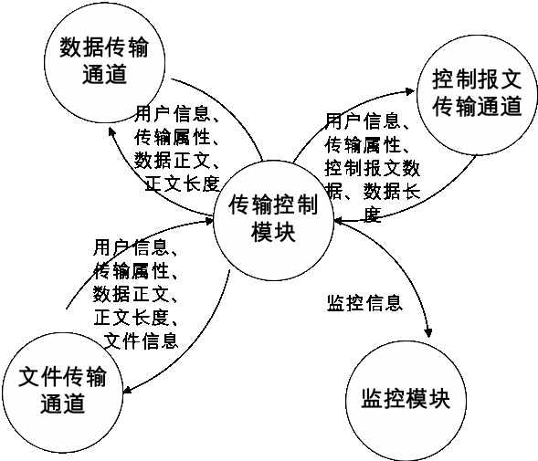
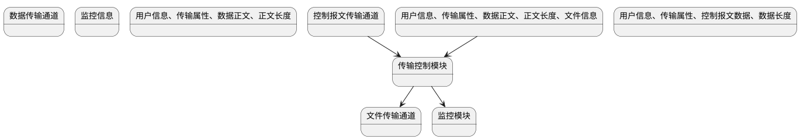
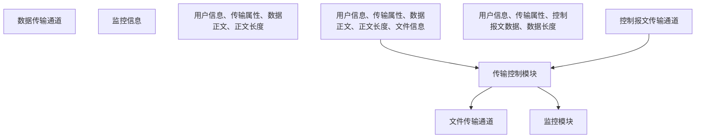
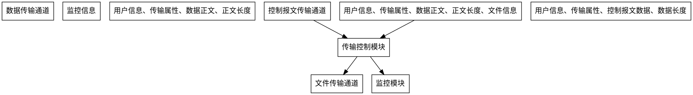

# 3_028 数据对档案

| 字段 | 值 |
|---|---|
| doc | 15实时信息传输服务软件需求规格说明-终稿 |
| section | 3.4.1 |
| image_caption | 图11实时信息传输服务软件接口需求 |
| table_caption | 表21实时信息传输服务软件内部接口需求 |

## 原始图片

*图11实时信息传输服务软件接口需求*

## 结构图

*来源: born-digital导出(flowchart, 9节点/4边)*
*类型经几何启发式精化(Master类型识别失败的图, 投影层推断, canonical锚点不变)*

*状态图以PlantUML渲染(UML母语): [*]=起止 | 圆角框=状态 | 箭头标签=迁移事件*

Mermaid兼容投影(通用md渲染器可显示)

DOT源码(完整语义, graphviz可渲染)

*锚点Connect重建存在3个悬空连线端点, 已几何恢复3条边(连线自由端吸附最近语义节点, 每条带距离证据, via=dangling_snap; canonical锚点不变)*

### 锚点节点结构

| # | 文本 | 类型 |
|---|---|---|
| 1 | 数据传输通道 | process |
| 2 | 监控信息 | other |
| 3 | 用户信息、传输属性、数据正文、正文长度 | other |
| 4 | 控制报文传输通道 | process |
| 5 | 文件传输通道 | process |
| 6 | 监控模块 | process |
| 7 | 用户信息、传输属性、控制报文数据、数据长度 | other |
| 8 | 用户信息、传输属性、数据正文、正文长度、文件信息 | other |
| 9 | 传输控制模块 | process |

## 表格内容

| 序号 | 接口需求名称 | 接口需求标识 | 接口类型 | 发送方 | 接收方 | 接口内容 | 接口优先级 |
|---|---|---|---|---|---|---|---|
| 1 | 传输控制与监控接口 | PZXQ-NBJK-CSKZ-JK | API接口 | 传输控制模块 | 监控模块 | 用户信息、传输属性、数据内容、数据长度 | 中 |
| 2 | 传输控制与数据传输通道接口 | PZXQ-NBJK-CSKZ-SJCST | API接口 | 传输控制模块 | 数据传输通道模块 | 用户信息、传输属性、数据内容、数据长度 | 高 |
| 3 | 数据传输通道与传输控制接口 | PZXQ-NBJK-SJCSTD-CSK | API接口 | 数据传输通道模块 | 传输控制模块 | 用户信息、传输属性、数据内容、数据长度 |   |
| 4 | 传输控制与控制报文传输通道接口 | PZXQ-NBJK-CSKZ-KZBWC | API接口 | 传输控制模块 | 控制报文传输通道模块 | 传输属性、控制报文 | 高 |
| 5 | 控制报文传输通道与传输控制接口 | PZXQ-NBJK-KZBWCSTD-C | API接口 | 控制报文传输通道模块 | 传输控制模块 | 传输属性、控制报文 | 高 |
| 6 | 传输控制与文件传输通道接口 | PZXQ-NBJK-CSKZ-WJCST | API接口 | 传输控制模块 | 文件传输通道模块 | 用户信息、传输属性、数据内容、文件信息 | 高 |
| 7 | 文件传输通道与传输控制接口 | PZXQ-NBJK-WJCSTD-CSK | API接口 | 文件传输通道模块 | 传输控制模块 | 用户信息、传输属性、数据内容、文件信息 | 高 |

## 正文

实时信息传输服务软件内部接口包括：传输控制与监控接口、传输控制与数据传输通道接口、数据传输通道与传输控制接口、传输控制与控制报文传输通道接口、控制报文传输通道与传输控制接口、文件传输通道与传输控制接口、传输控制与文件传输通道接口。
