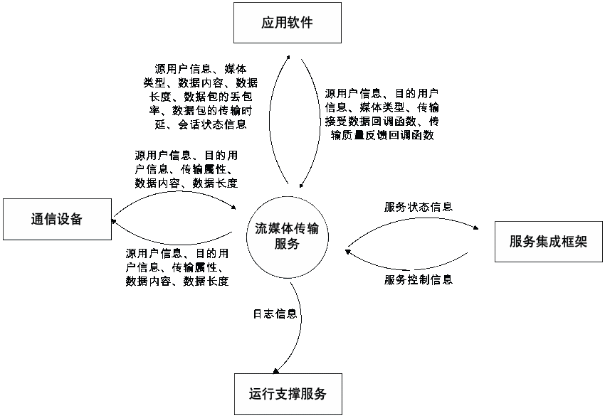
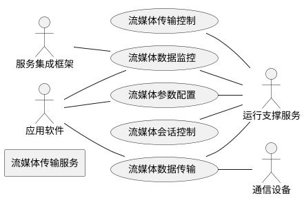
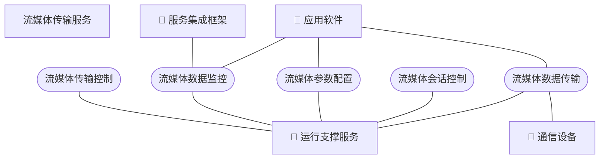
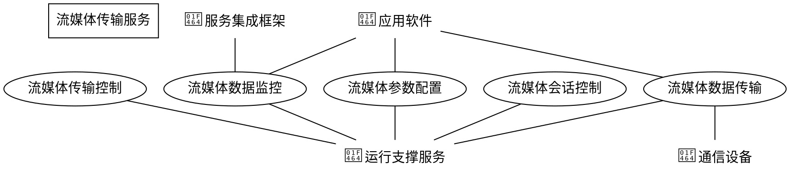

# 3_029 数据对档案

| 字段 | 值 |
|---|---|
| doc | 16流媒体传输服务软件需求规格说明-终稿 |
| section | 3.3.1 |
| image_caption | 图8 流媒体传输服务软件外部接口需求 |
| table_caption | 表20 流媒体传输服务软件外部接口需求 |

## 原始图片

*图8 流媒体传输服务软件外部接口需求*

## 结构图

*⚠ 结构经census重对齐: 旧锚点(oleObject3.bin:page1.xml)与图片不符, 已切换到与image.png内容一致的锚点(oleObject2.bin:page1.xml, align_score=0.5)*

*来源: born-digital导出(usecase, 10节点/10边)*
*类型经几何启发式精化(Master类型识别失败的图, 投影层推断, canonical锚点不变)*

*用例图以PlantUML渲染(UML母语): 小人=参与者 | 椭圆=用例 | 矩形框=系统边界 | 实线=关联 | 虚线=include/extend*

Mermaid兼容投影(通用md渲染器可显示)

DOT源码(完整语义, graphviz可渲染)

### 锚点节点结构

| # | 文本 | 类型 |
|---|---|---|
| 1 | 流媒体传输服务 | process |
| 2 | 通信设备 | actor |
| 3 | 流媒体传输控制 | usecase |
| 4 | 流媒体数据监控 | usecase |
| 5 | 流媒体参数配置 | usecase |
| 6 | 流媒体会话控制 | usecase |
| 7 | 流媒体数据传输 | usecase |
| 8 | 运行支撑服务 | actor |
| 9 | 应用软件 | actor |
| 10 | 服务集成框架 | actor |

## 表格内容

| 序号 | 接口需求名称 | 接口需求标识 | 接口类型 | 发送方 | 接收方 | 接口内容 | 接口优先级 |
|---|---|---|---|---|---|---|---|
| 1 | 流媒体传输服务软件与应用软件之间接口 | PZXQ-WBJK-LMTCSFW-YY | 函数接口 | 本系统 | 应用软件 | 源用户信息、媒体类型、数据内容、数据长度 | 低 |
| 应用软件 | 本系统 | 源用户信息、目的用户信息、媒体类型、传输 | 低 |
| 2 | 流媒体传输服务软件与通信设备之间接口 | PZXQ-WBJK-LMTCSFW-TX | 硬件接口 | 本系统 | 通信设备 | 源用户信息、目的用户信息、传输属性、数据 | 低 |
| 通信设备 | 本系统 | 源用户信息、目的用户信息、传输属性、数据 | 低 |
| 3 | 流媒体传输服务软件与运行支撑服务之间接口 | PZXQ-WBJK-LMTCSFW-YX | 函数接口 | 本系统 | 运行支撑服务 | 日志信息 | 低 |
| 4 | 流媒体传输服务软件与服务集成框架软件之间 | PZXQ-WBJK-LMTCSFW-FW | 函数接口 | 本系统 | 服务集成框架 | 服务状态信息 | 中 |
| 服务集成框架 | 本系统 | 服务控制信息 | 中 |

## 正文

流媒体传输服务软件外部接口包括：与服务集成框架接口、与运行支撑服务接口、与通信设备接口、与应用软件接口。
