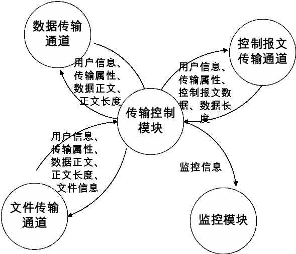
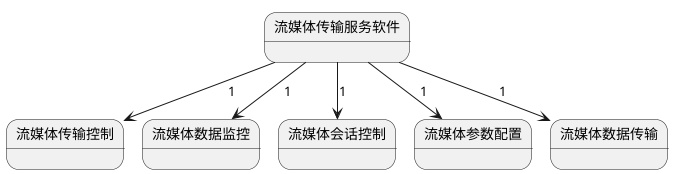
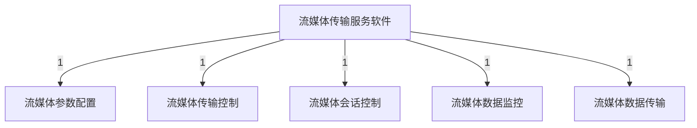

# 3_030 数据对档案

| 字段 | 值 |
|---|---|
| doc | 16流媒体传输服务软件需求规格说明-终稿 |
| section | 3.4.1 |
| image_caption | 图9 流媒体传输服务软件内部接口需求 |
| table_caption | 表25 流媒体传输服务软件内部接口需求 |

## 原始图片


*图9 流媒体传输服务软件内部接口需求*

## 结构图

*来源: born-digital导出(flowchart, 6节点/5边)*
*类型经几何启发式精化(Master类型识别失败的图, 投影层推断, canonical锚点不变)*

*状态图以PlantUML渲染(UML母语): [*]=起止 | 圆角框=状态 | 箭头标签=迁移事件*



<details><summary>Mermaid兼容投影(通用md渲染器可显示)</summary>



</details>

<details><summary>DOT源码(完整语义, graphviz可渲染)</summary>

```dot
digraph G {
  rankdir=TB;
  node [fontname="Microsoft YaHei"];
  N1 [shape=box, label="流媒体传输服务软件"];
  N4 [shape=box, label="流媒体传输控制"];
  N9 [shape=box, label="流媒体数据监控"];
  N14 [shape=box, label="流媒体会话控制"];
  N49 [shape=box, label="流媒体参数配置"];
  N54 [shape=box, label="流媒体数据传输"];
  N1 -> N49, label="1";
  N1 -> N4, label="1";
  N1 -> N14, label="1";
  N1 -> N9, label="1";
  N1 -> N54, label="1";
}
```

</details>

### 锚点节点结构

| # | 文本 | 类型 |
|---|---|---|
| 1 | 流媒体传输服务软件 | process |
| 2 | 流媒体传输控制 | process |
| 3 | 流媒体数据监控 | process |
| 4 | 流媒体会话控制 | process |
| 5 | 流媒体参数配置 | process |
| 6 | 流媒体数据传输 | process |

## 表格内容

| 序号 | 接口需求名称 | 接口需求标识 | 接口类型 | 发送方 | 接收方 | 接口内容 | 接口优先级 |
|---|---|---|---|---|---|---|---|
| 1 | 监控接口 | PZXQ-NBJK-LMTCSFW-JK | 函数接口 | 流媒体数据传输模块 | 流媒体数据监控模块 | 用户信息、传输质量属性 | 低 |
| 2 | 流媒体会话控制接口 | PZXQ-NBJK-LMTCSFW-BJ | 函数接口 | 流媒体数据传输模块 | 流媒体会话控制模块 | 会话状态、媒体信息 | 高 |
| 3 | 流媒体参数配置接口 | PZXQ-NBJK-LMTCSFW-JY | 函数接口 | 流媒体参数配置 | 流媒体数据传输模块 | 成员参数信息、媒体类型 | 高 |
| 4 | 传输控制接口 | PZXQ-NBJK-LMTCSFW-PD | 函数接口 | 流媒体数据传输模块 | 流媒体传输控制模块 | 用户信息、媒体类型、传输属性、媒体流信息 | 高 |
| 5 | 客户端接口 | PZXQ-NBJK-LMTCSFW-KH | 函数接口 | 流媒体数据传输模块 | 流媒体客户端模块 | 视频会话的建立、播放、暂停和终止 | 高 |

## 正文

流媒体传输服务软件内部接口包括：监控接口、数据缓存接口、流媒体会话控制接口、流媒体参数配置接口、传输控制接口。
