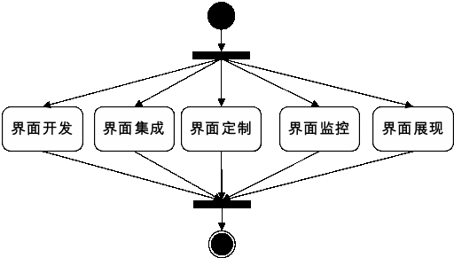
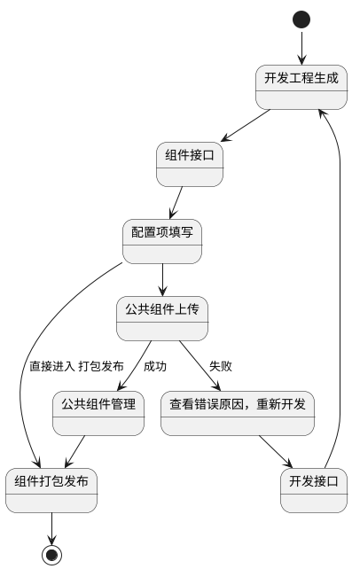
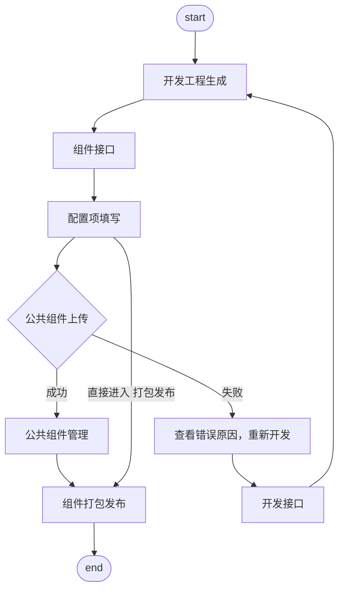

# 4_001 数据对档案

| 字段 | 值 |
|---|---|
| doc | 02界面集成框架软件需求规格说明-终稿 |
| section | 1.8.1 |
| image_caption | 图5 界面开发流程图 |
| table_caption | 表3 界面开发能力标识 |

## 原始图片


*图5 界面开发流程图*

## 结构图

*来源: born-digital导出(flowchart, 8节点/11边)*
*类型经几何启发式精化(Master类型识别失败的图, 投影层推断, canonical锚点不变)*

*状态图以PlantUML渲染(UML母语): [*]=起止 | 圆角框=状态 | 箭头标签=迁移事件*



<details><summary>Mermaid兼容投影(通用md渲染器可显示)</summary>



</details>

<details><summary>DOT源码(完整语义, graphviz可渲染)</summary>

```dot
digraph G {
  rankdir=TB;
  node [fontname="Microsoft YaHei"];
  N352 [shape=box, label="开发工程生成"];
  N375 [shape=box, label="配置项填写"];
  N398 [shape=box, label="公共组件上传"];
  N414 [shape=box, label="查看错误原因，重新开发"];
  N437 [shape=box, label="组件打包发布"];
  N460 [shape=box, label="组件接口"];
  N483 [shape=box, label="开发接口"];
  N3235 [shape=circle, label="start"];
  N3236 [shape=doublecircle, label="end"];
  N4083 [shape=box, label="公共组件管理"];
  N4083 -> N437;
  N437 -> N3236;
  N483 -> N352;
  N414 -> N483;
  N375 -> N437, label="直接进入 打包发布";
  N398 -> N414, label="失败";
  N398 -> N4083, label="成功";
  N3235 -> N352;
  N352 -> N460;
  N460 -> N375;
  N375 -> N398;
}
```

</details>

### 锚点节点结构

| # | 文本 | 类型 |
|---|---|---|
| 1 | 开发工程生成 | process |
| 2 | 配置项填写 | process |
| 3 | 公共组件上传 | gateway |
| 4 | 查看错误原因，重新开发 | process |
| 5 | 组件打包发布 | process |
| 6 | 组件接口 | process |
| 7 | 开发接口 | process |
| 8 |   | start |
| 9 |   | end |
| 10 | 公共组件管理 | process |

## 表格内容

| 序号 | Use case名称 | 项目唯一标识符 | 需求描述 | 需求重用 | 方式 名称 | 运行状态 | 对应的任务书功能/性能 |
|---|---|---|---|---|---|---|---|
| 1 | 开发工程生成 | PZXQ-GN-JMJCKJ- JMKF | 提供界面组件开发模板，支持应用软件基于模 | 新研 | 桌面 | 开发阶段 | 4.1.1a) |
| 2 | 组件配置填写 | PZXQ-GN-JMJCKJ- JMKF | 提供界面组件配置功能，能够对组件配置文件 | 沿用 | 桌面 | 开发阶段 | 4.1.1b) |
| 3 | 公共组件管理 | PZXQ-GN-JMJCKJ- JMKF | 提供公共组件展示功能，能够展示公共组件的 | 改造 | 桌面 | 开发阶段 | 4.1.1c) |
| 4 | 组件下载管理 | PZXQ-GN-JMJCKJ- JMKF | 提供组件包管理功能，支持界面开发所需的公 | 新研 | 桌面 | 开发阶段 | 4.1.1c) |
| 5 | 组件打包发布 | PZXQ-GN-JMJCKJ- JMKF | 提供界面组件的打包发布功能，支持对界面组 | 新研 | 桌面 | 开发阶段 | 4.1.1g) |
| 6 | 组件开发接口 | PZXQ-GN-JMJCKJ- JMKF | 提供组件生命周期管理、界面设置、数据状态 | 沿用 | 桌面 | 开发阶段 | 4.1.1d) e) f) |

## 正文

界面开发功能包括：开发工程生成、组件配置填写、公共组件管理、组件下载管理、组件打包发布、组件开发接口功能，此功能只在桌面版提供并使用，其功能用例如图4所示。
