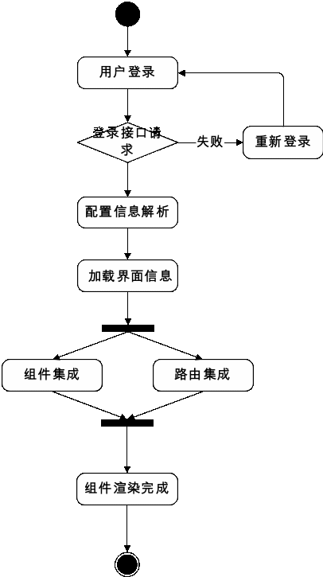
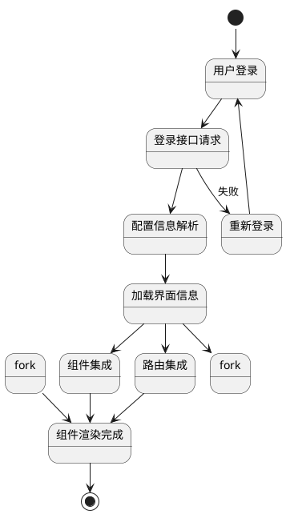
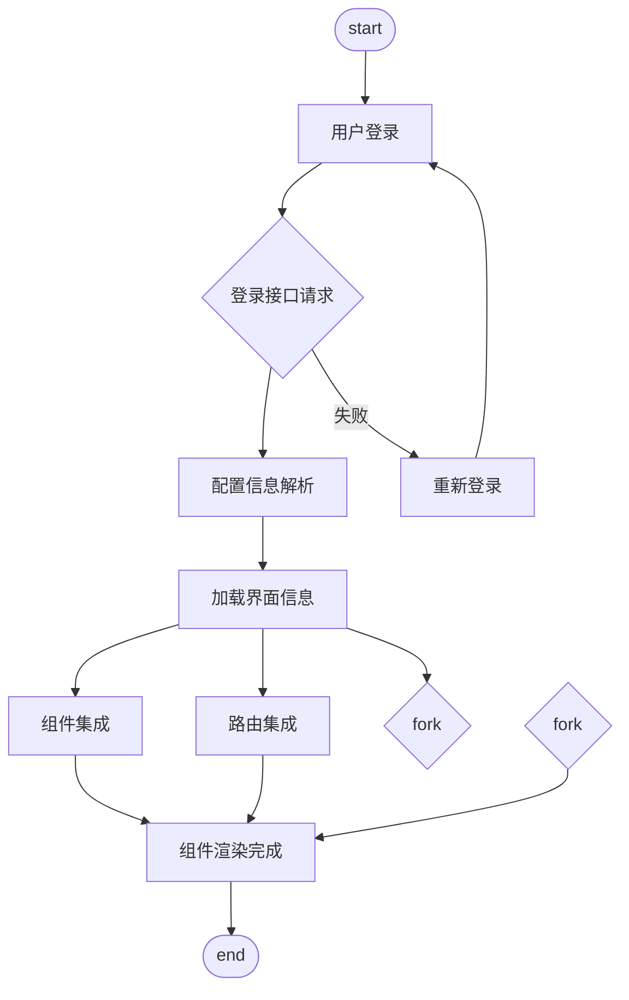

# 4_002 数据对档案

| 字段 | 值 |
|---|---|
| doc | 02界面集成框架软件需求规格说明-终稿 |
| section | 1.8.2 |
| image_caption | 图14 界面集成流程图 |
| table_caption | 表10 界面开发能力标识 |

## 原始图片


*图14 界面集成流程图*

## 结构图

*⚠ 结构经census重对齐: 旧锚点(oleObject13.bin:page1.xml)与图片不符, 已切换到与image.png内容一致的锚点(oleObject14.bin:page1.xml, align_score=1.0)*

*来源: born-digital导出(flowchart, 8节点/13边)*
*类型经几何启发式精化(Master类型识别失败的图, 投影层推断, canonical锚点不变)*

*状态图以PlantUML渲染(UML母语): [*]=起止 | 圆角框=状态 | 箭头标签=迁移事件*



<details><summary>Mermaid兼容投影(通用md渲染器可显示)</summary>



</details>

<details><summary>DOT源码(完整语义, graphviz可渲染)</summary>

```dot
digraph G {
  rankdir=TB;
  node [fontname="Microsoft YaHei"];
  N1010 [shape=box, label="用户登录"];
  N1033 [shape=box, label="登录接口请求"];
  N1048 [shape=box, label="配置信息解析"];
  N1071 [shape=box, label="加载界面信息"];
  N1107 [shape=box, label="组件集成"];
  N1130 [shape=box, label="路由集成"];
  N1237 [shape=box, label="组件渲染完成"];
  N3239 [shape=circle, label="start"];
  N3240 [shape=doublecircle, label="end"];
  N4264 [shape=box, label="重新登录"];
  N4311 [shape=box, label="fork"];
  N4317 [shape=box, label="fork"];
  N1107 -> N1237;
  N1130 -> N1237;
  N1071 -> N4311;
  N4264 -> N1010;
  N1033 -> N4264, label="失败";
  N1237 -> N3240;
  N4317 -> N1237;
  N1071 -> N1130;
  N1071 -> N1107;
  N3239 -> N1010;
  N1010 -> N1033;
  N1033 -> N1048;
  N1048 -> N1071;
}
```

</details>

### 锚点节点结构

| # | 文本 | 类型 |
|---|---|---|
| 1 | 用户登录 | process |
| 2 | 登录接口请求 | gateway |
| 3 | 配置信息解析 | process |
| 4 | 加载界面信息 | process |
| 5 | 组件集成 | process |
| 6 | 路由集成 | process |
| 7 | 组件渲染完成 | process |
| 8 |   | start |
| 9 |   | end |
| 10 | 重新登录 | process |
| 11 |   | fork |
| 12 |   | fork |

## 表格内容

| 序号 | Use case名称 | 项目唯一标识符 | 需求描述 | 需求重用 | 方式 名称 | 运行状态 | 对应的任务书功能/性能 |
|---|---|---|---|---|---|---|---|
| 1 | 用户登录 | PZXQ-GN-JMJCKJ- JMJC | 供用户登录功能，支持通过用户名、密码的登 | 沿用 | 平板、桌面、手持 | 集成阶段 | 4.1.2a) |
| 2 | 配置信息解析 | PZXQ-GN-JMJCKJ- JMJC | 提供应用界面的统一集成功能，支持从应用提 | 沿用 | 平板、桌面、手持 | 集成阶段 | 4.1.2b) |
| 3 | 组件集成 | PZXQ-GN-JMJCKJ- JMJC | 提供组件化集成与引用功能，支持通过界面组 | 沿用 | 平板、桌面、手持 | 集成阶段 | 4.1.2c)/4.2a) |
| 4 | 路由集成 | PZXQ-GN-JMJCKJ- JMJC | 提供路由集成与引用功能，支持通过路由方式 | 新研 | 平板、桌面、手持 | 集成阶段 | 4.1.2d) |
| 5 | 生命周期管理 | PZXQ-GN-JMJCKJ- JMJC | 提供界面组件的生命周期管理功能，能够依据 | 改造 | 平板、桌面、手持 | 集成阶段 | 4.1.2e) |
| 6 | 故障隔离检测 | PZXQ-GN-JMJCKJ- JMJC | 提供界面组件的故障隔离功能，支持组件之间 | 新研 | 平板、桌面、手持 | 集成阶段 | 4.1.2f) |
| 7 | 数据状态管理 | PZXQ-GN-JMJCKJ- JMJC | 提供界面数据共享功能，支持界面组件之间、 | 新研 | 平板、桌面、手持 | 集成阶段 | 4.1.2g) |
| 8 | 消息通知 | PZXQ-GN-JMJCKJ- JMJC | 提供消息通知功能，支持对服务推送到界面数 | 沿用 | 平板、桌面、手持 | 集成阶段 | 4.1.2h) |
| 9 | 服务请求 | PZXQ-GN-JMJCKJ- JMJC | 提供服务请求功能，支持通过Restful | 新研 | 平板、桌面、手持 | 集成阶段 | 4.1.2i) |

## 正文

界面集成功能包括：用户登录、配置信息解析、组件集成、路由集成、生命周期管理、故障隔离检测、数据状态管理、消息通知、服务请求功能，在桌面版、平板版、手持版功能保持一致，其功能用例如图 13所示。
