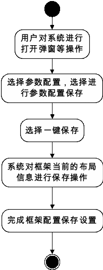
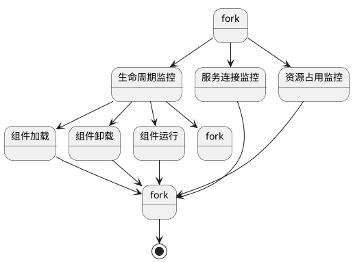
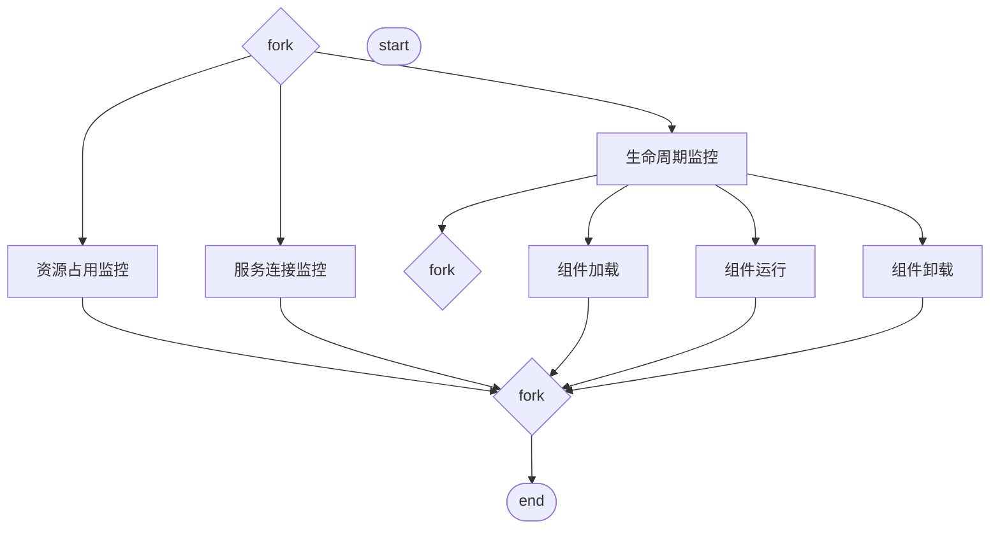
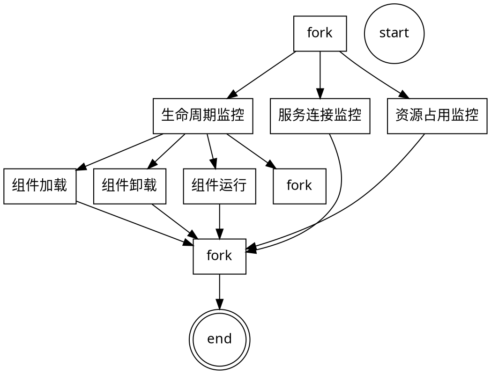

# 4_004 数据对档案

| 字段 | 值 |
|---|---|
| doc | 02界面集成框架软件需求规格说明-终稿 |
| section | 1.8.4 |
| image_caption | 图32界面监控流程图 |
| table_caption | 表26 界面定制能力标识 |

## 原始图片

*图32界面监控流程图*

## 结构图

*来源: born-digital导出(flowchart, 6节点/13边)*
*类型经几何启发式精化(Master类型识别失败的图, 投影层推断, canonical锚点不变)*

*状态图以PlantUML渲染(UML母语): [*]=起止 | 圆角框=状态 | 箭头标签=迁移事件*

Mermaid兼容投影(通用md渲染器可显示)

DOT源码(完整语义, graphviz可渲染)

*⚠ 锚点Connect重建存在1个悬空连线端点(线端粘在无文本形状上被语义过滤跳过), 图示边数可能少于原图——渲染只呈现锚点事实, 不编造边; 独立证据可对照VLM通道提取(scene_vlm_extractions.json)*

### 锚点节点结构

| # | 文本 | 类型 |
|---|---|---|
| 1 | 生命周期监控 | process |
| 2 | 服务连接监控 | process |
| 3 | 资源占用监控 | process |
| 4 | 组件加载 | process |
| 5 | 组件卸载 | process |
| 6 | 组件运行 | process |
| 7 |   | fork |
| 8 |   | fork |
| 9 |   | fork |
| 10 |   | start |
| 11 |   | end |

## 表格内容

| 序号 | Use case名称 | 项目唯一标识符 | 需求描述 | 需求 重用 | 方式 名称 | 运行阶段 | 对应的任务书功能/性能 |
|---|---|---|---|---|---|---|---|
| 1 | 生命周期监控 | PZXQ-GN-JMJCKJ- JMJC | 提供组件生命周期的监控，包括组件加载、组 | 新研 | 平板、桌面、手持 | 运行阶段 | 4.1.4a) |
| 2 | 资源占用监控 | PZXQ-GN-JMJCKJ- JMDZ | 提供集成组件占用资源的监控，包括网络、I | 新研 | 平板、桌面、手持 | 运行阶段 | 4.1.4b) |

## 正文

界面监控功能包括：组件生命周期监控（组件加载、组件运行、组件卸载）、服务连接监控和资源占用监控等功能，其功能用例如图31所示。
