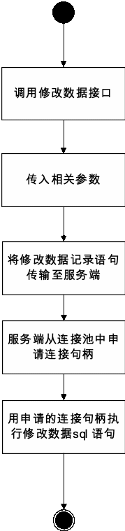
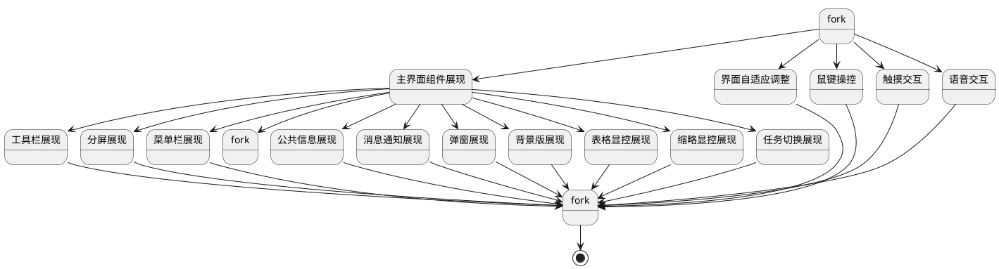
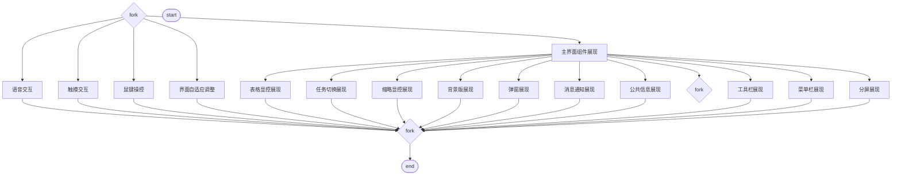
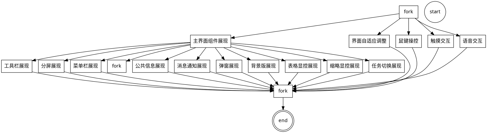

# 4_006 数据对档案

| 字段 | 值 |
|---|---|
| doc | 02界面集成框架软件需求规格说明-终稿 |
| section | 1.8.5 |
| image_caption | 图37 界面展示功能流程图 |
| table_caption | 表33 界面展示功能标识表 |

## 原始图片

*图37 界面展示功能流程图*

## 结构图

*⚠ 结构经census重对齐: 旧锚点(oleObject36.bin:page1.xml)与图片不符, 已切换到与image.png内容一致的锚点(oleObject37.bin:page1.xml, align_score=1.0)*

*来源: born-digital导出(flowchart, 15节点/31边)*
*类型经几何启发式精化(Master类型识别失败的图, 投影层推断, canonical锚点不变)*

*状态图以PlantUML渲染(UML母语): [*]=起止 | 圆角框=状态 | 箭头标签=迁移事件*

Mermaid兼容投影(通用md渲染器可显示)

DOT源码(完整语义, graphviz可渲染)

### 锚点节点结构

| # | 文本 | 类型 |
|---|---|---|
| 1 | 主界面组件展现 | process |
| 2 | 界面自适应调整 | process |
| 3 | 鼠键操控 | process |
| 4 | 工具栏展现 | process |
| 5 | 分屏展现 | process |
| 6 | 菜单栏展现 | process |
| 7 |   | fork |
| 8 |   | fork |
| 9 |   | fork |
| 10 | 触摸交互 | process |
| 11 | 语音交互 | process |
| 12 | 公共信息展现 | process |
| 13 | 消息通知展现 | process |
| 14 | 弹窗展现 | process |
| 15 | 背景版展现 | process |
| … | 共20个节点 | |

## 表格内容

| 序号 | Use case名称 | 项目唯一标识符 | 需求描述 | 需求 重用 | 方式名称 | 运行 状态 | 对应的任务书功能/性能 |
|---|---|---|---|---|---|---|---|
| 1 | 界面自适应调整 | PZXQ-GN-JMJCKJ-JMZX- | 提供界面自适应调整的功能，当框架在不同终 | 新研 | 平板、桌面、手持 | 运行阶段 | 4.1.5a) |
| 2 | 主界面组件展现 | PZXQ-GN-JMJCKJ-JMZX- | 提供主界面组件展示功能，主界面包括菜单栏 | 沿用 | 平板、桌面、手持 | 运行阶段 | 4.1.5b)c) d) e)/4.2  |
| 3 | 鼠键操控 | PZXQ-GN-JMJCKJ-JMZX- | 提供鼠键操控显示的功能，用户可以通过键盘 | 沿用 | 桌面 | 运行阶段 | 4.1.5f) |
| 4 | 触摸交互 | PZXQ-GN-JMJCKJ-JMZX- | 提供触摸交互显示的功能，用户可以通过触摸 | 改进 | 平板、手持 | 运行阶段 | 4.1.5g) |
| 5 | 语音交互 | PZXQ-GN-JMJCKJ-JMZX- | 提供语音交互显示的功能，用户可以通过语音 | 新研 | 平板、手持 | 运行阶段 | 4.1.5f) g) |

## 正文

界面展示功能包括：界面自适应调整、主界面组件展现、鼠标操控、触摸交互、语音交互等展现功能，其功能用例如图36所示。
