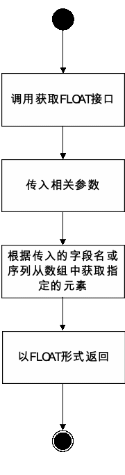
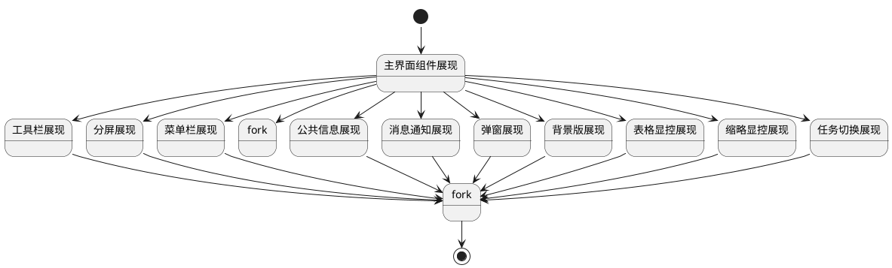
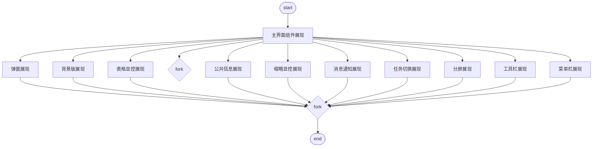
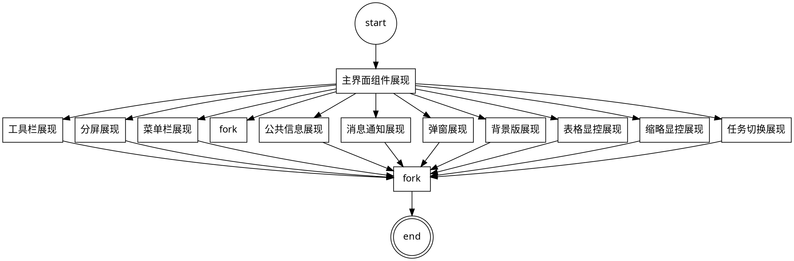

# 4_007 数据对档案

| 字段 | 值 |
|---|---|
| doc | 02界面集成框架软件需求规格说明-终稿 |
| section | 1.8.5.1 |
| image_caption | 图39 主界面展现开发流程 |
| table_caption | 表34 主界面组件展现标识 |

## 原始图片

*图39 主界面展现开发流程*

## 结构图

*来源: born-digital导出(flowchart, 11节点/23边)*
*类型经几何启发式精化(Master类型识别失败的图, 投影层推断, canonical锚点不变)*

*状态图以PlantUML渲染(UML母语): [*]=起止 | 圆角框=状态 | 箭头标签=迁移事件*

Mermaid兼容投影(通用md渲染器可显示)

DOT源码(完整语义, graphviz可渲染)

*锚点Connect重建存在1个悬空连线端点, 已几何恢复1条边(连线自由端吸附最近语义节点, 每条带距离证据, via=dangling_snap; canonical锚点不变)*

### 锚点节点结构

| # | 文本 | 类型 |
|---|---|---|
| 1 | 主界面组件展现 | process |
| 2 | 工具栏展现 | process |
| 3 | 分屏展现 | process |
| 4 | 菜单栏展现 | process |
| 5 |   | fork |
| 6 |   | fork |
| 7 | 公共信息展现 | process |
| 8 | 消息通知展现 | process |
| 9 | 弹窗展现 | process |
| 10 | 背景版展现 | process |
| 11 | 表格显控展现 | process |
| 12 | 缩略显控展现 | process |
| 13 | 任务切换展现 | process |
| 14 |   | start |
| 15 |   | end |

## 表格内容

| 序号 | Use case名称 | 项目唯一标识符 | 需求描述 | 需求重用 | 方式名称 | 对应的任务书功能/性能 |
|---|---|---|---|---|---|---|
| 1 | 菜单栏展现 | PZXQ-GN-JMJCKJ- JMZX | 提供菜单栏展现功能，包括一级菜单和二级菜 | 无 | 平板、桌面、手持 | 4.1.5 |
| 2 | 工具栏展现 | PZXQ-GN-JMJCKJ- JMZX | 提供工具栏展现功能，通过在esplug. | 无 | 平板、桌面、手持 | 4.1.5 |
| 3 | 分屏展现 | PZXQ-GN-JMJCKJ- JMZX | 提供分屏展现的功能，支持一屏、二屏、四屏 | 无 | 平板、桌面、手持 | 4.1.5 |
| 4 | 公共信息展现 | PZXQ-GN-JMJCKJ- JMZX | 提供公共信息展现的功能，通过在esplu | 无 | 平板、桌面、手持 | 4.1.5 |
| 5 | 消息通知展现 | PZXQ-GN-JMJCKJ- JMZX | 提供消息通知展现功能，在框架右上方位置显 | 无 | 平板、桌面、手持 | 4.1.5 |
| 6 | 弹窗展现 | PZXQ-GN-JMJCKJ- JMZX | 提供组件弹框展现的功能，弹框组件在esp | 无 | 平板、桌面、手持 | 4.1.5 |
| 7 | 背景版展现 | PZXQ-GN-JMJCKJ- JMZX | 提供背景版展现的功能，当未加载地图底图时 | 无 | 平板、桌面、手持 | 4.1.5 |
| 8 | 表格显控展现 | PZXQ-GN-JMJCKJ- JMZX | 提供表格显控展现的功能，表格显控在esp | 无 | 平板、桌面、手持 | 4.1.5 |
| 9 | 缩略显控展现 | PZXQ-GN-JMJCKJ- JMZX | 提供缩略显控展现的功能，在esplug. | 无 | 平板、桌面、手持 | 4.1.5 |
| 10 | 任务切换展现 | PZXQ-GN-JMJCKJ- JMZX | 提供任务切换展现的功能，任务切换在界面的 | 无 | 平板、桌面、手持 | 4.1.5 |

## 正文

主界面组件展现功能包括：菜单栏展现、工具栏展现、分屏展现、公共信息展现、消息通知展现、弹窗展现、背景板展现、表格显控展现、缩略显控展现、任务切换展现功能，其功能用例如图38所示。
