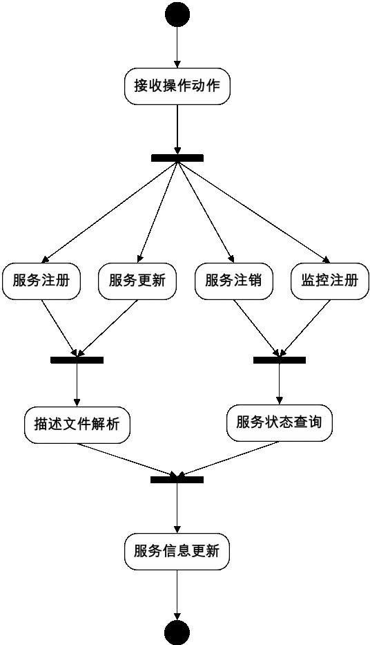
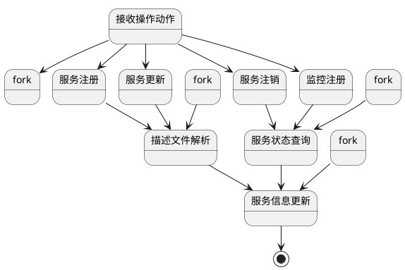
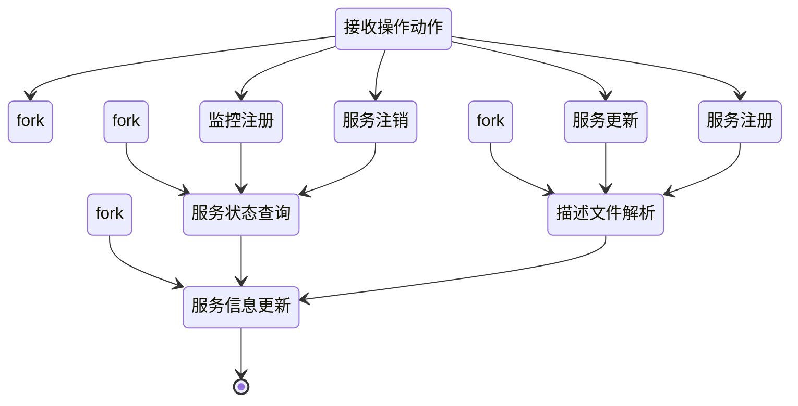
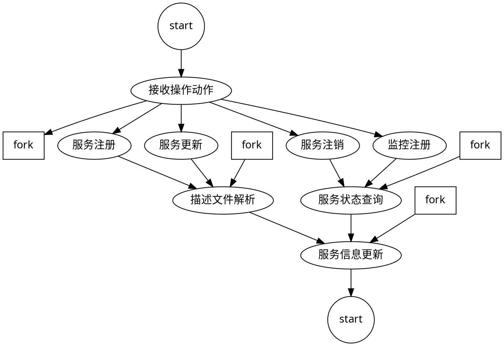

# 4_009 数据对档案

| 字段 | 值 |
|---|---|
| doc | 03服务集成框架软件需求规格说明-终稿 |
| section | 3.2.2 |
| image_caption | 图 9 服务部署管理流程图 |
| table_caption | 表21 服务部署管理所有能力能力标识 |

## 原始图片

*图 9 服务部署管理流程图*

## 结构图

*⚠ 结构经census重对齐: 旧锚点(oleObject8.bin:page1.xml)与图片不符, 已切换到与image.png内容一致的锚点(oleObject9.bin:page1.xml, align_score=1.0)*

*来源: born-digital导出(state, 8节点/16边)*
*类型经几何启发式精化(Master类型识别失败的图, 投影层推断, canonical锚点不变)*

*状态图以PlantUML渲染(UML母语): [*]=起止 | 圆角框=状态 | 箭头标签=迁移事件*

Mermaid兼容投影(通用md渲染器可显示)

DOT源码(完整语义, graphviz可渲染)

### 锚点节点结构

| # | 文本 | 类型 |
|---|---|---|
| 1 |   | start |
| 2 | 接收操作动作 | state |
| 3 |   | fork |
| 4 | 服务注册 | state |
| 5 | 服务更新 | state |
| 6 | 服务注销 | state |
| 7 | 监控注册 | state |
| 8 | 描述文件解析 | state |
| 9 | 服务状态查询 | state |
| 10 | 服务信息更新 | state |
| 11 |   | start |
| 12 |   | fork |
| 13 |   | fork |
| 14 |   | fork |

## 表格内容

| 序号 | Use case名称 | 项目唯一标识符 | 需求描述 | 需求重用 | 方式名称 | 运行状态 | 对应的任务书功能/性能 |
|---|---|---|---|---|---|---|---|
| 1 | 服务注册 | PZXQ-GN-FWBSGL-FWZC | 需要通过服务描述信息完成服务注册，使得服 | 改进 | 桌面、平板、手持 | 运行阶段 | 4.1.2/4.2 a) |
| 2 | 服务更新 | PZXQ-GN-FWBSGL-FWGX | 对服务的信息更新 | 改进 | 桌面、平板、手持 | 运行阶段 | 4.1.2 |
| 3 | 服务监控注册 | PZXQ-GN-FWBSGL-FWJKZ | 调用接口注册对某个服务进行资源占用和状态 | 新增 | 桌面、平板、手持 | 运行阶段 | 4.1.2 |
| 4 | 服务注销 | PZXQ-GN-FWBSGL-FWZX | 通过服务描述信息完成服务注册信息的删除 | 新增 | 桌面、平板、手持 | 运行阶段 | 4.1.2 |

## 正文

服务部署管理功能包括服务注册、服务多实例部署、服务更新和服务注销功能，其中服务注册支持通过读取服务清单文件完成服务注册；服务监控注册支持调用接口注册对某个服务进行资源占用和状态的监控；服务更新支持重新读取服务清单文件完成服务注册信息的更新；服务注销支持重新读取服务清单文件完成服务注册信息的删除；其功能用例如图8所示。
