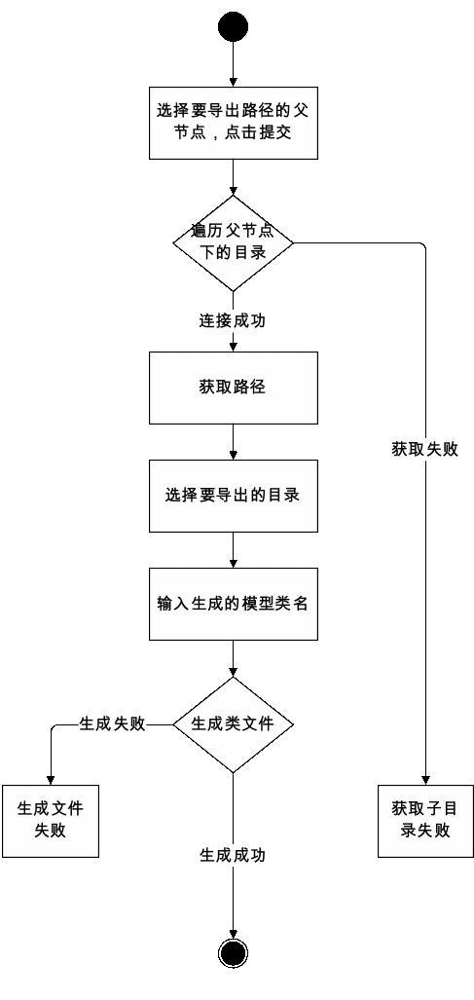
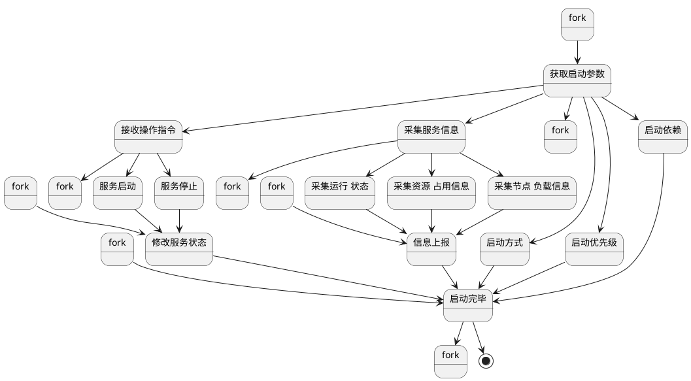
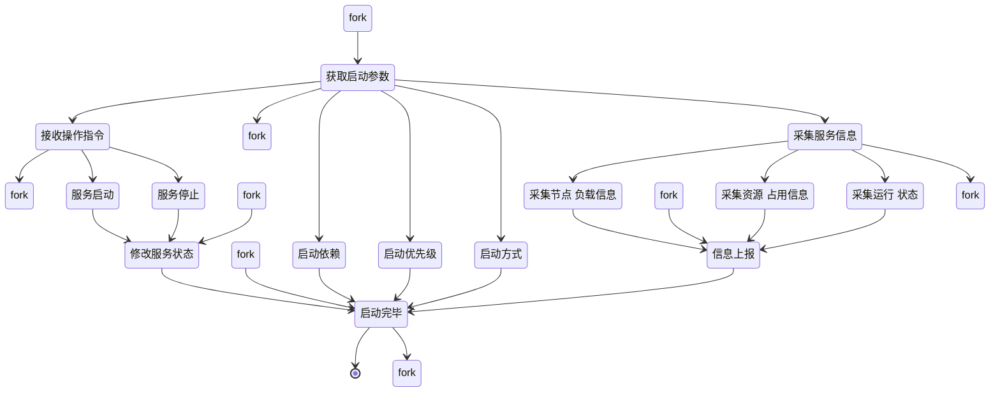
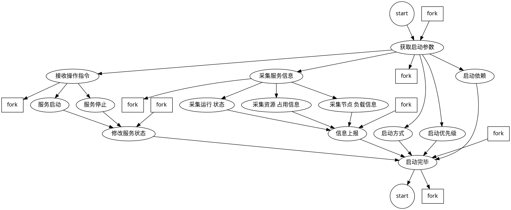

# 4_010 数据对档案

| 字段 | 值 |
|---|---|
| doc | 03服务集成框架软件需求规格说明-终稿 |
| section | 3.2.3 |
| image_caption | 图 11 服务运行控制流程图 |
| table_caption | 表26 服务运行控制所有能力能力标识 |

## 原始图片

*图 11 服务运行控制流程图*

## 结构图

*来源: born-digital导出(state, 14节点/30边)*
*类型经几何启发式精化(Master类型识别失败的图, 投影层推断, canonical锚点不变)*

*状态图以PlantUML渲染(UML母语): [*]=起止 | 圆角框=状态 | 箭头标签=迁移事件*

Mermaid兼容投影(通用md渲染器可显示)

DOT源码(完整语义, graphviz可渲染)

### 锚点节点结构

| # | 文本 | 类型 |
|---|---|---|
| 1 |   | start |
| 2 | 接收操作指令 | state |
| 3 |   | fork |
| 4 | 服务启动 | state |
| 5 | 服务停止 | state |
| 6 | 修改服务状态 | state |
| 7 | 启动完毕 | state |
| 8 |   | start |
| 9 |   | fork |
| 10 |   | fork |
| 11 |   | fork |
| 12 | 获取启动参数 | state |
| 13 |   | fork |
| 14 | 采集服务信息 | state |
| 15 |   | fork |
| … | 共24个节点 | |

## 表格内容

| 序号 | Use case名称 | 项目唯一标识符 | 需求描述 | 需求重用 | 方式名称 | 运行状态 | 对应的任务书功能/性能 |
|---|---|---|---|---|---|---|---|
| 1 | 服务启停控制 | PZXQ-GN-FWYXKZ-FWQTK | 控制服务进程的启动与停止。 | 沿用 | 桌面、平板、手持 | 运行阶段 | 4.1.3 |
| 2 | 服务启动控制方式控制 | PZXQ-GN-FWYXKZ-FWQTK | 根据启动方式对服务控制 | 新增 | 桌面、平板、手持 | 运行阶段 | 4.1.3 |
| 3 | 服务启动优先级控制 | PZXQ-GN-FWYXKZ-FWQDY | 根据启动优先级对服务控制 | 沿用 | 桌面、平板、手持 | 运行阶段 | 4.1.3 |
| 4 | 服务启动依赖控制 | PZXQ-GN-FWYXKZ-FWQDY | 启动依赖对服务控制 | 沿用 | 桌面、平板、手持 | 运行阶段 | 4.1.3 |
| 5 | 服务异常重启 | PZXQ-GN-FWYXKZ-FWYCC | 服务异常 服务管控重启 | 新增 | 桌面、平板、手持 | 运行阶段 | 4.1.3 |
| 6 | 服务状态采集 | PZXQ-GN-FWYXKZ-FWZTC | 采集服务的运行状态信息 | 沿用 | 桌面、平板、手持 | 运行阶段 | 4.1.3/4.2 b) |
| 7 | 服务占用资源采集 | PZXQ-GN-FWYXKZ-FWZYZ | 采集服务占用资源的相关信息，包括CPU占 | 新增 | 桌面、平板、手持 | 运行阶段 | 4.1.3 |
| 8 | 节点信息采集 | PZXQ-GN-FWYXKZ-JDXXC | 采集节点的CPU使用率、内存使用率、磁盘 | 新增 | 桌面、平板、手持 | 运行阶段 | 4.1.3 |

## 正文

服务运行控制功能包括服务启动方式控制功能，支持手动、自动、按需三种服务启动策略；服务启动优先级控制功能，支持根据配置文件按优先级启动服务；服务启动依赖控制功能，支持在某个服务启动之前先启动它所依赖的服务；服务启停控制功能，支持接收服务启停指令完成服务的启动、停止状态切换；提供服务异常重启功能，能够在检测到服务故障退出后，自动重启服务；服务状态采集，支持对服务的启动、停止状态进行监视；服务占用资源采集功能，支持对服务运行占用的CPU、内存、磁盘信息的监视；节点信息采集功能，支持根据节点IP采集占用的CPU、内存、磁盘和平均网速的信息；其功能用例如图10所示。
