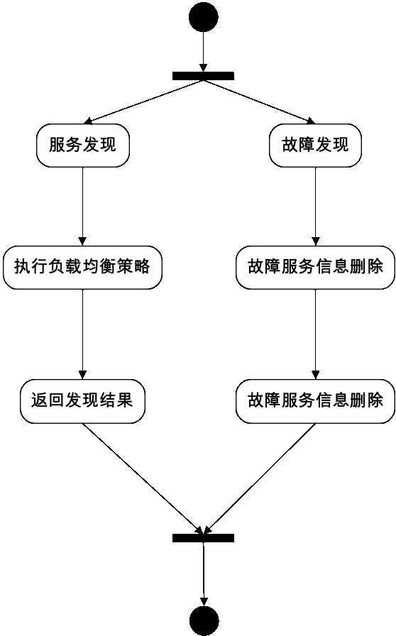
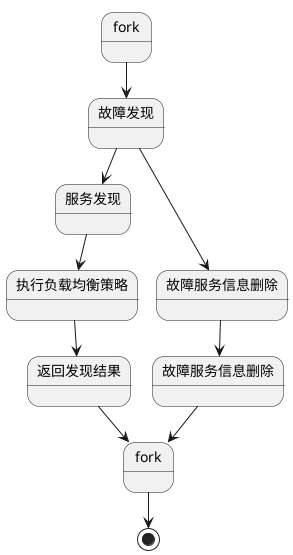
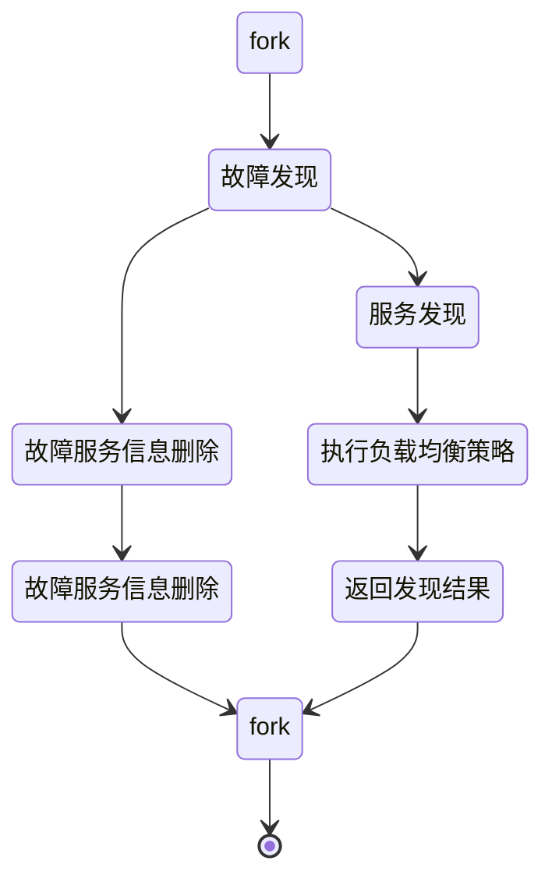
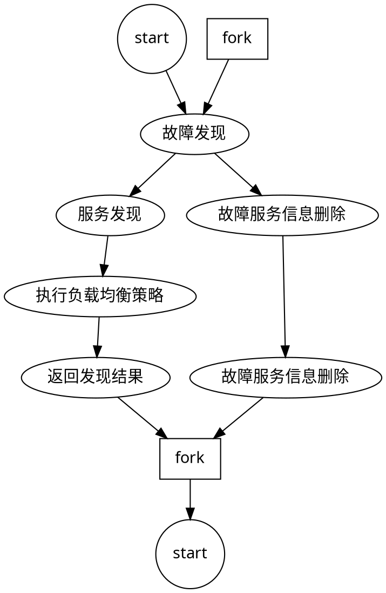

# 4_012 数据对档案

| 字段 | 值 |
|---|---|
| doc | 03服务集成框架软件需求规格说明-终稿 |
| section | 3.2.5 |
| image_caption | 图 15 服务调度运行流程图 |
| table_caption | 表43服务信息管理所有能力能力标识 |

## 原始图片

*图 15 服务调度运行流程图*

## 结构图

*⚠ 结构经census重对齐: 旧锚点(oleObject14.bin:page1.xml)与图片不符, 已切换到与image.png内容一致的锚点(oleObject15.bin:page1.xml, align_score=1.0)*

*来源: born-digital导出(state, 6节点/10边)*
*类型经几何启发式精化(Master类型识别失败的图, 投影层推断, canonical锚点不变)*

*状态图以PlantUML渲染(UML母语): [*]=起止 | 圆角框=状态 | 箭头标签=迁移事件*

Mermaid兼容投影(通用md渲染器可显示)

DOT源码(完整语义, graphviz可渲染)

### 锚点节点结构

| # | 文本 | 类型 |
|---|---|---|
| 1 |   | start |
| 2 | 服务发现 | state |
| 3 | 执行负载均衡策略 | state |
| 4 | 返回发现结果 | state |
| 5 |   | start |
| 6 |   | fork |
| 7 | 故障发现 | state |
| 8 |   | fork |
| 9 | 故障服务信息删除 | state |
| 10 | 故障服务信息删除 | state |

## 表格内容

| 序号 | Use case名称 | 项目唯一标识符 | 需求描述 | 需求重用 | 方式名称 | 运行状态 | 对应的任务书功能/性能 |
|---|---|---|---|---|---|---|---|
| 1 | 服务发现 | PZXQ-GN-FWDD-FWFX | 服务访问代理向服务信息管理查询，自动发现 | 新增 | 桌面、平板、手持 | 运行阶段 | 4.1.5 |
| 2 | 基于轮询的负载均衡 | PZXQ-GN-FWDD-FWLXFZ | 服务访问代理以轮询的方式将服务分发到不同 | 新增 | 桌面、平板、手持 | 运行阶段 | 4.1.5 |
| 3 | 基于优先级的负载均衡 | PZXQ-GN-FWDD-FWYXJFZ | 按照预先配置的服务优先级将服务按比例分发 | 新增 | 桌面、平板、手持 | 运行阶段 | 4.1.5 |
| 4 | 基于主机负载的负载均衡 | PZXQ-GN-FWDD-FWZJFZ | 通过比较服务主机负载将服务分发到负载最小 | 新增 | 桌面、平板、手持 | 运行阶段 | 4.1.5 |
| 5 | 服务故障迁移 | PZXQ-GN-FWDD-FWGZQY | 出现服务访问故障的请求自动调度到运行正常 | 新增 | 桌面、平板、手持 | 运行阶段 | 4.1.5 |

## 正文

服务调度功能包括服务发现、服务负载均衡功能、基于优先级的负载均衡、基于主机负载的负载均衡；支持服务故障迁移功能，将访问故障服务的请求调度到运行正常的服务，其用例图功能如图14所示；
