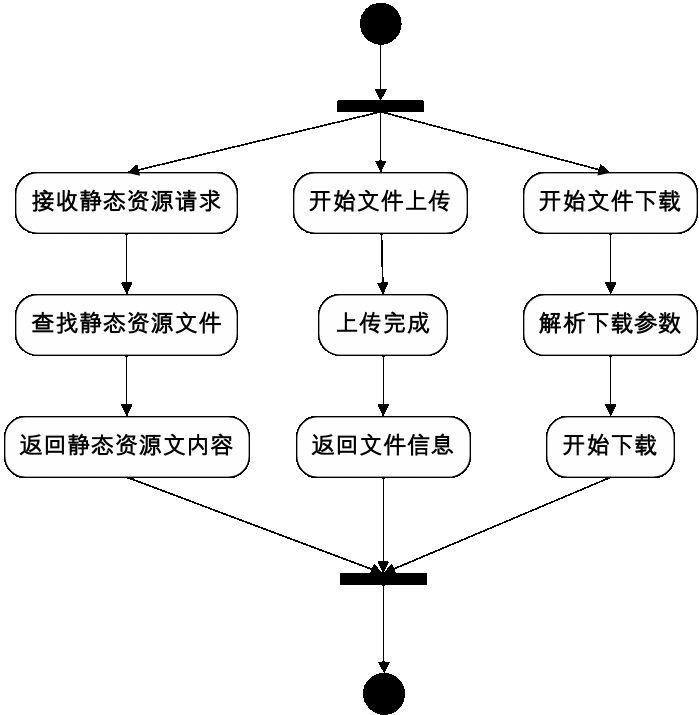
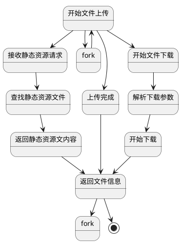
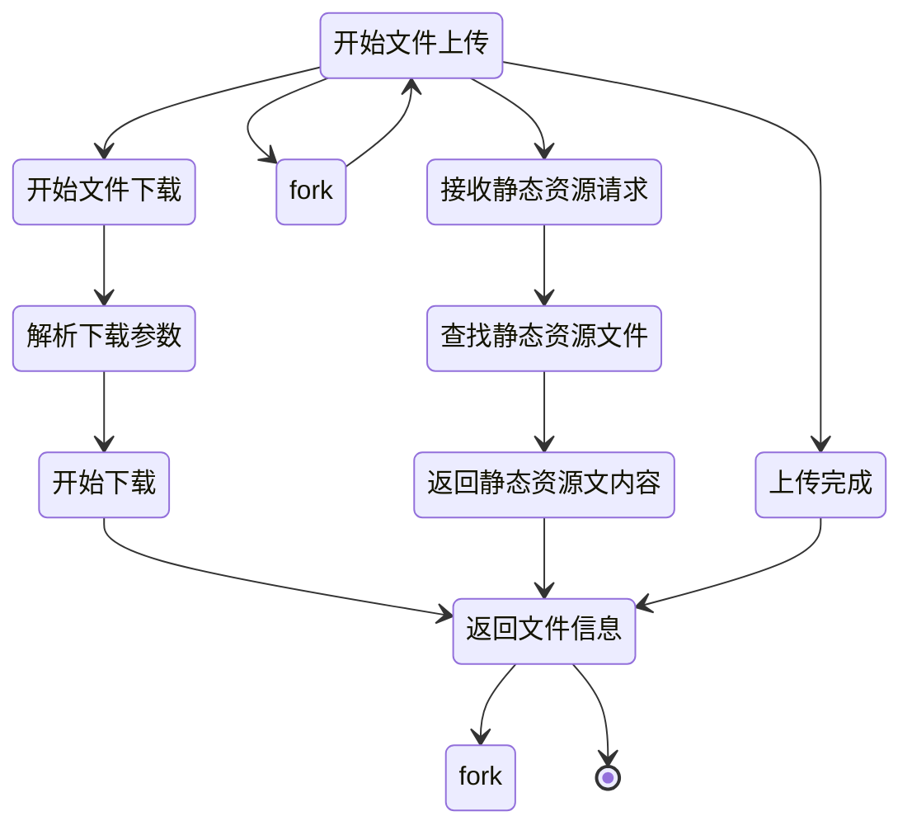
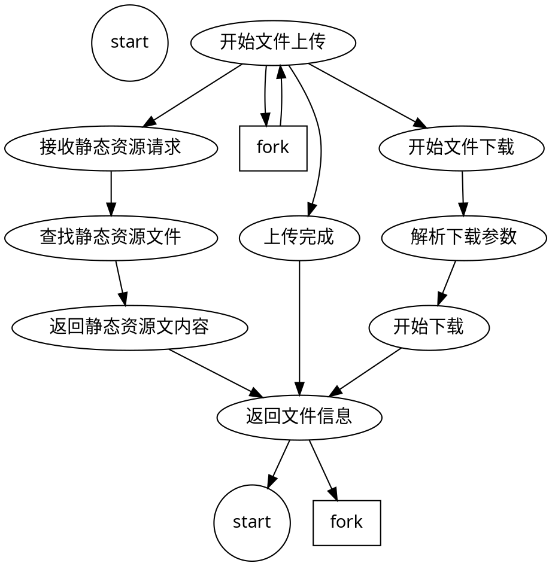

# 4_014 数据对档案

| 字段 | 值 |
|---|---|
| doc | 03服务集成框架软件需求规格说明-终稿 |
| section | 3.2.7 |
| image_caption | 图 19 静态请求处理运行流程图 |
| table_caption | 表55 静态请求处理所有能力标识 |

## 原始图片

*图 19 静态请求处理运行流程图*

## 结构图

*⚠ 结构经census重对齐: 旧锚点(oleObject18.bin:page1.xml)与图片不符, 已切换到与image.png内容一致的锚点(oleObject19.bin:page1.xml, align_score=1.0)*

*来源: born-digital导出(state, 9节点/14边)*
*类型经几何启发式精化(Master类型识别失败的图, 投影层推断, canonical锚点不变)*

*状态图以PlantUML渲染(UML母语): [*]=起止 | 圆角框=状态 | 箭头标签=迁移事件*

Mermaid兼容投影(通用md渲染器可显示)

DOT源码(完整语义, graphviz可渲染)

### 锚点节点结构

| # | 文本 | 类型 |
|---|---|---|
| 1 |   | start |
| 2 | 接收静态资源请求 | state |
| 3 |   | start |
| 4 |   | fork |
| 5 | 开始文件上传 | state |
| 6 |   | fork |
| 7 | 查找静态资源文件 | state |
| 8 | 上传完成 | state |
| 9 | 返回文件信息 | state |
| 10 | 开始文件下载 | state |
| 11 | 解析下载参数 | state |
| 12 | 开始下载 | state |
| 13 | 返回静态资源文内容 | state |

## 表格内容

| 序号 | Use case名称 | 项目唯一标识符 | 需求描述 | 需求重用 | 方式名称 | 运行状态 | 对应的任务书功能/性能 |
|---|---|---|---|---|---|---|---|
| 1 | 静态资源请求处理 | PZXQ-GN-JTQQCL-JTQQC | 接收获取HTML、CSS等资源的请求，进 | 新增 | 桌面、平板、手持 | 运行阶段 | 4.1.6 |
| 2 | 文件上传 | PZXQ-GN-JTQQCL-WJSC | 支持对文件上传到指定位置，包括文件的大小 | 新增 | 桌面、平板、手持 | 运行阶段 | 4.1.6 |
| 3 | 文件下载 | PZXQ-GN-JTQQCL-WJXZ | 通过文件资源路径下载文件 | 新增 | 桌面、平板、手持 | 运行阶段 | 4.1.6 |

## 正文

静态请求处理功能包括静态资源请求处理功能，可根据请求信息返回对应的静态资源文件；文件上传功能，可对上传文件的大小、上传速度进行控制，可支持服务获取上传文件的位置、大小信息；文件下载功能，可根据文件资源路径下载文件；其功能用例如图18所示。
