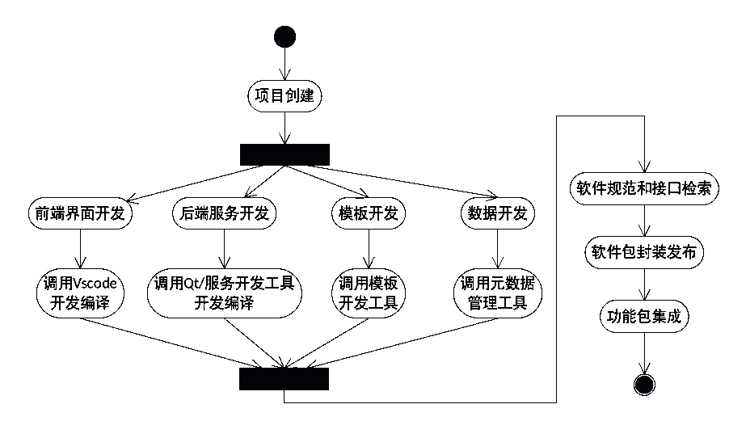
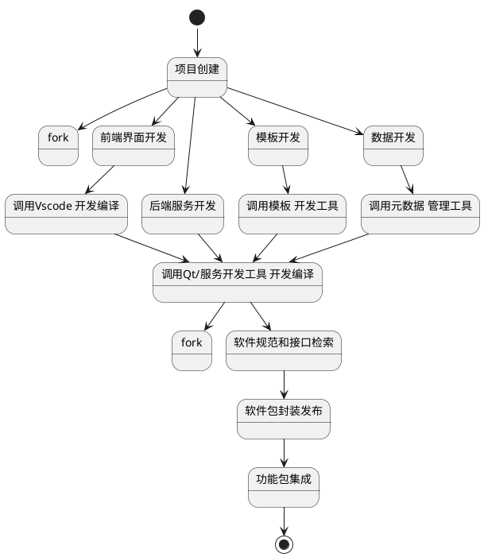
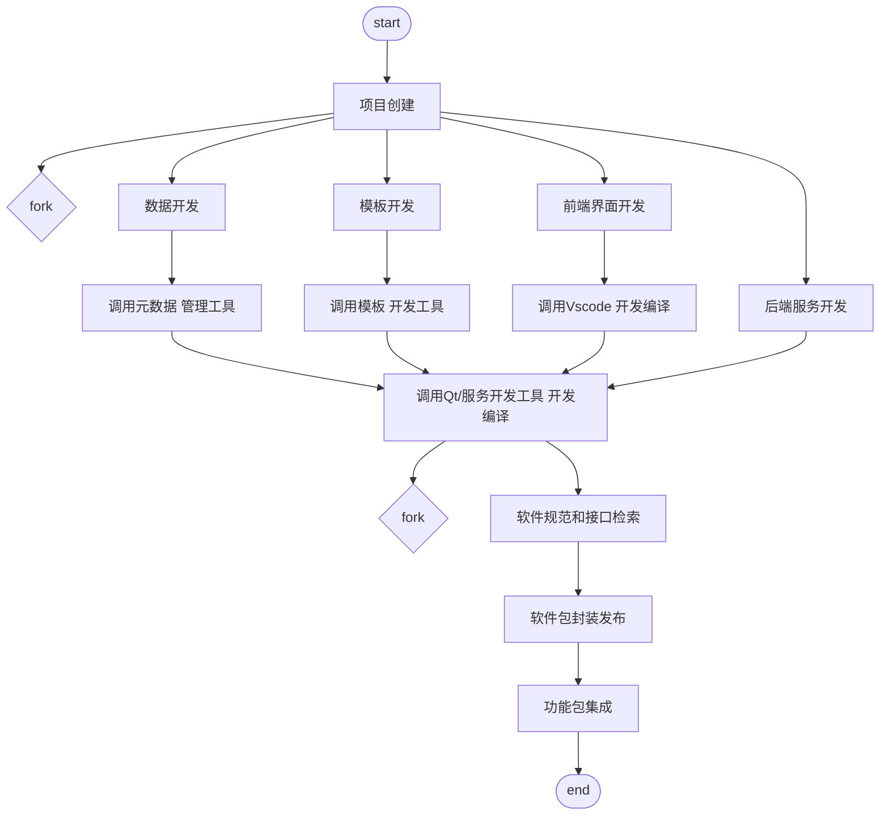
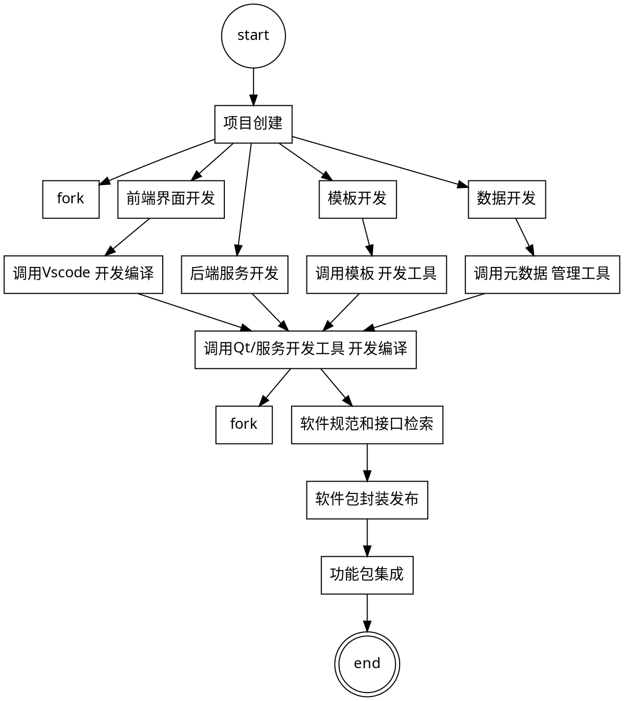

# 4_016 数据对档案

| 字段 | 值 |
|---|---|
| doc | 05软件部署管理软件需求规格说明-终稿 |
| section | 3.2.1 |
| image_caption | 图7 开发集成处理流程 |
| table_caption | 表3 开发集成所有能力能力标识 |

## 原始图片

*图7 开发集成处理流程*

## 结构图

*⚠ 结构经census重对齐: 旧锚点(oleObject6.bin:page1.xml)与图片不符, 已切换到与image.png内容一致的锚点(oleObject7.bin:page1.xml, align_score=1.0)*

*来源: born-digital导出(flowchart, 12节点/18边)*
*类型经几何启发式精化(Master类型识别失败的图, 投影层推断, canonical锚点不变)*

*状态图以PlantUML渲染(UML母语): [*]=起止 | 圆角框=状态 | 箭头标签=迁移事件*

Mermaid兼容投影(通用md渲染器可显示)

DOT源码(完整语义, graphviz可渲染)

### 锚点节点结构

| # | 文本 | 类型 |
|---|---|---|
| 1 |   | start |
| 2 | 项目创建 | process |
| 3 |   | end |
| 4 |   | fork |
| 5 | 前端界面开发 | process |
| 6 | 后端服务开发 | process |
| 7 | 模板开发 | process |
| 8 | 数据开发 | process |
| 9 | 调用Vscode
开发编译 | process |
| 10 | 调用Qt/服务开发工具
开发编译 | process |
| 11 | 调用模板
开发工具 | process |
| 12 | 调用元数据
管理工具 | process |
| 13 |   | fork |
| 14 | 软件规范和接口检索 | process |
| 15 | 软件包封装发布 | process |
| … | 共16个节点 | |

## 表格内容

| 序号 | Use case名称 | 项目唯一标识符 | 需求描述 | 需求重用 | 方式名称 | 运行状态 | 对应的任务书功能/性能 |
|---|---|---|---|---|---|---|---|
|   | 开发项目工程管理 | PZXQ-GN-RJBSGL-KFJC- | 提供软件开发项目工程的创建、编辑、封装、 | 无 | 桌面 | 开发阶段 | 4.1.1 a) |
|   | 软件开发工具集成 | PZXQ-GN-RJBSGL-KFJC- | 提供软件开发工具的集成功能，支持界面开发 | 无 | 桌面 | 开发阶段 | 4.1.1 b) |
|   | 软件开发引导 | PZXQ-GN-RJBSGL-KFJC- | 提供软件开发引导功能，能够引导用户进行界 | 无 | 桌面 | 开发阶段 | 4.1.1 c) |
|   | 开发规范接口检索 | PZXQ-GN-RJBSGL-KFJC- | 提供软件开发规范和接口的查看和检索功能， | 无 | 桌面 | 开发阶段 | 4.1.1 d) |

## 正文

b）用户可对已创建或者已打开的项目工程，如果选择前端界面开发，则调用VScode并将前端资源路径传入，进行前端代码的编辑、调试、打包；如果选择后端服务开发，则调用服务开发工具，生成服务及其插件，调用Qt5.9.6进行服务代码的编辑、编译和调试；如果选择模板开发，调用模板开发工具，进行模板的编辑、生成；如果选择数据开发，调用元数据管理工具进行数据库表的编辑、生成数据组件；
