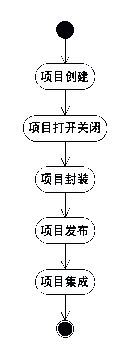
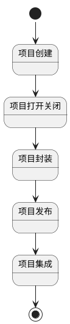
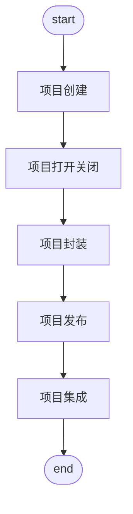
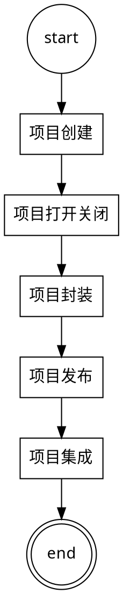

# 4_017 数据对档案

| 字段 | 值 |
|---|---|
| doc | 05软件部署管理软件需求规格说明-终稿 |
| section | 3.2.1.1 |
| image_caption | 图9 开发项目工程管理的处理流程 |
| table_caption | 表4 开发项目工程管理所有能力标识 |

## 原始图片

*图9 开发项目工程管理的处理流程*

## 结构图

*来源: born-digital导出(flowchart, 5节点/6边)*
*类型经几何启发式精化(Master类型识别失败的图, 投影层推断, canonical锚点不变)*

*状态图以PlantUML渲染(UML母语): [*]=起止 | 圆角框=状态 | 箭头标签=迁移事件*

Mermaid兼容投影(通用md渲染器可显示)

DOT源码(完整语义, graphviz可渲染)

### 锚点节点结构

| # | 文本 | 类型 |
|---|---|---|
| 1 |   | start |
| 2 | 项目创建 | process |
| 3 |   | end |
| 4 | 项目打开关闭 | process |
| 5 | 项目封装 | process |
| 6 | 项目发布 | process |
| 7 | 项目集成 | process |

## 表格内容

| 序号 | Use case名称 | 项目唯一标识符 | 需求描述 | 需求重用 | 方式名称 | 运行方式 | 对应的任务书功能/性能 |
|---|---|---|---|---|---|---|---|
|   | 项目创建 | PZXQ-GN-RJBSGL-KFJC- | 提供项目创建及项目描述信息编辑功能 | 新研 | 桌面 | 开发阶段 | 4.1.1 a) |
|   | 项目打开关闭 | PZXQ-GN-RJBSGL-KFJC- | 提供项目的打开、关闭，最近项目的快速打开 | 新研 | 桌面 | 开发阶段 | 4.1.1 a) |
|   | 项目封装 | PZXQ-GN-RJBSGL-KFJC- | 提供对项目开发的文件和文件夹进行封装功能 | 新研 | 桌面 | 开发阶段 | 4.1.1 a) |
|   | 项目发布 | PZXQ-GN-RJBSGL-KFJC- | 提供项目软件产品的发布功能； | 新研 | 桌面 | 开发阶段 | 4.1.1 a) |
|   | 项目集成 | PZXQ-GN-RJBSGL-KFJC- | 提供对项目软件包的集成工具 | 新研 | 桌面 | 开发阶段 | 4.1.1 a) |

## 正文

开发项目工程管理是对软件开发的项目工程进行创建、编辑、打开、关闭、封装、发布、集成的管理。
