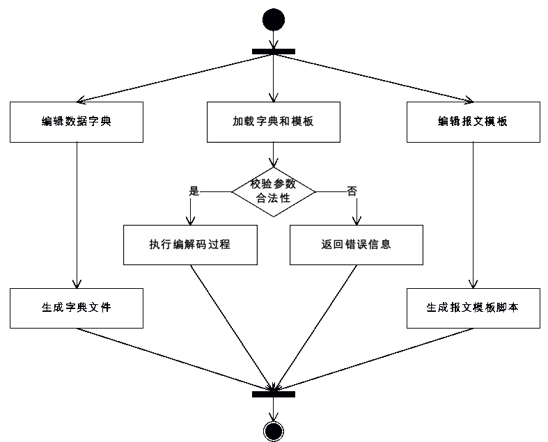
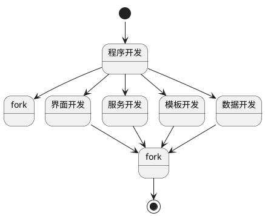
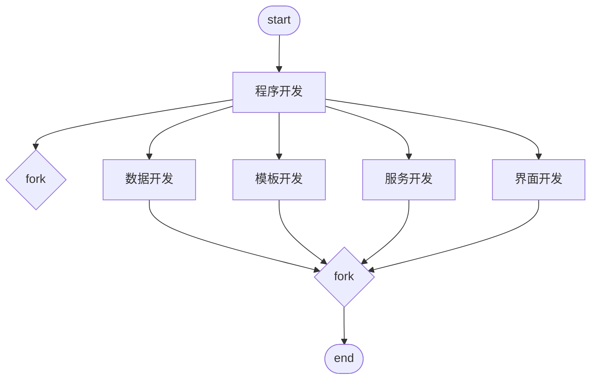
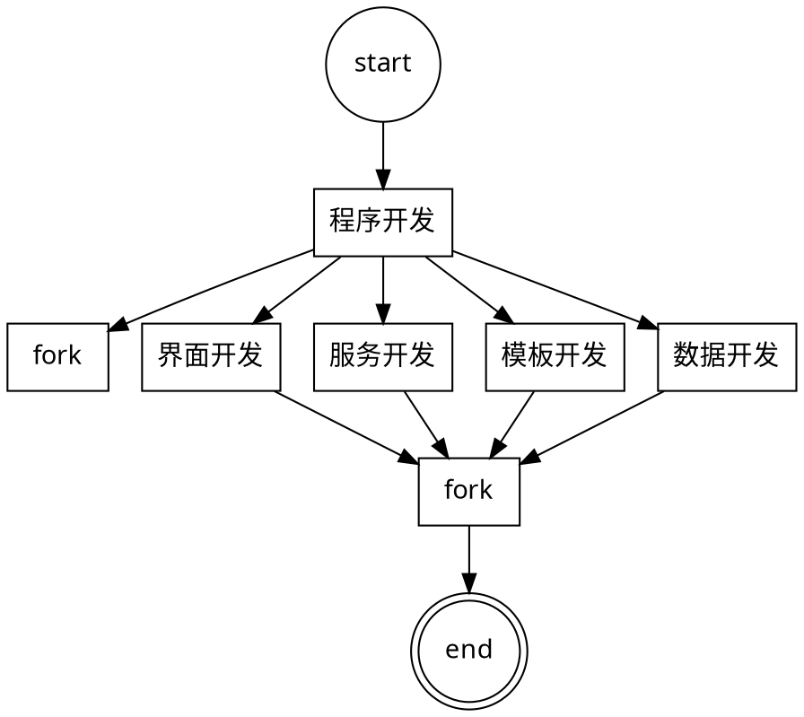

# 4_018 数据对档案

| 字段 | 值 |
|---|---|
| doc | 05软件部署管理软件需求规格说明-终稿 |
| section | 3.2.1.3 |
| image_caption | 图11 软件开发引导的处理流程 |
| table_caption | 表11 软件开发引导所有能力标识 |

## 原始图片

*图11 软件开发引导的处理流程*

## 结构图

*来源: born-digital导出(flowchart, 5节点/11边)*
*类型经几何启发式精化(Master类型识别失败的图, 投影层推断, canonical锚点不变)*

*状态图以PlantUML渲染(UML母语): [*]=起止 | 圆角框=状态 | 箭头标签=迁移事件*

Mermaid兼容投影(通用md渲染器可显示)

DOT源码(完整语义, graphviz可渲染)

### 锚点节点结构

| # | 文本 | 类型 |
|---|---|---|
| 1 |   | start |
| 2 | 程序开发 | process |
| 3 |   | end |
| 4 |   | fork |
| 5 | 界面开发 | process |
| 6 | 服务开发 | process |
| 7 | 模板开发 | process |
| 8 | 数据开发 | process |
| 9 |   | fork |

## 表格内容

| 序号 | Use case名称 | 项目唯一标识符 | 需求描述 | 需求重用 | 方式名称 | 运行状态 | 对应的任务书功能/性能 |
|---|---|---|---|---|---|---|---|
|   | 界面程序开发 | PZXQ-GN-RJBSGL-KFJC- | 能够引导用户进行界面类程序的编辑、编译、 | 新研 | 桌面 | 开发阶段 | 4.1.1 c) |
|   | 服务程序开发 | PZXQ-GN-RJBSGL-KFJC- | 能够引导用户进行服务类程序的代码编辑、编 | 新研 | 桌面 | 开发阶段 | 4.1.1 c) |
|   | 模板开发 | PZXQ-GN-RJBSGL-KFJC- | 能够引导用户进行模板的制作、编辑； | 新研 | 桌面 | 开发阶段 | 4.1.1 c) |
|   | 数据开发 | PZXQ-GN-RJBSGL-KFJC- | 能够引导用户进行数据库表编辑，生成指定格 | 新研 | 桌面 | 开发阶段 | 4.1.1 c) |

## 正文

软件开发引导能够引导用户进行界面类程序的编辑、编译、调试，生成指定格式的界面组件，能够引导用户进行服务类程序的代码编辑、编译、调试，生成指定格式的服务组件，能够引导用户进行数据库表编辑，生成指定格式的数据组件；能够引导用户进行模板的制作、编辑。
