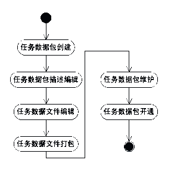
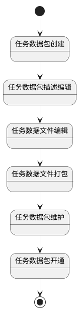
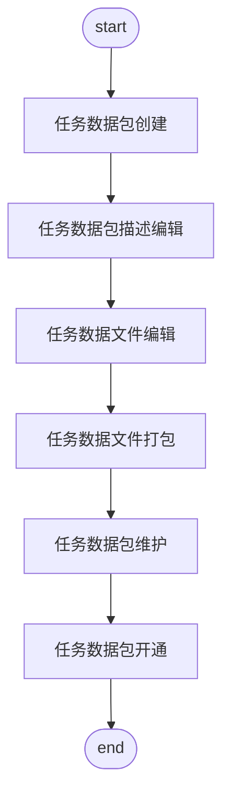
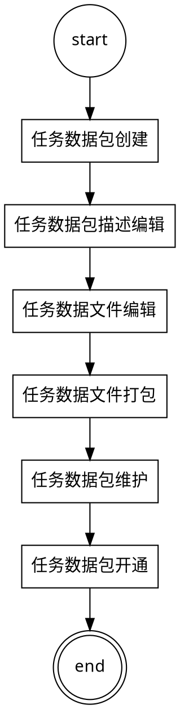

# 4_020 数据对档案

| 字段 | 值 |
|---|---|
| doc | 05软件部署管理软件需求规格说明-终稿 |
| section | 3.2.3 |
| image_caption | 图15 预案制作开通处理流程 |
| table_caption | 表24 预案制作开通所有能力能力标识 |

## 原始图片

*图15 预案制作开通处理流程*

## 结构图

*⚠ 结构经census重对齐: 旧锚点(oleObject17.bin:page1.xml)与图片不符, 已切换到与image.png内容一致的锚点(oleObject15.bin:page1.xml, align_score=1.0)*

*来源: born-digital导出(flowchart, 6节点/7边)*
*类型经几何启发式精化(Master类型识别失败的图, 投影层推断, canonical锚点不变)*

*状态图以PlantUML渲染(UML母语): [*]=起止 | 圆角框=状态 | 箭头标签=迁移事件*

Mermaid兼容投影(通用md渲染器可显示)

DOT源码(完整语义, graphviz可渲染)

### 锚点节点结构

| # | 文本 | 类型 |
|---|---|---|
| 1 |   | start |
| 2 | 任务数据包创建 | process |
| 3 |   | end |
| 4 | 任务数据包描述编辑 | process |
| 5 | 任务数据文件编辑 | process |
| 6 | 任务数据文件打包 | process |
| 7 | 任务数据包维护 | process |
| 8 | 任务数据包开通 | process |

## 表格内容

| 序号 | Use case名称 | 项目唯一标识符 | 需求描述 | 需求重用 | 方式名称 | 运行状态 | 对应的任务书功能/性能 |
|---|---|---|---|---|---|---|---|
| 1 | 任务数据包管理 | PZXQ-GN-RJBSGL-YAZZK | 提供任务数据包可视化管理功能，支持任务数 | 改进 | 桌面、平板 | 集成阶段 | 4.1.3 a) |
| 2 | 任务数据包制作 | PZXQ-GN-RJBSGL-YAZZK | 提供任务数据包制作功能，能够导入sql类 | 改进 | 桌面、平板 | 集成阶段 | 4.1.3 b) |
| 3 | 任务数据开通 | PZXQ-GN-RJBSGL-YAZZK | 提供任务数据开通功能，能够将任务数据包内 | 改进 | 桌面、平板、手持 | 运行阶段 | 4.1.3 c) 4.2 b) |
| 4 | 任务数据验证 | PZXQ-GN-RJBSGL-YAZZK | 提供开通数据验证的功能，能够对任务数据包 | 改进 | 桌面、平板、手持 | 运行阶段 | 4.1.3 d) |

## 正文

预案制作开通包括：任务数据包管理、任务数据包制作和任务数据开通，其功能用例如图14所示。
