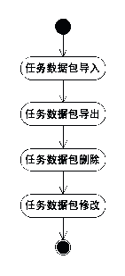
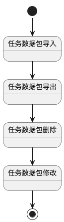
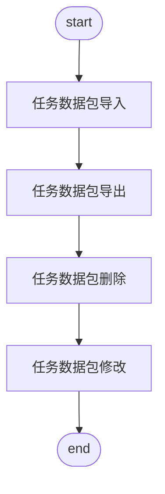
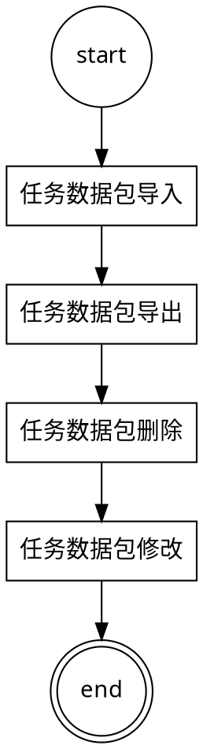

# 4_021 数据对档案

| 字段 | 值 |
|---|---|
| doc | 05软件部署管理软件需求规格说明-终稿 |
| section | 3.2.3.1 |
| image_caption | 图17 任务数据包管理的处理流程 |
| table_caption | 表25 任务数据包管理所有能力标识 |

## 原始图片

*图17 任务数据包管理的处理流程*

## 结构图

*⚠ 结构经census重对齐: 旧锚点(oleObject16.bin:page1.xml)与图片不符, 已切换到与image.png内容一致的锚点(oleObject17.bin:page1.xml, align_score=1.0)*

*来源: born-digital导出(flowchart, 4节点/5边)*
*类型经几何启发式精化(Master类型识别失败的图, 投影层推断, canonical锚点不变)*

*状态图以PlantUML渲染(UML母语): [*]=起止 | 圆角框=状态 | 箭头标签=迁移事件*

Mermaid兼容投影(通用md渲染器可显示)

DOT源码(完整语义, graphviz可渲染)

### 锚点节点结构

| # | 文本 | 类型 |
|---|---|---|
| 1 |   | start |
| 2 | 任务数据包导入 | process |
| 3 |   | end |
| 4 | 任务数据包导出 | process |
| 5 | 任务数据包删除 | process |
| 6 | 任务数据包修改 | process |

## 表格内容

| 序号 | Use case名称 | 项目唯一标识符 | 需求描述 | 需求重用 | 方式名称 | 运行状态 | 对应的任务书功能/性能 |
|---|---|---|---|---|---|---|---|
|   | 任务数据包导入 | PZXQ-GN-YAZZKT-RWSJB | 提供任务数据包的导入 | 改进 | 桌面 | 集成阶段 | 4.1.3 a) |
|   | 任务数据包导出 | PZXQ-GN-YAZZKT-RWSJB | 提供任务数据包的导出 | 改进 | 桌面 | 集成阶段 | 4.1.3 a) |
|   | 任务数据包删除 | PZXQ-GN-YAZZKT-RWSJB | 提供任务数据包的删除 | 改进 | 桌面 | 集成阶段 | 4.1.3 a) |
|   | 任务数据包修改 | PZXQ-GN-YAZZKT-RWSJB | 提供任务数据包的修改 | 改进 | 桌面 | 集成阶段 | 4.1.3 a) |

## 正文

任务数据包管理提供任务数据包可视化管理功能，支持任务数据包的新建、编辑、删除、导入、导出的功能。
