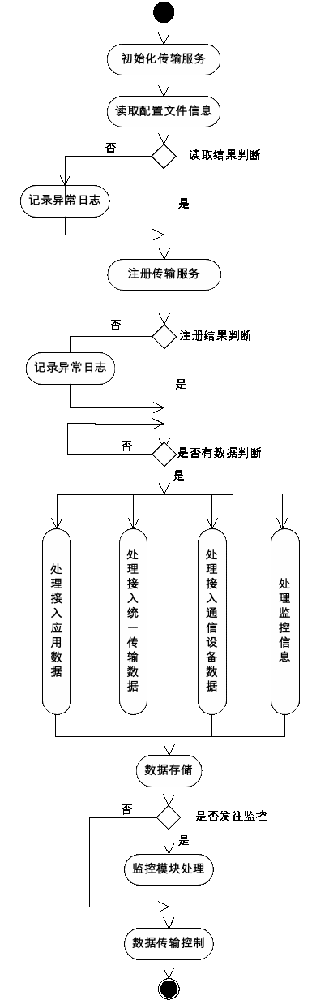
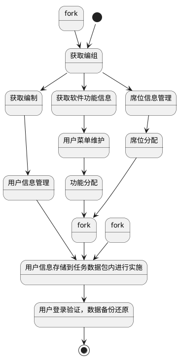
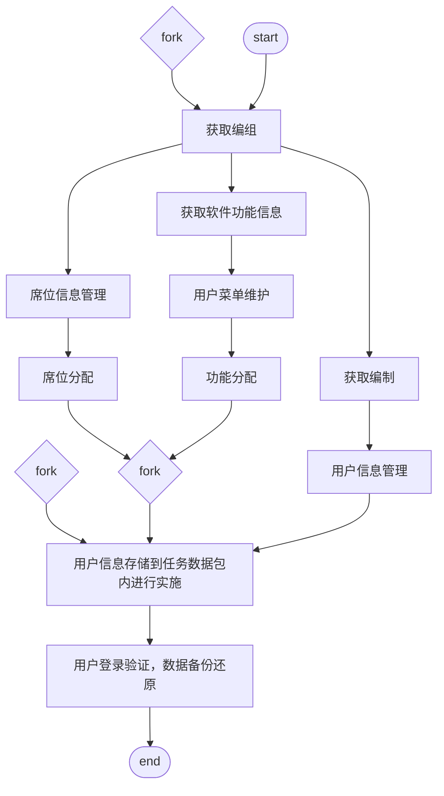
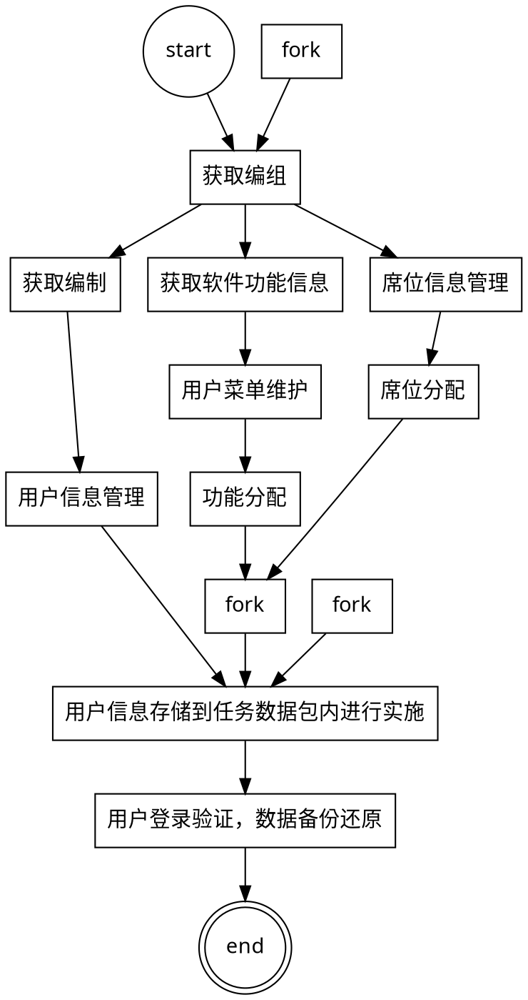

# 4_022 数据对档案

| 字段 | 值 |
|---|---|
| doc | 05软件部署管理软件需求规格说明-终稿 |
| section | 3.2.4 |
| image_caption | 图19 用户管理处理流程 |
| table_caption | 表33 用户管理所有能力标识 |

## 原始图片

*图19 用户管理处理流程*

## 结构图

*⚠ 结构经census重对齐: 旧锚点(oleObject18.bin:page1.xml)与图片不符, 已切换到与image.png内容一致的锚点(oleObject19.bin:page1.xml, align_score=1.0)*

*来源: born-digital导出(flowchart, 10节点/16边)*
*类型经几何启发式精化(Master类型识别失败的图, 投影层推断, canonical锚点不变)*

*状态图以PlantUML渲染(UML母语): [*]=起止 | 圆角框=状态 | 箭头标签=迁移事件*

Mermaid兼容投影(通用md渲染器可显示)

DOT源码(完整语义, graphviz可渲染)

### 锚点节点结构

| # | 文本 | 类型 |
|---|---|---|
| 1 |   | start |
| 2 | 获取编制 | process |
| 3 | 获取编组 | process |
| 4 | 获取软件功能信息 | process |
| 5 | 用户信息管理 | process |
| 6 | 席位信息管理 | process |
| 7 | 用户菜单维护 | process |
| 8 | 席位分配 | process |
| 9 | 功能分配 | process |
| 10 |   | fork |
| 11 |   | fork |
| 12 |   | fork |
| 13 | 用户登录验证，数据备份还原 | process |
| 14 | 用户信息存储到任务数据包内进行实施 | process |
| 15 |   | end |

## 表格内容

| 序号 | Use case名称 | 项目唯一标识符 | 需求描述 | 需求重用 | 方式名称 | 运行状态 | 对应的任务书功能/性能 |
|---|---|---|---|---|---|---|---|
|   | 用户基本信息维护 | PZXQ-GN-RJBSGL-YHGL- | 提供用户基本信息（用户ID、用户密码）编 | 改进 | 桌面、平板 | 集成阶段、运行阶段 | 4.1.4 a) |
|   | 坐位信息维护 | PZXQ-GN-RJBSGL-YHGL- | 提供坐位信息（坐位名称、坐位描述、坐位功 | 改进 | 桌面、平板 | 集成阶段、运行阶段 | 4.1.4 b) |
|   | 坐位分配 | PZXQ-GN-RJBSGL-YHGL- | 提供坐位分配的功能，能够为用户分配坐位， | 改进 | 桌面、平板 | 集成阶段、运行阶段 | 4.1.4 c) |
|   | 功能组件维护 | PZXQ-GN-RJBSGL-YHGL- | 提供功能组件的编辑功能，支持组件的导入、 | 改进 | 桌面、平板 | 集成阶段、运行阶段 | 4.1.4 d) |
|   | 用户功能菜单维护 | PZXQ-GN-RJBSGL-YHGL- | 提供用户功能菜单的编辑、导入、导出维护功 | 改进 | 桌面、平板 | 集成阶段、运行阶段 | 4.1.4 e) |
|   | 编组信息查看 | PZXQ-GN-RJBSGL-YHGL- | 提供编组文件的导入、查看功能，能够查看编 | 改进 | 桌面、平板 | 集成阶段、运行阶段 | 4.1.4 f) |
|   | 编组用户信息维护 | PZXQ-GN-RJBSGL-YHGL- | 提供对编组内的用户进行坐位分配功能，能够 | 改进 | 桌面、平板 | 集成阶段、运行阶段 | 4.1.4 g) |
|   | 用户信息制作 | PZXQ-GN-RJBSGL-YHGL- | 提供用户信息数据（用户基本信息、角色信息 | 改进 | 桌面、平板 | 集成阶段、运行阶段 | 4.1.4 h) |
|   | 用户数据备份还原 | PZXQ-GN-RJBSGL-YHGL- | 提供用户数据备份还原功能，能够在用户登录 | 改进 | 桌面、平板、手持 | 运行阶段 | 4.1.4 i) |

## 正文

用户管理功能包括：用户基本信息维护、坐位信息维护、坐位分配、用户功能菜单维护、功能组件编辑、编组信息查看、编组用户信息维护、用户信息制作、用户数据备份还原，其功能用例如图18所示。
