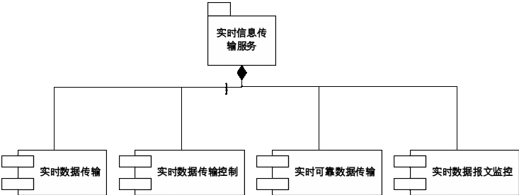
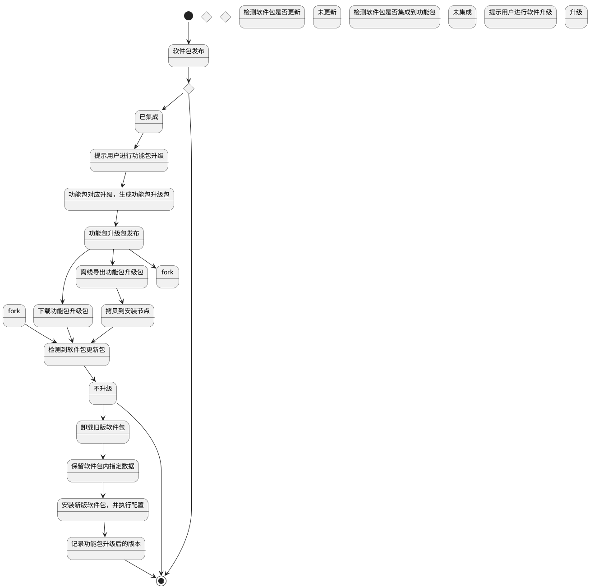
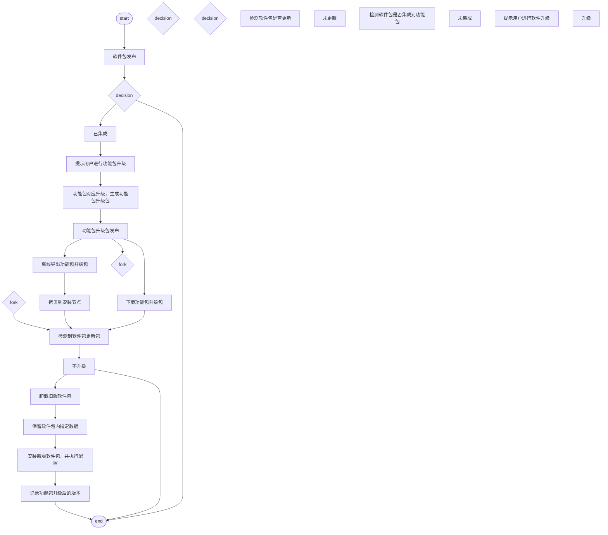
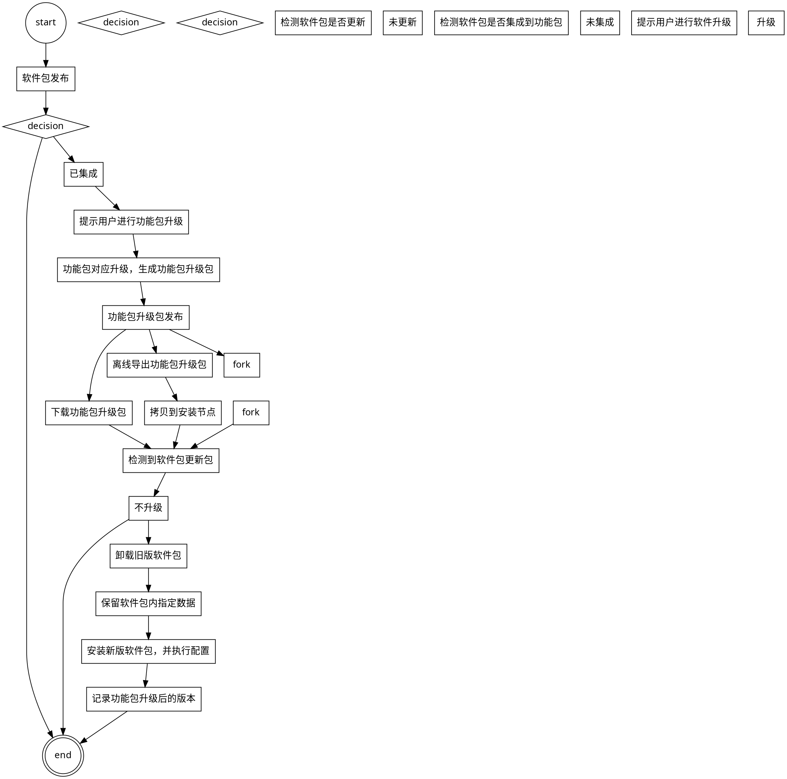

# 4_024 数据对档案

| 字段 | 值 |
|---|---|
| doc | 05软件部署管理软件需求规格说明-终稿 |
| section | 3.2.5 |
| image_caption | 图 22 软件升级的处理流程 |
| table_caption | 表43 软件安装管理所有能力标识 |

## 原始图片

*图 22 软件升级的处理流程*

## 结构图

*⚠ 结构经census重对齐: 旧锚点(oleObject5.bin:page1.xml)与图片不符, 已切换到与image.png内容一致的锚点(oleObject21.bin:page1.xml, align_score=0.75)*

*来源: born-digital导出(flowchart, 20节点/21边)*
*类型经几何启发式精化(Master类型识别失败的图, 投影层推断, canonical锚点不变)*

*状态图以PlantUML渲染(UML母语): [*]=起止 | 圆角框=状态 | 箭头标签=迁移事件*

Mermaid兼容投影(通用md渲染器可显示)

DOT源码(完整语义, graphviz可渲染)

### 锚点节点结构

| # | 文本 | 类型 |
|---|---|---|
| 1 |   | start |
| 2 |   | end |
| 3 | 软件包发布 | process |
| 4 |   | decision |
| 5 |   | decision |
| 6 | 提示用户进行功能包升级 | process |
| 7 | 功能包对应升级，生成功能包升级包 | process |
| 8 | 功能包升级包发布 | process |
| 9 | 下载功能包升级包 | process |
| 10 | 离线导出功能包升级包 | process |
| 11 | 拷贝到安装节点 | process |
| 12 |   | decision |
| 13 | 卸载旧版软件包 | process |
| 14 | 保留软件包内指定数据 | process |
| 15 | 安装新版软件包，并执行配置 | process |
| … | 共27个节点 | |

## 表格内容

| 序号 | Use case名称 | 项目唯一标识符 | 需求描述 | 需求重用 | 方式名称 | 运行状态 | 对应的任务书功能/性能 |
|---|---|---|---|---|---|---|---|
|   | 软件数据发布管理 | PZXQ-GN-RJBSGL-RJAZG | 提供软件、数据发布管理功能，能够进行软件 | 无 | 桌面、平板 | 运行阶段 | 4.1.5 a） |
|   | 软件本地管理 | PZXQ-GN-RJBSGL-RJAZG | 提供本地软件管理功能，支持软件的单个导入 | 无 | 桌面、平板、手持 | 运行阶段 | 4.1.5 b） |
|   | 软件本地安装 | PZXQ-GN-RJBSGL-RJAZG | 提供本地软件安装、升级、卸载功能，支持软 | 无 | 桌面、平板、手持 | 运行阶段 | 4.1.5 c） 4.2 a） |
|   | 服务配置与菜单配置 | PZXQ-GN-RJBSGL-RJAZG | 提供服务启动清单及界面集成框架菜单的生成 | 无 | 桌面、平板、手持 | 运行阶段 | 4.1.5 d） |
|   | 软件远程安装 | PZXQ-GN-RJBSGL-RJAZG | 提供软件的远程安装、更新、卸载功能，在有 | 无 | 桌面、平板、手持 | 运行阶段 | 4.1.5 e） |
|   | 软件在线升级 | PZXQ-GN-RJBSGL-RJAZG | 提供在线升级安装功能，在有线网络或者高速 | 无 | 桌面、平板、手持 | 运行阶段 | 4.1.5 f） |
|   | 任务数据包远程下载 | PZXQ-GN-RJBSGL-RJAZG | 提供任务数据包远程索取功能，在有线网络或 | 无 | 桌面、平板、手持 | 运行阶段 | 4.1.5 g） |
|   | 任务数据包远程开通 | PZXQ-GN-RJBSGL-RJAZG | 提供系统远程开通控制功能，支持在有线网络 | 无 | 桌面、平板、手持 | 运行阶段 | 4.1.5 h） |

## 正文

软件安装管理功能包括：软件数据发布管理、软件本地管理、软件本地安装、服务配置与界面配置、软件远程安装、软件在线升级、任务数据包远程下载、任务数据包远程开通，其功能用例如图20所示。
