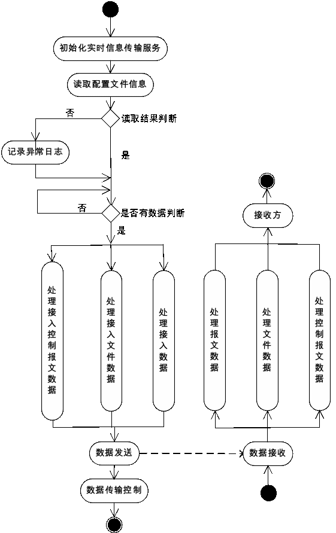
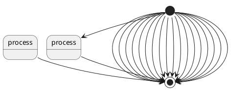
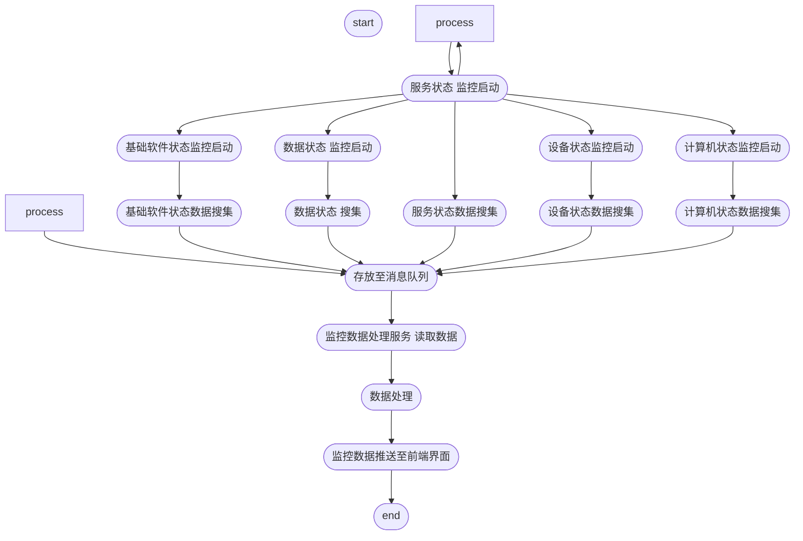
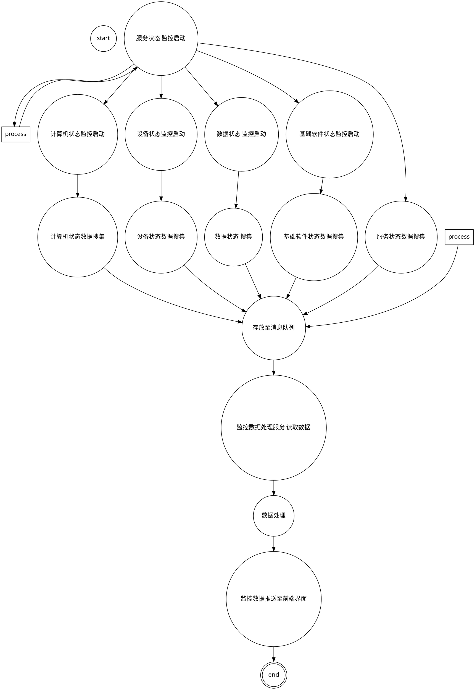

# 4_025 数据对档案

| 字段 | 值 |
|---|---|
| doc | 06运行支撑服务软件需求规格说明-终稿 |
| section | 3.2.1 |
| image_caption | 图5 系统运行监控流程图 |
| table_caption | 表3 系统运行监控所有能力标识 |

## 原始图片

*图5 系统运行监控流程图*

## 结构图

*⚠ 结构经census重对齐: 旧锚点(oleObject9.bin:page1.xml)与图片不符, 已切换到与image.png内容一致的锚点(oleObject5.bin:page1.xml, align_score=0.929)*

*来源: born-digital导出(flowchart, 14节点/21边)*
*类型经几何启发式精化(Master类型识别失败的图, 投影层推断, canonical锚点不变)*

*状态图以PlantUML渲染(UML母语): [*]=起止 | 圆角框=状态 | 箭头标签=迁移事件*

Mermaid兼容投影(通用md渲染器可显示)

DOT源码(完整语义, graphviz可渲染)

### 锚点节点结构

| # | 文本 | 类型 |
|---|---|---|
| 1 |   | start |
| 2 |   | end |
| 3 |   | process |
| 4 | 计算机状态监控启动 | start |
| 5 | 设备状态监控启动 | start |
| 6 | 服务状态
监控启动 | start |
| 7 | 数据状态
监控启动 | start |
| 8 | 基础软件状态监控启动 | start |
| 9 | 计算机状态数据搜集 | start |
| 10 | 设备状态数据搜集 | start |
| 11 | 服务状态数据搜集 | start |
| 12 | 数据状态
搜集 | start |
| 13 | 基础软件状态数据搜集 | start |
| 14 | 存放至消息队列 | start |
| 15 |   | process |
| … | 共18个节点 | |

## 表格内容

| 序号 | Use case名称 | 项目唯一标识符 | 需求描述 | 需求 重用 | 方式 名称 | 运行 状态 | 对应的任务书功能/性能 |
|---|---|---|---|---|---|---|---|
| 1 | 重要信息提示 | PZXQ-YXZCFW-GN-XTYXZ | 能够对系统运行过程中的重要信息包括计算机 | 新增 | 桌面、平板、手持 | 开发阶段、集成阶段、运行阶段 | 4.1.1 a) |
| 2 | 计算机状态监控 | PZXQ-YXZCFW-GN-XTYXZ | 能够读取计算机中正在运行软件的CPU状态 | 新增 | 桌面、平板、手持 | 开发阶段、集成阶段、运行阶段 | 4.1.1 b) |
| 3 | 数据状态监控 | PZXQ-YXZCFW-GN-XTYXZ | 能够读取计算机的数据库连接状态、数据库最 | 新增 | 桌面、平板、手持 | 开发阶段、集成阶段、运行阶段 | 4.1.1 c) |
| 4 | 服务状态监控 | PZXQ-YXZCFW-GN-XTYXZ | 能够接收服务支撑框架提供的服务启动数量、 | 改进 | 桌面、平板、手持 | 开发阶段、集成阶段、运行阶段 | 4.1.1 d) |
| 5 | 软件状态监控 | PZXQ-YXZCFW-GN-XTYXZ | 能够获取计算机安装的WPS和杀毒软件的版 | 新增 | 桌面 | 开发阶段、集成阶段、运行阶段 | 4.1.1 e) |
| 6 | 设备状态监控 | PZXQ-YXZCFW-GN-XTYXZ | 能够显示车内终端的在线信息、终端用户登陆 | 新增 | 桌面、平板、手持 | 运行阶段 | 4.1.1 f) |

## 正文

系统运行状态监控功能包括：重要信息提示、计算机状态监控、设备状态监控、服务状态监控、数据状态监控、基础软件状态监控，其功能用例如图4所示。
