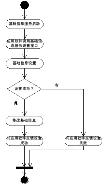
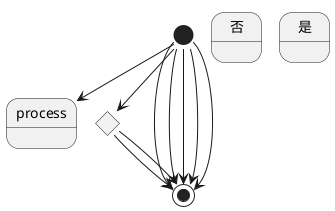
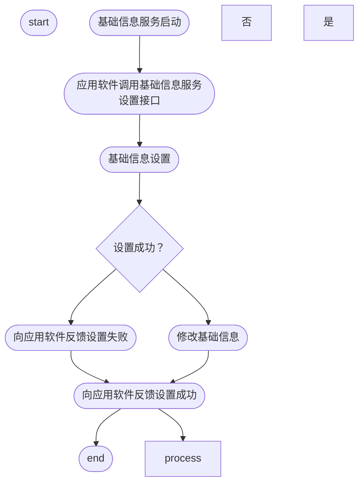
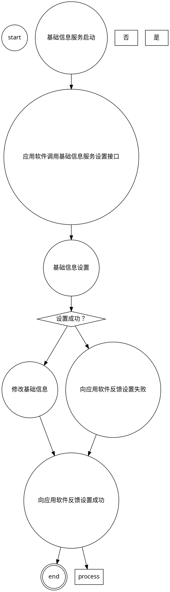

# 4_027 数据对档案

| 字段 | 值 |
|---|---|
| doc | 06运行支撑服务软件需求规格说明-终稿 |
| section | 3.2.3 |
| image_caption | 图18 系统基础信息设置流程图 |
| table_caption | 表45 系统基础信息维护所有能力标识 |

## 原始图片

*图18 系统基础信息设置流程图*

## 结构图

*⚠ 结构经census重对齐: 旧锚点(oleObject20.bin:page1.xml)与图片不符, 已切换到与image.png内容一致的锚点(oleObject18.bin:page1.xml, align_score=0.778)*

*来源: born-digital导出(flowchart, 9节点/9边)*
*类型经几何启发式精化(Master类型识别失败的图, 投影层推断, canonical锚点不变)*

*状态图以PlantUML渲染(UML母语): [*]=起止 | 圆角框=状态 | 箭头标签=迁移事件*

Mermaid兼容投影(通用md渲染器可显示)

DOT源码(完整语义, graphviz可渲染)

### 锚点节点结构

| # | 文本 | 类型 |
|---|---|---|
| 1 |   | start |
| 2 |   | end |
| 3 |   | process |
| 4 | 基础信息服务启动 | start |
| 5 | 应用软件调用基础信息服务设置接口 | start |
| 6 | 基础信息设置 | start |
| 7 | 设置成功？ | decision |
| 8 | 修改基础信息 | start |
| 9 | 向应用软件反馈设置成功 | start |
| 10 | 向应用软件反馈设置失败 | start |
| 11 | 否 | other |
| 12 | 是 | other |

## 表格内容

| 序号 | Use case名称 | 项目唯一标识符 | 需求描述 | 需求重用 | 方式 名称 | 运行 状态 | 对应的任务书功能/性能 |
|---|---|---|---|---|---|---|---|
| 1 | 用户基础信息查询设置 | PZXQ-YXZCFW-GN-XTJCX | 提供接口支持对当前登录的用户名、用户ID | 新增 | 桌面、平板、手持 | 运行阶段 | 4.1.3 a) |
| 2 | 系统基础信息查询设置 | PZXQ-YXZCFW-GN-XTJCX | 提供接口支持对指挥所内服务器、备份服务器 | 新增 | 桌面、平板、手持 | 运行阶段 | 4.1.3 b) |
| 3 | 任务基础信息查询设置 | PZXQ-YXZCFW-GN-XTJCX | 提供对当前开通的任务数据包信息的查询和设 | 新增 | 桌面、平板、手持 | 运行阶段 | 4.1.3 c) |
| 4 | 网卡基础信息查询设置 | PZXQ-YXZCFW-GN-XTJCX | 提供对当前计算机网卡信息的查询和设置 | 新增 | 桌面、平板 | 运行阶段 | 4.1.3 d) |

## 正文

系统基础信息维护功能包括：用户基础信息查询设置、系统基础信息查询设置、任务基础信息查询设置、网卡相关信息查询设置、其功能用例如图17所示。
