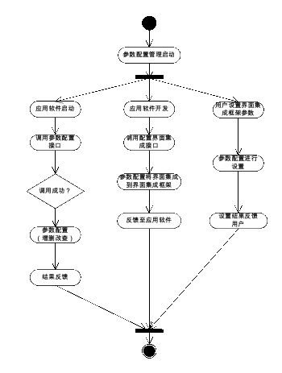
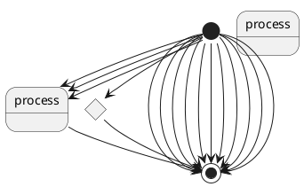
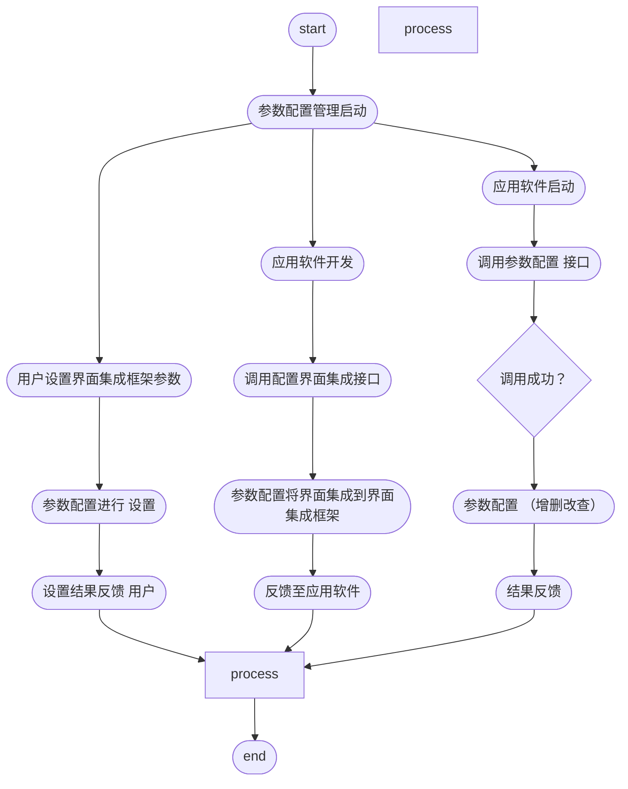
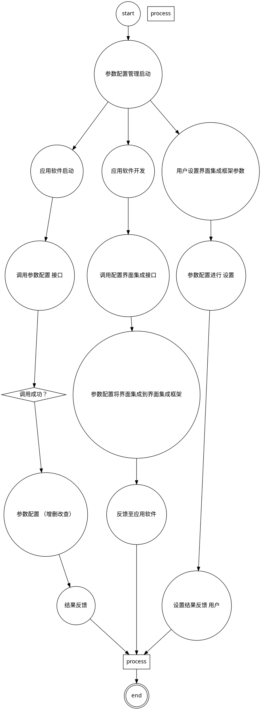

# 4_029 数据对档案

| 字段 | 值 |
|---|---|
| doc | 06运行支撑服务软件需求规格说明-终稿 |
| section | 3.2.4 |
| image_caption | 图25 参数配置管理设置流程图 |
| table_caption | 表58 参数配置管理所有能力标识 |

## 原始图片

*图25 参数配置管理设置流程图*

## 结构图

*来源: born-digital导出(flowchart, 13节点/17边)*
*类型经几何启发式精化(Master类型识别失败的图, 投影层推断, canonical锚点不变)*

*状态图以PlantUML渲染(UML母语): [*]=起止 | 圆角框=状态 | 箭头标签=迁移事件*

Mermaid兼容投影(通用md渲染器可显示)

DOT源码(完整语义, graphviz可渲染)

*锚点Connect重建存在3个悬空连线端点, 已几何恢复1条边(连线自由端吸附最近语义节点, 每条带距离证据, via=dangling_snap; canonical锚点不变)*

### 锚点节点结构

| # | 文本 | 类型 |
|---|---|---|
| 1 |   | start |
| 2 |   | end |
| 3 |   | process |
| 4 | 参数配置管理启动 | start |
| 5 | 调用成功？ | decision |
| 6 |   | process |
| 7 | 应用软件启动 | start |
| 8 | 调用参数配置
接口 | start |
| 9 | 参数配置
（增删改查） | start |
| 10 | 结果反馈 | start |
| 11 | 应用软件开发 | start |
| 12 | 用户设置界面集成框架参数 | start |
| 13 | 参数配置进行
设置 | start |
| 14 | 设置结果反馈
用户 | start |
| 15 | 调用配置界面集成接口 | start |
| … | 共17个节点 | |

## 表格内容

| 序号 | Use case名称 | 项目唯一标识符 | 需求描述 | 需求重用 | 方式 名称 | 运行 状态 | 对应的任务书功能/性能 |
|---|---|---|---|---|---|---|---|
| 1 | 界面集成框架参数配置 | PZXQ-YXZCFW-GN-XTJCX | 能够对界面集成框架的分屏、字体大小、背景 | 改进 | 桌面、平板、手持 | 开发阶段、运行阶段 | 4.1.4 a) |
| 2 | 应用界面集成 | PZXQ-YXZCFW-GN-XTJCX | 提供参数配置界面二次开发接口，依据《界面 | 改进 | 桌面、平板、手持 | 开发阶段、运行阶段 | 4.1.4 b) |
| 3 | 参数配置接口 | PZXQ-YXZCFW-GN-XTJCX | 支持应用软件配置信息的写入、查询、删除、 | 新增 | 桌面、平板、手持 | 开发阶段、运行阶段 | 4.1.4 c) |

## 正文

参数配置管理功能包括：界面集成框架参数配置、应用界面集成、参数配置接口，其功能用例如图24所示。
