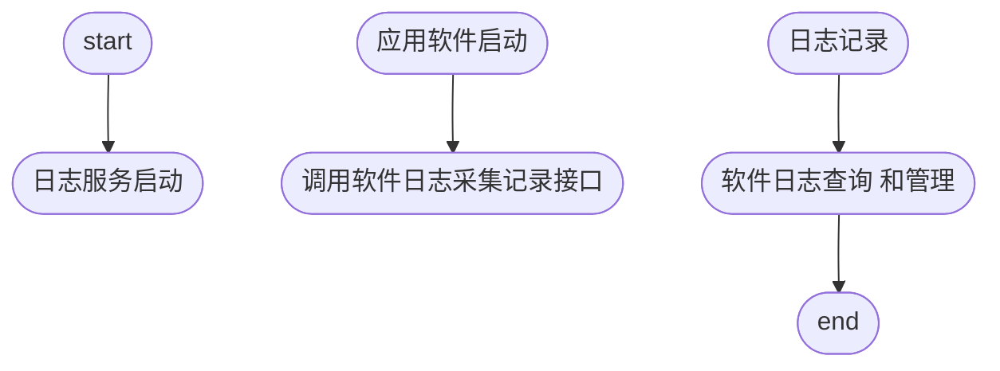
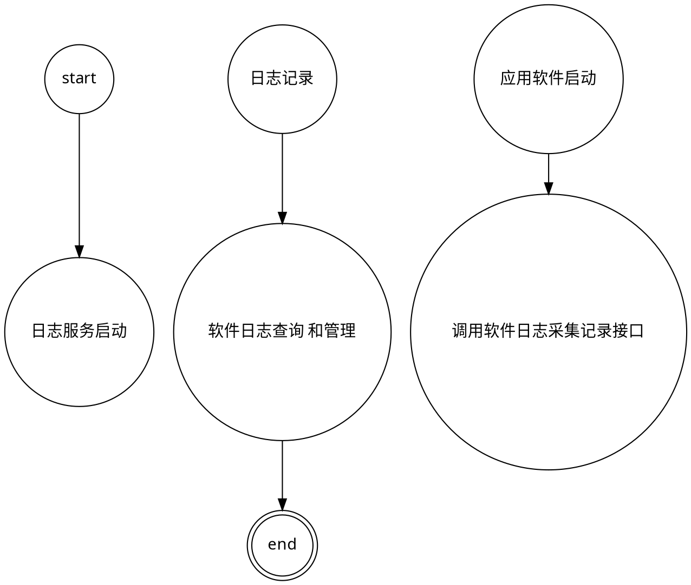

# 4_030 数据对档案

| 字段 | 值 |
|---|---|
| doc | 06运行支撑服务软件需求规格说明-终稿 |
| section | 3.2.5 |
| image_caption | 图28 日志采集与管理流程图 |
| table_caption | 表66 日志采集与管理所有能力标识 |

## 原始图片

*图28 日志采集与管理流程图*

## 结构图

*⚠ 结构经census重对齐: 旧锚点(oleObject27.bin:page1.xml)与图片不符, 已切换到与image.png内容一致的锚点(oleObject28.bin:page1.xml, align_score=1.0)*

*来源: born-digital导出(flowchart, 5节点/4边)*
*类型经几何启发式精化(Master类型识别失败的图, 投影层推断, canonical锚点不变)*

*状态图以PlantUML渲染(UML母语): [*]=起止 | 圆角框=状态 | 箭头标签=迁移事件*

Mermaid兼容投影(通用md渲染器可显示)

DOT源码(完整语义, graphviz可渲染)

### 锚点节点结构

| # | 文本 | 类型 |
|---|---|---|
| 1 |   | start |
| 2 |   | end |
| 3 | 日志服务启动 | start |
| 4 | 应用软件启动 | start |
| 5 | 调用软件日志采集记录接口 | start |
| 6 | 日志记录 | start |
| 7 | 软件日志查询
和管理 | start |

## 表格内容

| 序号 | Use case名称 | 项目唯一标识符 | 需求描述 | 需求重用 | 方式 名称 | 运行 状态 | 对应的任务书功能/性能 |
|---|---|---|---|---|---|---|---|
| 1 | 软件日志采集 | PZXQ-YXZCFW-GN-RZCJY | 提供软件日志记录接口，支持应用软件记录日 | 新增 | 桌面、平板、手持 | 开发阶段、集成阶段、运行阶段 | 4.1.6 a) |
| 2 | 软件日志查询 | PZXQ-YXZCFW-GN-RZCJY | 提供对软件日志文件的查询接口，支持对软件 | 新增 | 桌面、平板 | 开发阶段、集成阶段、运行阶段 | 4.1.6 b) |
| 3 | 日志删除 | PZXQ-YXZCFW-GN-RZCJY | 提供对软件日志文件的删除功能 | 新增 | 桌面、平板 | 开发阶段、集成阶段、运行阶段 | 4.1.6 c) |
| 4 | 日志清理 | PZXQ-YXZCFW-GN-RZCJY | 支持按照日志记录时间对日志文件进行自动清 | 新增 | 桌面、平板 | 开发阶段、集成阶段、运行阶段 | 4.1.6 d) |

## 正文

日志采集与管理功能包括：软件日志采集、软件日志查询、日志删除、日志清理，其功能用例如图27所示。
