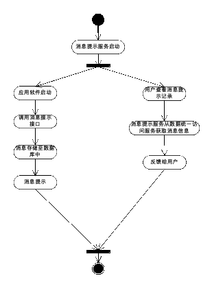

# 4_031 数据对档案

| 字段 | 值 |
|---|---|
| doc | 06运行支撑服务软件需求规格说明-终稿 |
| section | 3.2.7 |
| image_caption | 图31 消息提示与管理流程图 |
| table_caption | 表74 消息提示与管理所有能力标识 |

## 原始图片

*图31 消息提示与管理流程图*

## 结构图

*该对无Visio锚点(非Visio图, 无born-digital导出)*

## 表格内容

| 序号 | Use case名称 | 项目唯一标识符 | 需求描述 | 需求重用 | 方式 名称 | 运行状态 | 对应的任务书功能/性能 |
|---|---|---|---|---|---|---|---|
| 1 | 消息提示 | PZXQ-YXZCFW-GN-RZCJY | 提供消息提示功能，支持以弹框的形式对消息 | 改进 | 桌面 | 运行阶段 | 4.1.8 a) |
| 2 | 消息管理 | PZXQ-YXZCFW-GN-RZCJY | 提供消息的管理能力，支持将消息通过数据统 | 改进 | 桌面 | 运行阶段 | 4.1.8 b) |

## 正文

消息提示与管理功能包括：消息提示和消息管理，其功能用例如图30所示。
