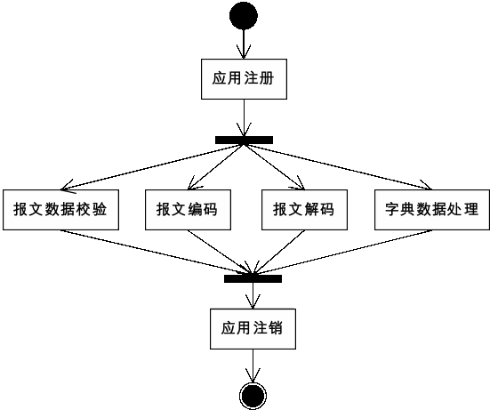
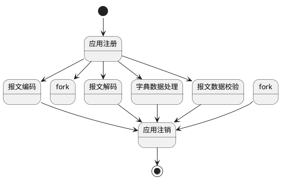
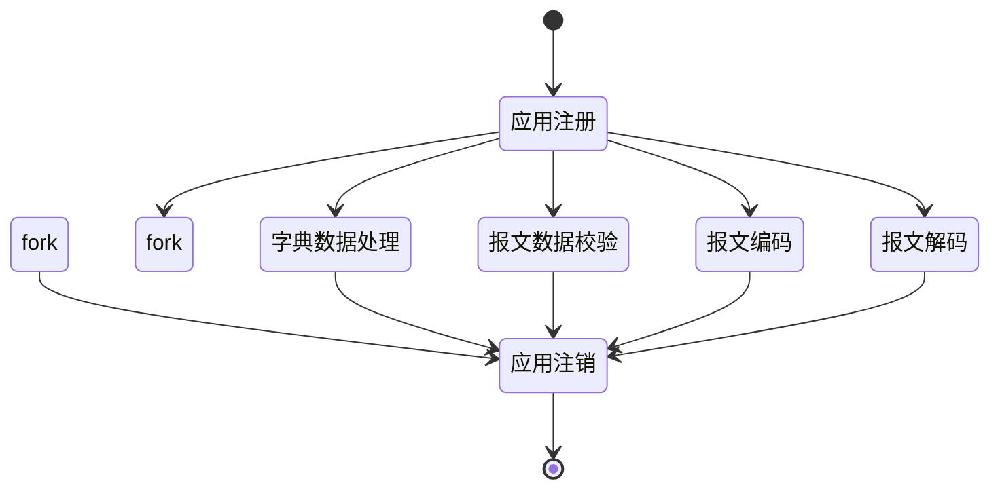
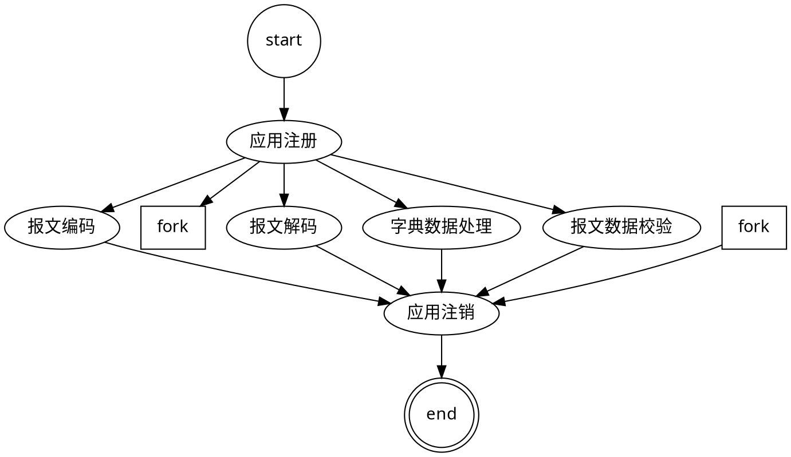

# 4_032 数据对档案

| 字段 | 值 |
|---|---|
| doc | 07报文处理服务软件需求规格说明-终稿 |
| section | 3.2.1 |
| image_caption | 图5 报文编解码服务流程图 |
| table_caption | 表3 报文编解码服务所有能力能力标识 |

## 原始图片

*图5 报文编解码服务流程图*

## 结构图

*⚠ 结构经census重对齐: 旧锚点(oleObject7.bin:page1.xml)与图片不符, 已切换到与image.png内容一致的锚点(oleObject5.bin:page1.xml, align_score=1.0)*

*来源: born-digital导出(state, 6节点/12边)*
*类型经几何启发式精化(Master类型识别失败的图, 投影层推断, canonical锚点不变)*

*状态图以PlantUML渲染(UML母语): [*]=起止 | 圆角框=状态 | 箭头标签=迁移事件*

Mermaid兼容投影(通用md渲染器可显示)

DOT源码(完整语义, graphviz可渲染)

### 锚点节点结构

| # | 文本 | 类型 |
|---|---|---|
| 1 | 报文编码 | state |
| 2 |   | fork |
| 3 |   | start |
| 4 |   | end |
| 5 | 报文解码 | state |
| 6 | 字典数据处理 | state |
| 7 | 报文数据校验 | state |
| 8 | 应用注册 | state |
| 9 | 应用注销 | state |
| 10 |   | fork |

## 表格内容

| 序号 | Use case名称 | 项目唯一标识符 | 需求描述 | 需求重用 | 方式名称 | 运行状态 | 对应的任务书功能/性能 |
|---|---|---|---|---|---|---|---|
| 1 | 应用注册 | PZXQ-GN-BWBJ-ZC | 程序初始化，加载字典等资源 | 沿用 | 桌面、平板、手持 | 开发、 运行 | -- |
| 2 | 报文编码 | PZXQ-GN-BWBJ-BWBM | 将符合模板规则的用户数据结构进行编码，返 | 沿用 | 桌面、平板、手持 | 开发、 运行 | 4.1.1 4.2 |
| 3 | 报文解码 | PZXQ-GN-BWBJ-BWJM | 将符合对应协议标准的比特数据进行解码，返 | 沿用 | 桌面、平板、手持 | 开发、 运行 | 4.1.1 4.2 |
| 4 | 报文数据校验 | PZXQ-GN-BWBJ-BWJY | 能够检验输入的用户结构数据或比特数据，是 | 沿用 | 桌面、平板、手持 | 开发、 运行 | 4.1.1 4.2 |
| 5 | 字典数据处理 | PZXQ-GN-BWBJ-ZDCL | 提供基于数据字典规则的数据处理 | 沿用 | 桌面、平板、手持 | 开发、 运行 | 4.1.1 4.2 |
| 6 | 应用注销 | PZXQ-GN-BWBJ-ZX | 程序退出，释放资源 | 沿用 | 桌面、平板、手持 | 开发、 运行 |   |

## 正文

报文编解码服务提供所有面向应用软件的功能，实现应用注册、报文编码、报文解码、字典数据处理、报文数据校验和应用注册等功能和接口，其功能用例如图4所示。
