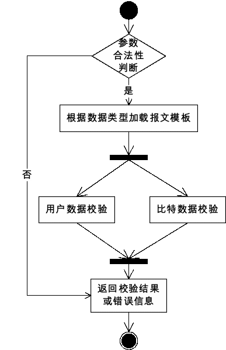
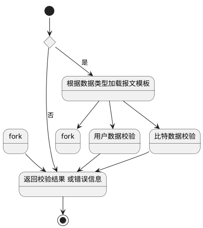
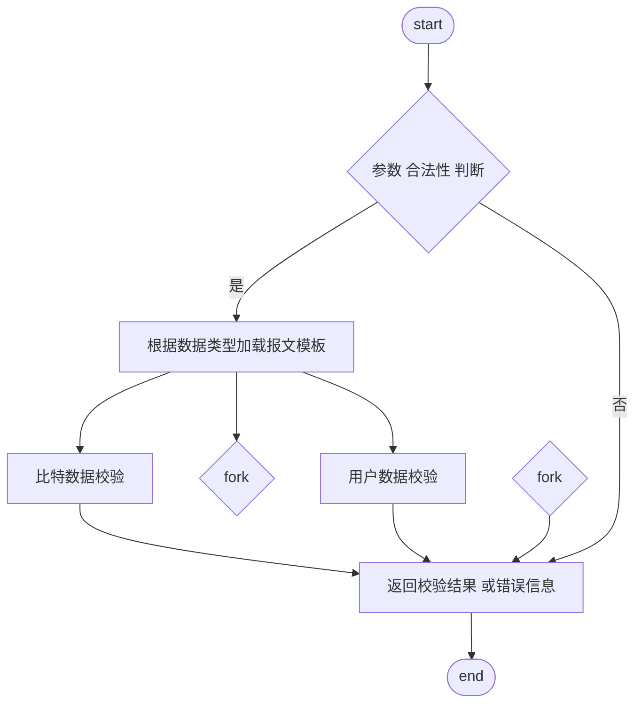

# 4_033 数据对档案

| 字段 | 值 |
|---|---|
| doc | 07报文处理服务软件需求规格说明-终稿 |
| section | 3.2.1.4 |
| image_caption | 图8 报文数据校验处理流程图 |
| table_caption | 表5 报文数据校验所有能力标识 |

## 原始图片


*图8 报文数据校验处理流程图*

## 结构图

*来源: born-digital导出(flowchart, 5节点/10边)*
*类型经几何启发式精化(Master类型识别失败的图, 投影层推断, canonical锚点不变)*

*状态图以PlantUML渲染(UML母语): [*]=起止 | 圆角框=状态 | 箭头标签=迁移事件*



<details><summary>Mermaid兼容投影(通用md渲染器可显示)</summary>



</details>

<details><summary>DOT源码(完整语义, graphviz可渲染)</summary>

```dot
digraph G {
  rankdir=TB;
  node [fontname="Microsoft YaHei"];
  N2 [shape=box, label="fork"];
  N9 [shape=circle, label="start"];
  N10 [shape=doublecircle, label="end"];
  N13 [shape=ellipse, label="用户数据校验"];
  N18 [shape=ellipse, label="比特数据校验"];
  N22 [shape=ellipse, label="返回校验结果 或错误信息"];
  N31 [shape=ellipse, label="根据数据类型加载报文模板"];
  N36 [shape=box, label="fork"];
  N42 [shape=diamond, label="参数 合法性 判断"];
  N36 -> N22;
  N31 -> N18;
  N31 -> N2;
  N9 -> N42;
  N42 -> N31, label="是";
  N42 -> N22, label="否";
  N18 -> N22;
  N13 -> N22;
  N31 -> N13;
  N22 -> N10;
}
```

</details>

### 锚点节点结构

| # | 文本 | 类型 |
|---|---|---|
| 1 |   | fork |
| 2 |   | start |
| 3 |   | end |
| 4 | 用户数据校验 | state |
| 5 | 比特数据校验 | state |
| 6 | 返回校验结果
或错误信息 | state |
| 7 | 根据数据类型加载报文模板 | state |
| 8 |   | fork |
| 9 | 参数
合法性
判断 | decision |

## 表格内容

| 序号 | Use case名称 | 项目唯一标识符 | 需求描述 | 需求重用 | 方式名称 | 运行方式 | 对应的任务书功能/性能 |
|---|---|---|---|---|---|---|---|
| 1 | 用户数据校验 | PZXQ-GN-BWBJ-BWJY-YH | 校验用户数据是否符合模板规则 | 沿用 | 桌面、平板、手持 | 开发、 运行 | 4.1.1 |
| 2 | 比特报文校验 | PZXQ-GN-BWBJ-BWJY-BT | 校验比特数据是否符合对应数据协议 | 沿用 | 桌面、平板、手持 | 开发、 运行 | 4.1.1 |

## 正文

报文数据校验提供用户数据结构和比特报文的校验接口，能够检验输入的用户数据或比特数据，是否符合与之对应的模板规则或者协议标准，满足不同业务数据协议标准要求的数据处理规则。
