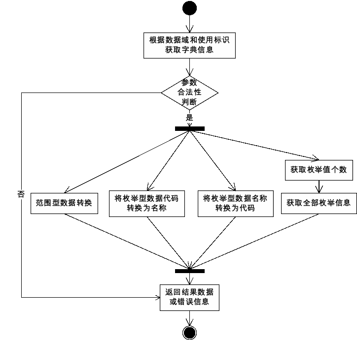
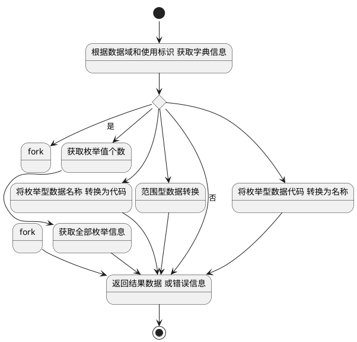
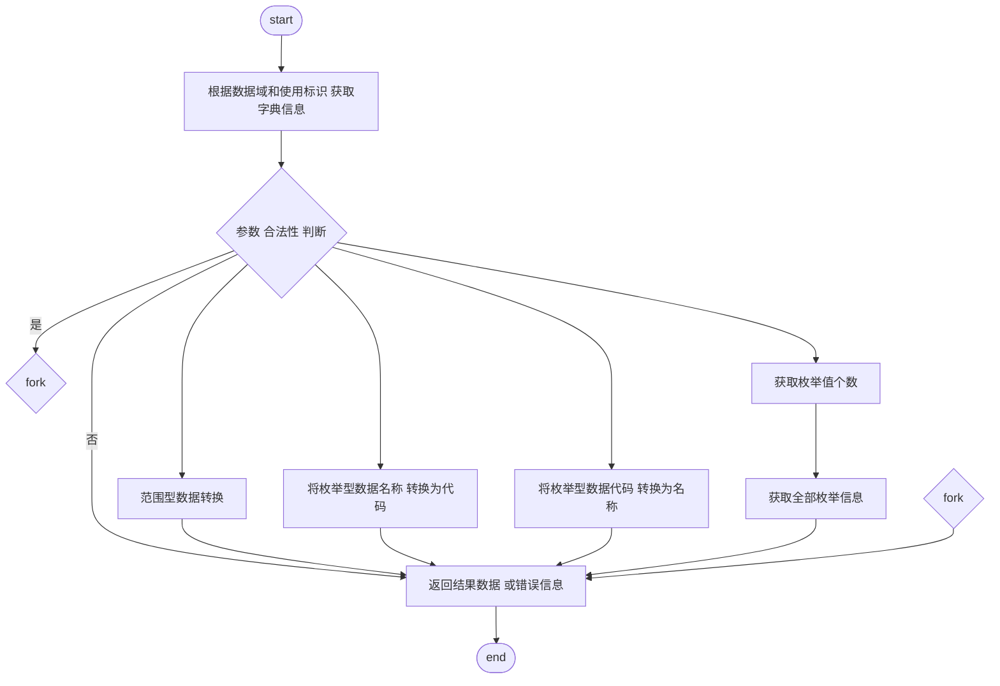

# 4_034 数据对档案

| 字段 | 值 |
|---|---|
| doc | 07报文处理服务软件需求规格说明-终稿 |
| section | 3.2.1.5 |
| image_caption | 图10 字典数据处理流程图 |
| table_caption | 表8 字典数据处理所有能力标识 |

## 原始图片


*图10 字典数据处理流程图*

## 结构图

*⚠ 结构经census重对齐: 旧锚点(oleObject9.bin:page1.xml)与图片不符, 已切换到与image.png内容一致的锚点(oleObject10.bin:page1.xml, align_score=1.0)*

*来源: born-digital导出(flowchart, 8节点/15边)*
*类型经几何启发式精化(Master类型识别失败的图, 投影层推断, canonical锚点不变)*

*状态图以PlantUML渲染(UML母语): [*]=起止 | 圆角框=状态 | 箭头标签=迁移事件*



<details><summary>Mermaid兼容投影(通用md渲染器可显示)</summary>



</details>

<details><summary>DOT源码(完整语义, graphviz可渲染)</summary>

```dot
digraph G {
  rankdir=TB;
  node [fontname="Microsoft YaHei"];
  N139 [shape=box, label="fork"];
  N146 [shape=circle, label="start"];
  N147 [shape=doublecircle, label="end"];
  N150 [shape=ellipse, label="获取枚举值个数"];
  N154 [shape=ellipse, label="将枚举型数据名称 转换为代码"];
  N161 [shape=ellipse, label="范围型数据转换"];
  N165 [shape=ellipse, label="返回结果数据 或错误信息"];
  N169 [shape=ellipse, label="将枚举型数据代码 转换为名称"];
  N175 [shape=box, label="fork"];
  N186 [shape=ellipse, label="根据数据域和使用标识 获取字典信息"];
  N192 [shape=ellipse, label="获取全部枚举信息"];
  N197 [shape=diamond, label="参数 合法性 判断"];
  N197 -> N139, label="是";
  N197 -> N165, label="否";
  N150 -> N192;
  N161 -> N165;
  N154 -> N165;
  N169 -> N165;
  N192 -> N165;
  N197 -> N154;
  N165 -> N147;
  N197 -> N150;
  N197 -> N169;
  N175 -> N165;
  N186 -> N197;
  N197 -> N161;
  N146 -> N186;
}
```

</details>

### 锚点节点结构

| # | 文本 | 类型 |
|---|---|---|
| 1 |   | fork |
| 2 |   | start |
| 3 |   | end |
| 4 | 获取枚举值个数 | state |
| 5 | 将枚举型数据名称
转换为代码 | state |
| 6 | 范围型数据转换 | state |
| 7 | 返回结果数据
或错误信息 | state |
| 8 | 将枚举型数据代码
转换为名称 | state |
| 9 |   | fork |
| 10 | 根据数据域和使用标识
获取字典信息 | state |
| 11 | 获取全部枚举信息 | state |
| 12 | 参数
合法性
判断 | decision |

## 表格内容

| 序号 | Use case 名称 | 项目唯一标识符 | 需求描述 | 需求重用 | 方式名称 | 运行状态 | 对应的任务书功能/性能 |
|---|---|---|---|---|---|---|---|
|   | 枚举型数据代码转换成名称 | PZXQ-GN-BWBJ-ZDCL- M | 根据字典数据，将枚举型数据的代码转换为对 | 沿用 | 桌面、平板、手持 | 开发、运行 | 4.1.1 |
|   | 枚举型数据名称转换成代码 | PZXQ-GN-BWBJ-ZDCL- M | 根据字典数据，将枚举型数据的名称转换为对 | 沿用 | 桌面、平板、手持 | 开发、运行 | 4.1.1 |
|   | 获取枚举型数据的枚举值个数 | PZXQ-GN-BWBJ-ZDCL- M | 根据字典数据，获取枚举型数据枚举值数量 | 沿用 | 桌面、平板、手持 | 开发、运行 | 4.1.1 |
|   | 获取枚举型数据的全部信息 | PZXQ-GN-BWBJ-ZDCL- M | 根据字典数据，获取枚举型数据的全部数据 | 沿用 | 桌面、平板、手持 | 开发、运行 | 4.1.1 |
|   | 范围型数据校验 | PZXQ-GN-BWBJ-ZDCL- F | 根据字典数据，校验范围型数据是否符合协议 | 沿用 | 桌面、平板、手持 | 开发、运行 | 4.1.1 |

## 正文

字典数据处理基于数据字典提供用户数据处理功能，为应用软件提供接口，能够将枚举型数据的代码转换成名称，能够将枚举型数据的名称转换成代码，能够获得枚举型字段的枚举值个数，能够获得枚举型字段的所有枚举值和相应VMF编码数组，能够检查范围型字段的用户数据是否正确，功能用例如图9所示。
