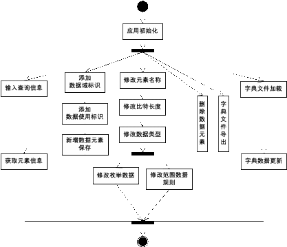
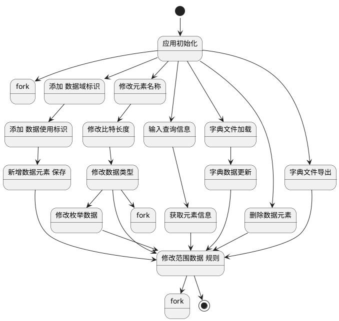
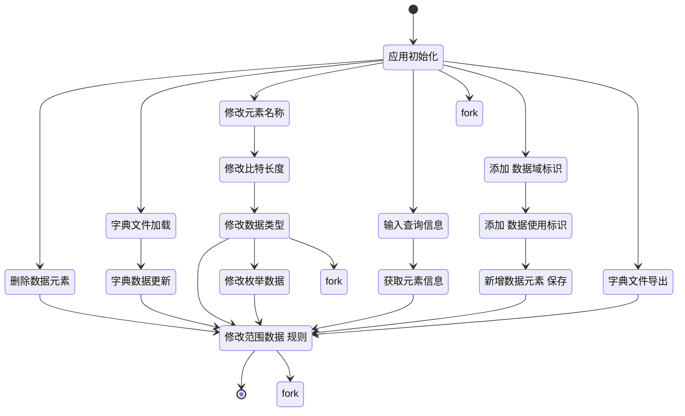
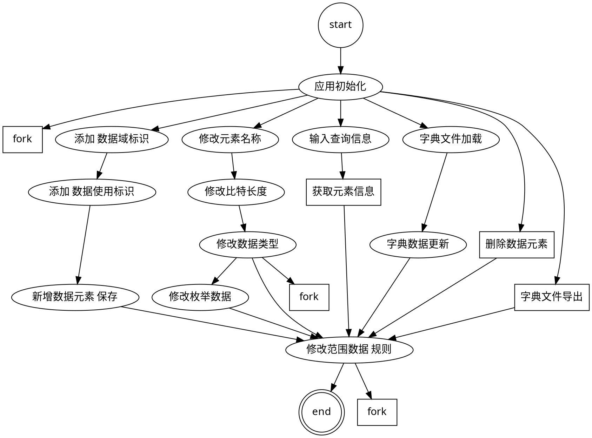

# 4_035 数据对档案

| 字段 | 值 |
|---|---|
| doc | 07报文处理服务软件需求规格说明-终稿 |
| section | 3.2.2 |
| image_caption | 图13 数据字典管理流程图 |

## 原始图片

*图13 数据字典管理流程图*

## 结构图

*⚠ 结构经census重对齐: 旧锚点(oleObject12.bin:page1.xml)与图片不符, 已切换到与image.png内容一致的锚点(oleObject13.bin:page1.xml, align_score=1.0)*

*来源: born-digital导出(state, 15节点/25边)*
*类型经几何启发式精化(Master类型识别失败的图, 投影层推断, canonical锚点不变)*

*状态图以PlantUML渲染(UML母语): [*]=起止 | 圆角框=状态 | 箭头标签=迁移事件*

Mermaid兼容投影(通用md渲染器可显示)

DOT源码(完整语义, graphviz可渲染)

*⚠ 锚点Connect重建存在1个悬空连线端点(线端粘在无文本形状上被语义过滤跳过), 图示边数可能少于原图——渲染只呈现锚点事实, 不编造边; 独立证据可对照VLM通道提取(scene_vlm_extractions.json)*

### 锚点节点结构

| # | 文本 | 类型 |
|---|---|---|
| 1 |   | fork |
| 2 |   | start |
| 3 |   | end |
| 4 | 添加
数据域标识 | state |
| 5 | 应用初始化 | state |
| 6 |   | fork |
| 7 | 添加
数据使用标识 | state |
| 8 | 新增数据元素
保存 | state |
| 9 | 修改数据类型 | state |
| 10 | 修改比特长度 | state |
| 11 | 修改元素名称 | state |
| 12 | 修改枚举数据 | state |
| 13 | 修改范围数据
规则 | state |
| 14 | 输入查询信息 | state |
| 15 | 字典文件加载 | state |
| … | 共20个节点 | |

## 表格内容

| 序号 | Use case名称 | 项目唯一标识符 | 需求描述 | 需求重用 | 方式名称 | 运行状态 | 对应的任务书功能/性能 |
|---|---|---|---|---|---|---|---|
|   | 数据元素新增 | PZXQ-GN-SJZD-XZYS | 支持开发人员根据数据协议新增数据元素 | 沿用 | 桌面 | 运行 | 4.1.2 |
|   | 数据元素编辑 | PZXQ-GN-SJZD-BJYS | 支持开发人员根据数据协议修改已存在的数据 | 沿用 | 桌面 | 运行 | 4.1.2 |
|   | 数据元素删除 | PZXQ-GN-SJZD-SCYS | 支持开发人员删除已存在的数据元素 | 沿用 | 桌面 | 运行 | 4.1.2 |
|   | 字典文件导入 | PZXQ-GN-SJZD-WJDR | 能够通过导入数据字典文件来更新数据库 | 沿用 | 桌面 | 运行 | 4.1.2 |
|   | 字典文件导出 | PZXQ-GN-SJZD-WJDC | 能够根据数据库中的内容导出对应的数据字典 | 沿用 | 桌面 | 运行 | 4.1.2 |
|   | 数据元素查找 | PZXQ-GN-SJZD-YSCZ | 能够根据DFI、DUI或者DUI名称查找 | 沿用 | 桌面 | 运行 | 4.1.2 |

## 正文

数据字典管理具有人机交互界面，为开发人员提供报文数据元素的管理能功，能够导出报文数据字典文件供报文编解码服务使用，能够导入数据字典文件更新数据库，能够新增数据元素，能够修改数据元素，能够删除数据元素，能够查询数据元素，其功能用例如图12所示。
