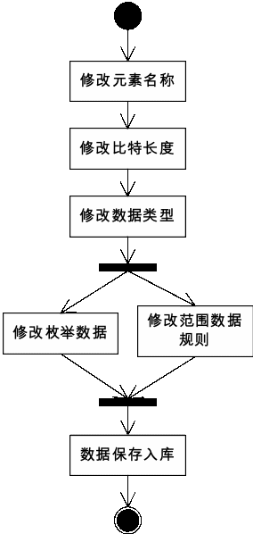
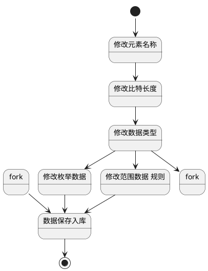
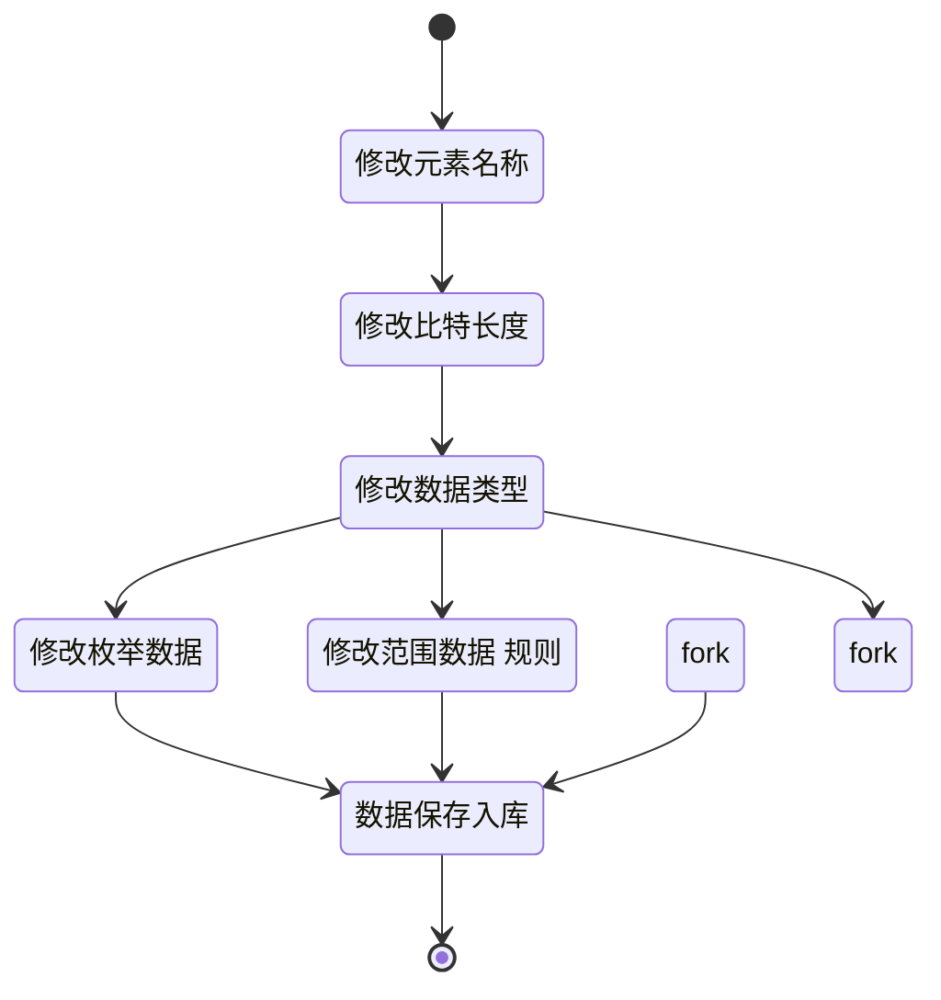
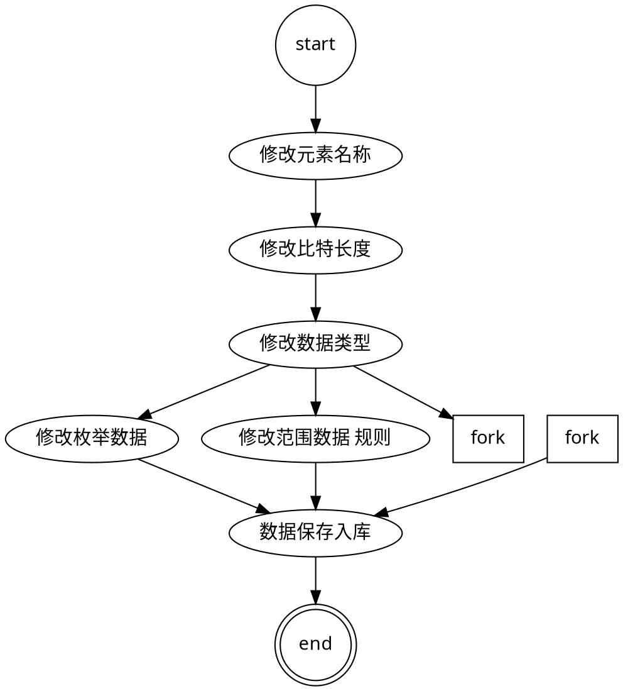

# 4_036 数据对档案

| 字段 | 值 |
|---|---|
| doc | 07报文处理服务软件需求规格说明-终稿 |
| section | 3.2.2.2 |
| image_caption | 图17 数据元素编辑流程图 |
| table_caption | 表19 数据元素编辑所有能力标识 |

## 原始图片

*图17 数据元素编辑流程图*

## 结构图

*⚠ 结构经census重对齐: 旧锚点(oleObject16.bin:page1.xml)与图片不符, 已切换到与image.png内容一致的锚点(oleObject17.bin:page1.xml, align_score=1.0)*

*来源: born-digital导出(state, 6节点/10边)*
*类型经几何启发式精化(Master类型识别失败的图, 投影层推断, canonical锚点不变)*

*状态图以PlantUML渲染(UML母语): [*]=起止 | 圆角框=状态 | 箭头标签=迁移事件*

Mermaid兼容投影(通用md渲染器可显示)

DOT源码(完整语义, graphviz可渲染)

### 锚点节点结构

| # | 文本 | 类型 |
|---|---|---|
| 1 |   | start |
| 2 |   | end |
| 3 |   | fork |
| 4 | 修改数据类型 | state |
| 5 | 修改比特长度 | state |
| 6 | 修改元素名称 | state |
| 7 | 修改枚举数据 | state |
| 8 | 修改范围数据
规则 | state |
| 9 |   | fork |
| 10 | 数据保存入库 | state |

## 表格内容

| 序号 | Use case 名称 | 项目唯一标识符 | 需求描述 | 需求重用 | 方式名称 | 运行状态 | 对应的任务书功能/性能 |
|---|---|---|---|---|---|---|---|
|   | 修改数据元素名称 | PZXQ-GN-SJZD-BJYS- M | 修改数据元素名称和变量名称 | 沿用 | 桌面 | 开发 | 4.1.2 |
|   | 修改比特长度 | PZXQ-GN-SJZD-BJYS- C | 按照数据协议，修改数据元素的比特长度 | 沿用 | 桌面 | 开发 | 4.1.2 |
|   | 修改数据类型 | PZXQ-GN-SJZD-BJYS- L | 修改数据元素的用户数据类型 | 沿用 | 桌面 | 开发 | 4.1.2 |
|   | 修改枚举型数据 | PZXQ-GN-SJZD-BJYS- M | 修改枚举型数据的枚举信息 | 沿用 | 桌面 | 开发 | 4.1.2 |
|   | 修改范围型数据 | PZXQ-GN-SJZD-BJYS- F | 修改范围型数据的数据规则 | 沿用 | 桌面 | 开发 | 4.1.2 |

## 正文

数据元素编辑提供用户修改数据元素内容的手段，主要包括修改元素名称、修改比特长度、修改数据类型、修改枚举型数据、修改范围型数据等功能，功能用例见图16。
