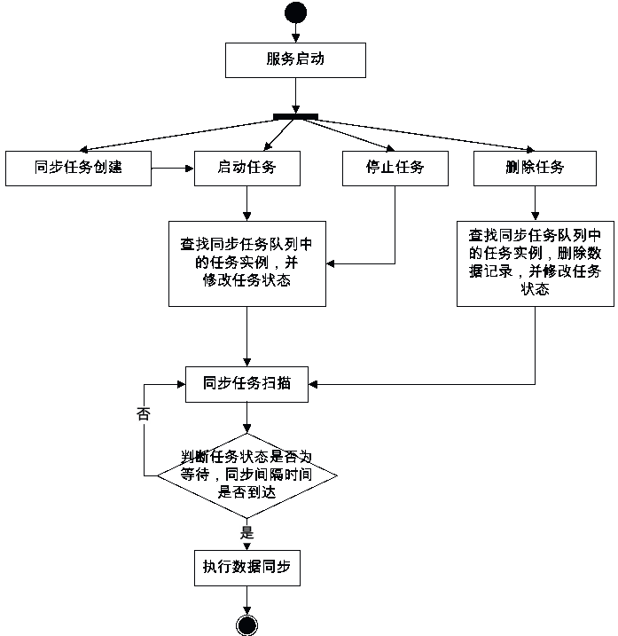
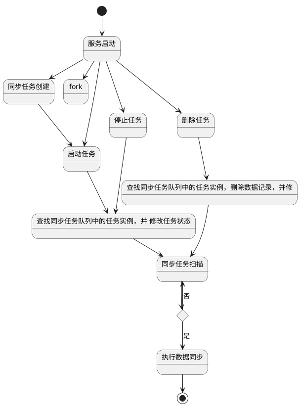
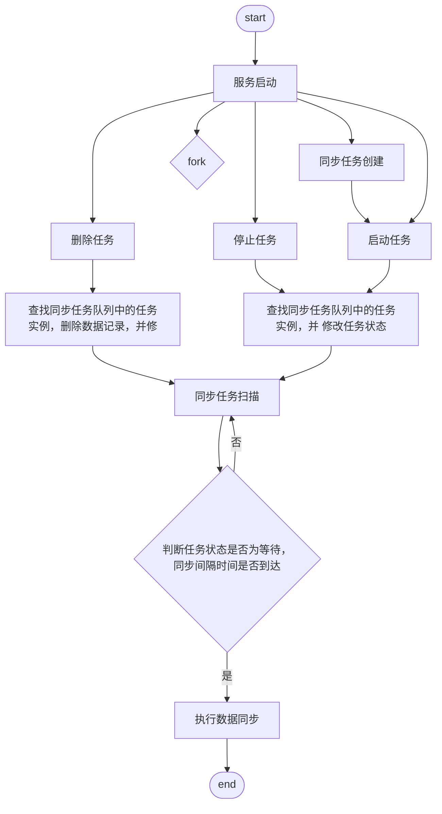

# 4_037 数据对档案

| 字段 | 值 |
|---|---|
| doc | 09数据同步共享服务软件需求规格说明-终稿 |
| section | 3.2.1.1.1 |
| image_caption | 图 13 同步任务管理流程图 |
| table_caption | 表 5同步任务管理功能能力标识 |

## 原始图片


*图 13 同步任务管理流程图*

## 结构图

*⚠ 结构经census重对齐: 旧锚点(oleObject12.bin:page1.xml)与图片不符, 已切换到与image.png内容一致的锚点(oleObject13.bin:page1.xml, align_score=1.0)*

*来源: born-digital导出(flowchart, 10节点/16边)*
*类型经几何启发式精化(Master类型识别失败的图, 投影层推断, canonical锚点不变)*

*状态图以PlantUML渲染(UML母语): [*]=起止 | 圆角框=状态 | 箭头标签=迁移事件*



<details><summary>Mermaid兼容投影(通用md渲染器可显示)</summary>



</details>

<details><summary>DOT源码(完整语义, graphviz可渲染)</summary>

```dot
digraph G {
  rankdir=TB;
  node [fontname="Microsoft YaHei"];
  N30 [shape=box, label="服务启动"];
  N31 [shape=box, label="同步任务创建"];
  N7 [shape=circle, label="start"];
  N9 [shape=box, label="fork"];
  N32 [shape=box, label="启动任务"];
  N38 [shape=box, label="停止任务"];
  N33 [shape=box, label="删除任务"];
  N35 [shape=box, label="查找同步任务队列中的任务实例，并 修改任务状态"];
  N36 [shape=box, label="同步任务扫描"];
  N17 [shape=diamond, label="判断任务状态是否为等待，同步间隔时间是否到达"];
  N37 [shape=box, label="执行数据同步"];
  N20 [shape=doublecircle, label="end"];
  N34 [shape=box, label="查找同步任务队列中的任务实例，删除数据记录，并修"];
  N17 -> N36, label="否";
  N31 -> N32;
  N34 -> N36;
  N33 -> N34;
  N38 -> N35;
  N32 -> N35;
  N35 -> N36;
  N37 -> N20;
  N30 -> N9;
  N30 -> N31;
  N30 -> N32;
  N30 -> N38;
  N30 -> N33;
  N17 -> N37, label="是";
  N36 -> N17;
  N7 -> N30;
}
```

</details>

### 锚点节点结构

| # | 文本 | 类型 |
|---|---|---|
| 1 | 服务启动 | process |
| 2 | 同步任务创建 | process |
| 3 |   | start |
| 4 |   | fork |
| 5 | 启动任务 | process |
| 6 | 停止任务 | process |
| 7 | 删除任务 | process |
| 8 | 查找同步任务队列中的任务实例，并
修改任务状态 | process |
| 9 | 同步任务扫描 | process |
| 10 | 判断任务状态是否为等待，同步间隔时间是否到达 | decision |
| 11 | 执行数据同步 | process |
| 12 |   | end |
| 13 | 查找同步任务队列中的任务实例，删除数据记录，并修 | process |

## 表格内容

| 序号 | Use case名称 | 项目唯一标识符 | 需求描述 | 需求重用 | 方式名称 | 运行状态 | 对应的任务书功能/性能 |
|---|---|---|---|---|---|---|---|
| 1 | 同步任务创建 | PZXQ-GN-SJTB-ZBZLTB- | 同步任务的创建； | 沿用 | 桌面 | 运行阶段 | 4.1.2.d |
| 2 | 同步任务列表展示 | PZXQ-GN-SJTB-ZBZLTB- | 同步任务列表展示； | 沿用 | 桌面 | 运行阶段 | 4.1.2.d |
| 3 | 同步任务停止 | PZXQ-GN-SJTB-ZBZLTB- | 同步任务提供停止功能； | 沿用 | 桌面 | 运行阶段 | 4.1.2.d |
| 4 | 同步任务启动 | PZXQ-GN-SJTB-ZBZLTB- | 同步任务启动功能； | 沿用 | 桌面 | 运行阶段 | 4.1.2.d |
| 5 | 同步任务删除 | PZXQ-GN-SJTB-ZBZLTB- | 同步任务删除功能 | 沿用 | 桌面 | 运行阶段 | 4.1.2.d |
| 6 | 同步任务详情展示 | PZXQ-GN-SJTB-ZBZLTB- | 同步任务详细信息展示功能 | 沿用 | 桌面 | 运行阶段 | 4.1.2.d |

## 正文

同步任务管理功能能力标识表，见表 5所示。
