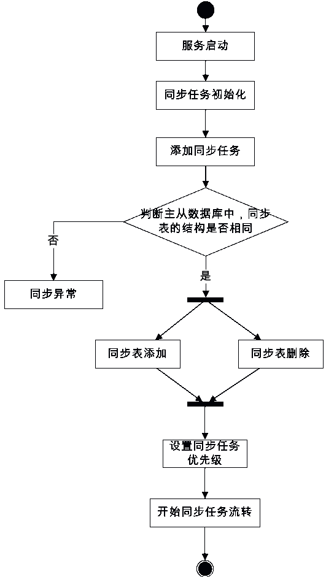
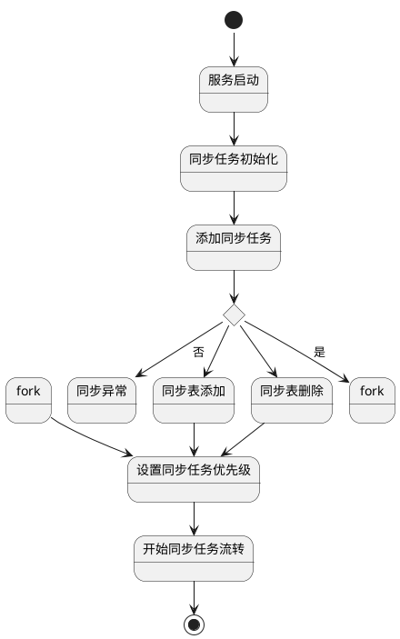
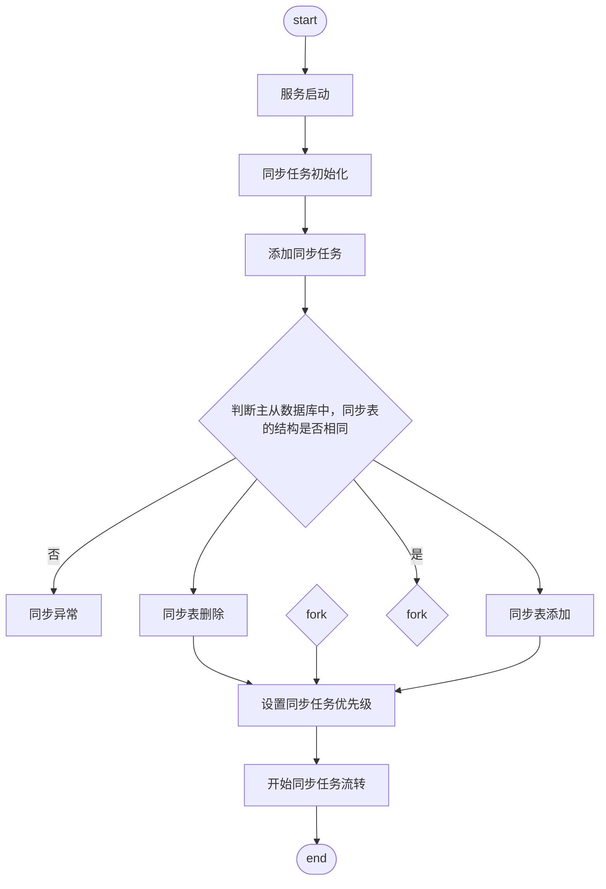

# 4_038 数据对档案

| 字段 | 值 |
|---|---|
| doc | 09数据同步共享服务软件需求规格说明-终稿 |
| section | 3.2.1.1.2 |
| image_caption | 图 15 同步表配置功能流程图 |
| table_caption | 表 12同步任务配置功能能力标识 |

## 原始图片


*图 15 同步表配置功能流程图*

## 结构图

*⚠ 结构经census重对齐: 旧锚点(oleObject14.bin:page1.xml)与图片不符, 已切换到与image.png内容一致的锚点(oleObject15.bin:page1.xml, align_score=1.0)*

*来源: born-digital导出(flowchart, 9节点/13边)*
*类型经几何启发式精化(Master类型识别失败的图, 投影层推断, canonical锚点不变)*

*状态图以PlantUML渲染(UML母语): [*]=起止 | 圆角框=状态 | 箭头标签=迁移事件*



<details><summary>Mermaid兼容投影(通用md渲染器可显示)</summary>



</details>

<details><summary>DOT源码(完整语义, graphviz可渲染)</summary>

```dot
digraph G {
  rankdir=TB;
  node [fontname="Microsoft YaHei"];
  N26 [shape=box, label="服务启动"];
  N2 [shape=circle, label="start"];
  N33 [shape=box, label="同步任务初始化"];
  N27 [shape=box, label="添加同步任务"];
  N9 [shape=diamond, label="判断主从数据库中，同步表的结构是否相同"];
  N28 [shape=box, label="同步异常"];
  N31 [shape=box, label="同步表添加"];
  N15 [shape=doublecircle, label="end"];
  N30 [shape=box, label="同步表删除"];
  N17 [shape=box, label="fork"];
  N32 [shape=box, label="开始同步任务流转"];
  N34 [shape=box, label="设置同步任务优先级"];
  N36 [shape=box, label="fork"];
  N30 -> N34;
  N34 -> N32;
  N36 -> N34;
  N31 -> N34;
  N9 -> N30;
  N9 -> N31;
  N9 -> N17, label="是";
  N9 -> N28, label="否";
  N2 -> N26;
  N26 -> N33;
  N32 -> N15;
  N33 -> N27;
  N27 -> N9;
}
```

</details>

### 锚点节点结构

| # | 文本 | 类型 |
|---|---|---|
| 1 | 服务启动 | process |
| 2 |   | start |
| 3 | 同步任务初始化 | process |
| 4 | 添加同步任务 | process |
| 5 | 判断主从数据库中，同步表的结构是否相同 | decision |
| 6 | 同步异常 | process |
| 7 | 同步表添加 | process |
| 8 |   | end |
| 9 | 同步表删除 | process |
| 10 |   | fork |
| 11 | 开始同步任务流转 | process |
| 12 | 设置同步任务优先级 | process |
| 13 |   | fork |

## 表格内容

| 序号 | Use case名称 | 项目唯一标识符 | 需求描述 | 需求重用 | 方式名称 | 运行状态 | 对应的任务书功能/性能 |
|---|---|---|---|---|---|---|---|
| 1 | 同步表检索 | PZXQ-GN-SJTB-ZBZLTB- | 主备服务器同步数据表检索功能 | 沿用 | 桌面 | 运行阶段 | 4.1.2.b |
| 2 | 同步表添加 | PZXQ-GN-SJTB-ZBZLTB- | 主备服务器同步数据表添加功能 | 沿用 | 桌面 | 运行阶段 | 4.1.2.b |
| 3 | 同步表删除 | PZXQ-GN-SJTB-ZBZLTB- | 主备服务器同步数据表删除功能 | 沿用 | 桌面 | 运行阶段 | 4.1.2.b |
| 4 | 同步任务优先级配置 | PZXQ-GN-SJTB-ZBZLTB- | 主备服务器同步任务优先级配置功能 | 沿用 | 桌面 | 运行阶段 | 4.1.2.c |

## 正文

同步任务配置功能包括同步表检索、同步表添加、同步表删除和同步任务优先级配置功能。同步任务配置功能用例图如图 14所示。
