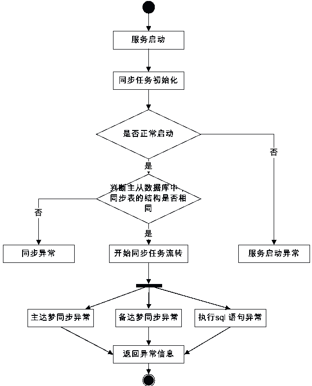
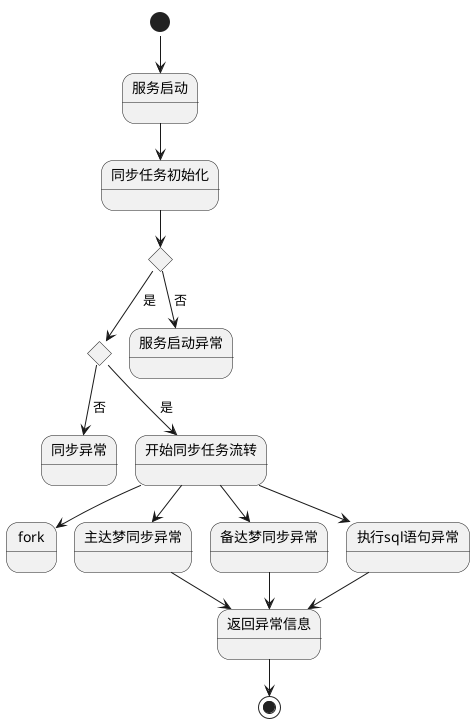
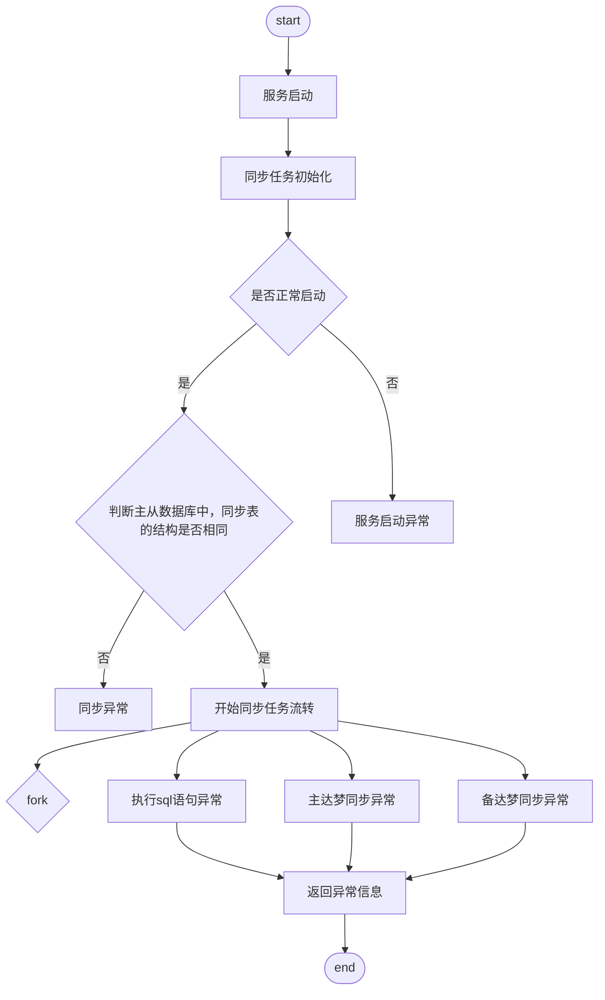

# 4_039 数据对档案

| 字段 | 值 |
|---|---|
| doc | 09数据同步共享服务软件需求规格说明-终稿 |
| section | 3.2.1.1.3 |
| image_caption | 图 17 异常处理流程图 |
| table_caption | 表 17异常处理功能能力标识 |

## 原始图片


*图 17 异常处理流程图*

## 结构图

*⚠ 结构经census重对齐: 旧锚点(oleObject16.bin:page1.xml)与图片不符, 已切换到与image.png内容一致的锚点(oleObject17.bin:page1.xml, align_score=1.0)*

*来源: born-digital导出(flowchart, 11节点/15边)*
*类型经几何启发式精化(Master类型识别失败的图, 投影层推断, canonical锚点不变)*

*状态图以PlantUML渲染(UML母语): [*]=起止 | 圆角框=状态 | 箭头标签=迁移事件*



<details><summary>Mermaid兼容投影(通用md渲染器可显示)</summary>



</details>

<details><summary>DOT源码(完整语义, graphviz可渲染)</summary>

```dot
digraph G {
  rankdir=TB;
  node [fontname="Microsoft YaHei"];
  N29 [shape=box, label="服务启动"];
  N2 [shape=circle, label="start"];
  N30 [shape=box, label="同步任务初始化"];
  N7 [shape=diamond, label="判断主从数据库中，同步表的结构是否相同"];
  N31 [shape=box, label="同步异常"];
  N32 [shape=box, label="开始同步任务流转"];
  N15 [shape=box, label="fork"];
  N34 [shape=box, label="主达梦同步异常"];
  N35 [shape=box, label="备达梦同步异常"];
  N36 [shape=box, label="执行sql语句异常"];
  N37 [shape=box, label="返回异常信息"];
  N22 [shape=doublecircle, label="end"];
  N33 [shape=box, label="服务启动异常"];
  N26 [shape=diamond, label="是否正常启动"];
  N37 -> N22;
  N26 -> N7, label="是";
  N32 -> N15;
  N32 -> N36;
  N32 -> N35;
  N7 -> N32, label="是";
  N2 -> N29;
  N29 -> N30;
  N7 -> N31, label="否";
  N26 -> N33, label="否";
  N36 -> N37;
  N34 -> N37;
  N35 -> N37;
  N32 -> N34;
  N30 -> N26;
}
```

</details>

### 锚点节点结构

| # | 文本 | 类型 |
|---|---|---|
| 1 | 服务启动 | process |
| 2 |   | start |
| 3 | 同步任务初始化 | process |
| 4 | 判断主从数据库中，同步表的结构是否相同 | decision |
| 5 | 同步异常 | process |
| 6 | 开始同步任务流转 | process |
| 7 |   | fork |
| 8 | 主达梦同步异常 | process |
| 9 | 备达梦同步异常 | process |
| 10 | 执行sql语句异常 | process |
| 11 | 返回异常信息 | process |
| 12 |   | end |
| 13 | 服务启动异常 | process |
| 14 | 是否正常启动 | decision |

## 表格内容

| 序号 | Use case名称 | 项目唯一标识符 | 需求描述 | 需求重用 | 方式名称 | 运行状态 | 对应的任务书功能/性能 |
|---|---|---|---|---|---|---|---|
| 1 | 服务启动异常 | PZXQ-GN-SJTB-ZBZLTB- | 记录主备服务器数据同步服务启动异常 | 沿用 | 桌面 | 运行阶段 | 4.1.2.e |
| 2 | 主达梦库同步异常 | PZXQ-GN-SJTB-ZBZLTB- | 记录主备服务器数据同步主服务器数据库异常 | 沿用 | 桌面 | 运行阶段 | 4.1.2.e |
| 3 | 备达梦库同步异常 | PZXQ-GN-SJTB-ZBZLTB- | 记录主备服务器数据同步备服务器数据库异常 | 沿用 | 桌面 | 运行阶段 | 4.1.2.e |
| 4 | 执行sql语句异常 | PZXQ-GN-SJTB-ZBZLTB- | 记录主备服务器数据同步中执行sql语句异 | 沿用 | 桌面 | 运行阶段 | 4.1.2.e |

## 正文

异常处理功能能力标识表，见表 17所示。
