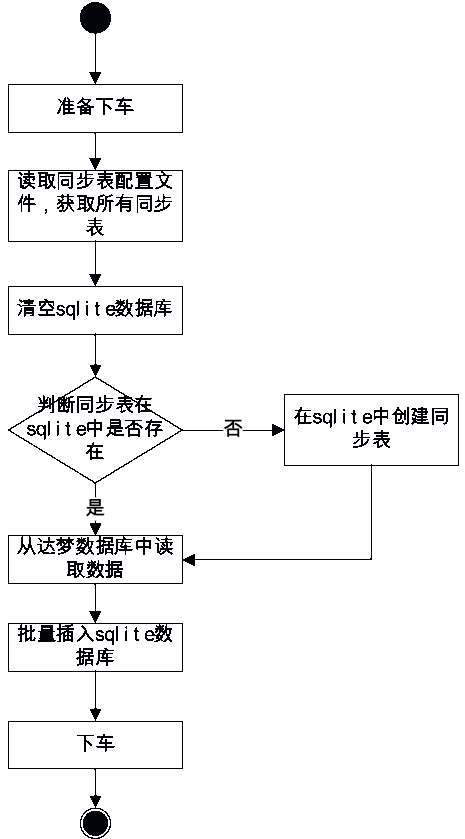
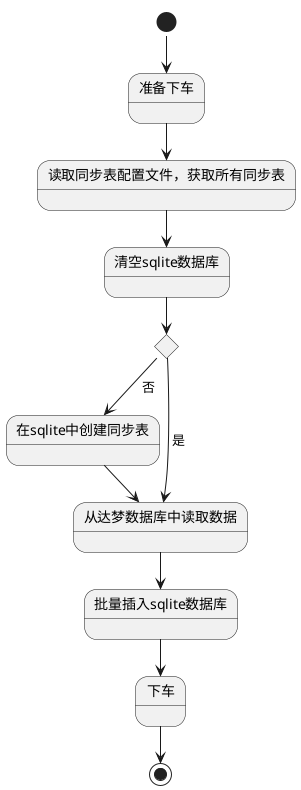
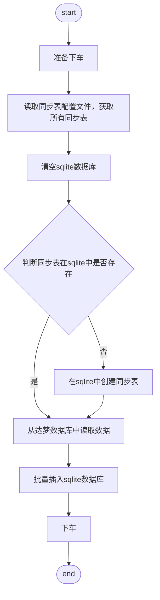

# 4_040 数据对档案

| 字段 | 值 |
|---|---|
| doc | 09数据同步共享服务软件需求规格说明-终稿 |
| section | 3.2.1.2 |
| image_caption | 图 19数据下载流程图 |
| table_caption | 表 22数据下载能力标识表 |

## 原始图片


*图 19数据下载流程图*

## 结构图

*⚠ 结构经census重对齐: 旧锚点(oleObject18.bin:page1.xml)与图片不符, 已切换到与image.png内容一致的锚点(oleObject19.bin:page1.xml, align_score=1.0)*

*来源: born-digital导出(flowchart, 8节点/10边)*
*类型经几何启发式精化(Master类型识别失败的图, 投影层推断, canonical锚点不变)*

*状态图以PlantUML渲染(UML母语): [*]=起止 | 圆角框=状态 | 箭头标签=迁移事件*



<details><summary>Mermaid兼容投影(通用md渲染器可显示)</summary>



</details>

<details><summary>DOT源码(完整语义, graphviz可渲染)</summary>

```dot
digraph G {
  rankdir=TB;
  node [fontname="Microsoft YaHei"];
  N23 [shape=box, label="读取同步表配置文件，获取所有同步表"];
  N24 [shape=box, label="清空sqlite数据库"];
  N5 [shape=diamond, label="判断同步表在sqlite中是否存在"];
  N25 [shape=box, label="在sqlite中创建同步表"];
  N26 [shape=box, label="从达梦数据库中读取数据"];
  N27 [shape=box, label="批量插入sqlite数据库"];
  N22 [shape=box, label="准备下车"];
  N28 [shape=box, label="下车"];
  N18 [shape=circle, label="start"];
  N20 [shape=doublecircle, label="end"];
  N28 -> N20;
  N18 -> N22;
  N22 -> N23;
  N27 -> N28;
  N26 -> N27;
  N23 -> N24;
  N24 -> N5;
  N5 -> N25, label="否";
  N5 -> N26, label="是";
  N25 -> N26;
}
```

</details>

### 锚点节点结构

| # | 文本 | 类型 |
|---|---|---|
| 1 | 读取同步表配置文件，获取所有同步表 | process |
| 2 | 清空sqlite数据库 | process |
| 3 | 判断同步表在sqlite中是否存在 | decision |
| 4 | 在sqlite中创建同步表 | process |
| 5 | 从达梦数据库中读取数据 | process |
| 6 | 批量插入sqlite数据库 | process |
| 7 | 准备下车 | process |
| 8 | 下车 | process |
| 9 |   | start |
| 10 |   | end |

## 表格内容

| 序号 | Use case名称 | 项目唯一标识符 | 需求描述 | 需求重用 | 状态/方式名称 | 运行状态 | 对应的任务书功能/性能 |
|---|---|---|---|---|---|---|---|
| 1 | 数据下载初始化 | PZXQ-GN-SJTB-SJXZ-CS | 实现主服务器的数据库(达梦数据库)到席位 | 新研 | 桌面、平板 | 运行阶段 | 4.1.2.f |
| 2 | 数据下载 | PZXQ-GN-SJTB-SJXZ-SJ | 实现主服务器的数据库(达梦数据库)到席位 | 新研 | 桌面、平板 | 运行阶段 | 4.1.2.f |
| 3 | 数据下载关闭 | PZXQ-GN-SJTB-SJXZ-SJ | 实现主服务器的数据库(达梦数据库)到席位 | 新研 | 桌面、平板 | 运行阶段 | 4.1.2.f |

## 正文

主服务器数据库到席位sqlite数据库数据下载流程图如图 19所示。
