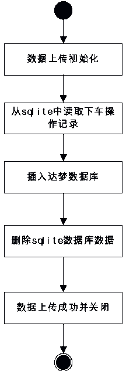
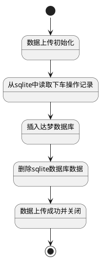
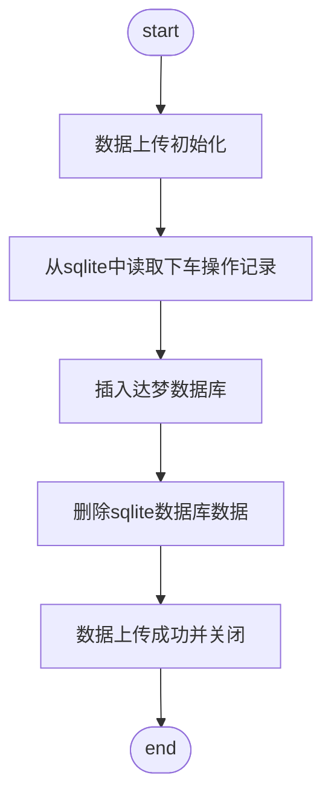
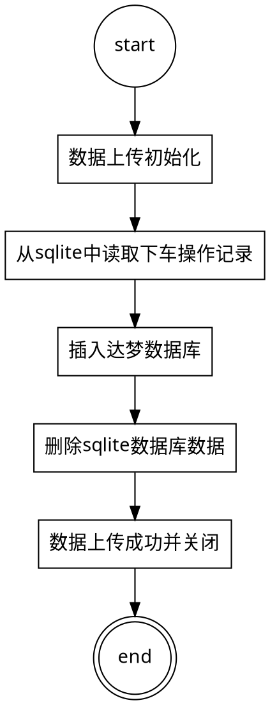

# 4_041 数据对档案

| 字段 | 值 |
|---|---|
| doc | 09数据同步共享服务软件需求规格说明-终稿 |
| section | 3.2.1.3 |
| image_caption | 图 21数据上传流程图 |
| table_caption | 表 26数据上传能力标识表 |

## 原始图片

*图 21数据上传流程图*

## 结构图

*⚠ 结构经census重对齐: 旧锚点(oleObject20.bin:page1.xml)与图片不符, 已切换到与image.png内容一致的锚点(oleObject21.bin:page1.xml, align_score=1.0)*

*来源: born-digital导出(flowchart, 5节点/6边)*
*类型经几何启发式精化(Master类型识别失败的图, 投影层推断, canonical锚点不变)*

*状态图以PlantUML渲染(UML母语): [*]=起止 | 圆角框=状态 | 箭头标签=迁移事件*

Mermaid兼容投影(通用md渲染器可显示)

DOT源码(完整语义, graphviz可渲染)

### 锚点节点结构

| # | 文本 | 类型 |
|---|---|---|
| 1 | 从sqlite中读取下车操作记录 | process |
| 2 | 插入达梦数据库 | process |
| 3 | 数据上传初始化 | process |
| 4 | 数据上传成功并关闭 | process |
| 5 |   | start |
| 6 |   | end |
| 7 | 删除sqlite数据库数据 | process |

## 表格内容

| 序号 | Use case名称 | 项目唯一标识符 | 需求描述 | 需求重用 | 状态/方式名称 | 运行状态 | 对应的任务书功能/性能 |
|---|---|---|---|---|---|---|---|
| 1 | 数据上传初始化 | PZXQ-GN-SJTB-SJSC-CS | 席位数据库（sqlite数据库）到主服务 | 新研 | 桌面、平板 | 运行阶段 | 4.1.2.g |
| 2 | 增量数据上传 | PZXQ-GN-SJTB-SJSC-ZL | 席位数据库（sqlite数据库）到主服务 | 新研 | 桌面、平板 | 运行阶段 | 4.1.2.g |
| 3 | 增量数据上传关闭 | PZXQ-GN-SJTB-SJSC-ZL | 席位数据库（sqlite数据库）到主服务 | 新研 | 桌面、平板 | 运行阶段 | 4.1.2.g |

## 正文

数据上传能力标识表，见表 26所示。
