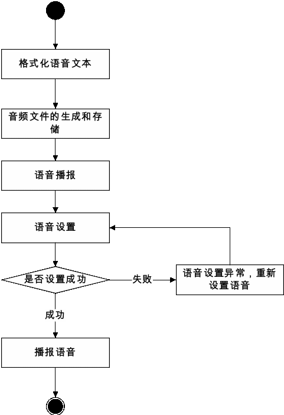
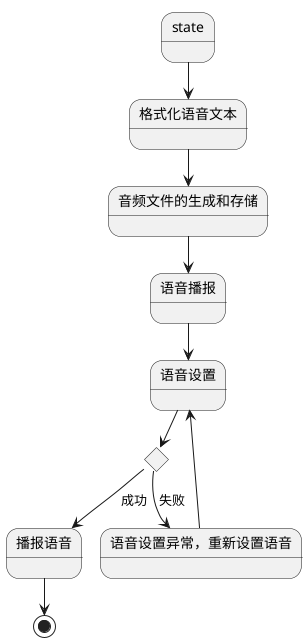
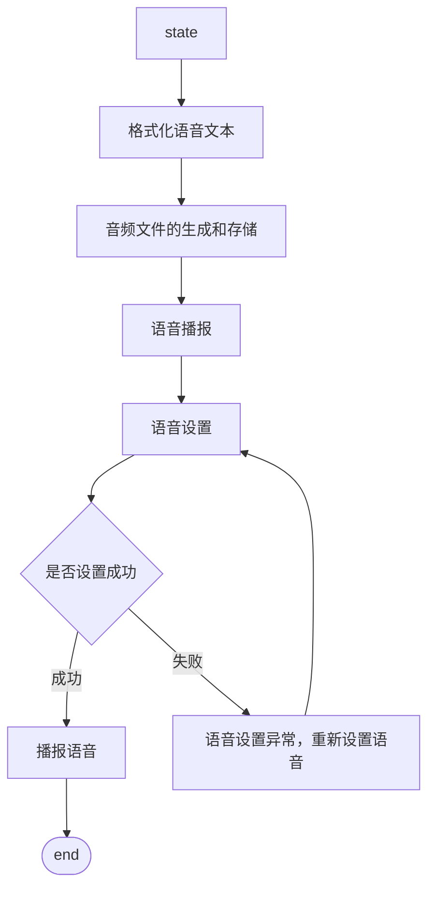

# 4_042 数据对档案

| 字段 | 值 |
|---|---|
| doc | 11语音综合处理软件需求规格说明-终稿 |
| section | 3.2 |
| image_caption | 图 5 语音合成流程图 |
| table_caption | 表3 语音合成能力标识 |

## 原始图片


*图 5 语音合成流程图*

## 结构图

*⚠ 结构经census重对齐: 旧锚点(oleObject4.bin:page1.xml)与图片不符, 已切换到与image.png内容一致的锚点(oleObject5.bin:page1.xml, align_score=1.0)*

*来源: born-digital导出(flowchart, 7节点/9边)*
*类型经几何启发式精化(Master类型识别失败的图, 投影层推断, canonical锚点不变)*

*状态图以PlantUML渲染(UML母语): [*]=起止 | 圆角框=状态 | 箭头标签=迁移事件*



<details><summary>Mermaid兼容投影(通用md渲染器可显示)</summary>



</details>

<details><summary>DOT源码(完整语义, graphviz可渲染)</summary>

```dot
digraph G {
  rankdir=TB;
  node [fontname="Microsoft YaHei"];
  N592 [shape=box, label="格式化语音文本"];
  N593 [shape=box, label="音频文件的生成和存储"];
  N594 [shape=diamond, label="是否设置成功"];
  N613 [shape=ellipse, label="state"];
  N614 [shape=doublecircle, label="end"];
  N620 [shape=box, label="语音播报"];
  N622 [shape=box, label="语音设置"];
  N624 [shape=box, label="播报语音"];
  N625 [shape=box, label="语音设置异常，重新设置语音"];
  N625 -> N622;
  N624 -> N614;
  N622 -> N594;
  N613 -> N592;
  N592 -> N593;
  N593 -> N620;
  N594 -> N625, label="失败";
  N594 -> N624, label="成功";
  N620 -> N622;
}
```

</details>

### 锚点节点结构

| # | 文本 | 类型 |
|---|---|---|
| 1 | 格式化语音文本 | process |
| 2 | 音频文件的生成和存储 | process |
| 3 | 是否设置成功 | decision |
| 4 |   | state |
| 5 |   | end |
| 6 | 语音播报 | process |
| 7 | 语音设置 | process |
| 8 | 播报语音 | process |
| 9 | 语音设置异常，重新设置语音 | process |

## 表格内容

| 序号 | Use case名称 | 项目唯一标识符 | 需求描述 | 需求重用 | 方式 名称 | 运行 状态 | 对应的任务书功能/性能 |
|---|---|---|---|---|---|---|---|
| 1 | 格式化文本语音合成 | PZXQ-GN-YYZHCL-YYHC- | 提供格式化文本信息向语音信息转换的语音合 | 新研 | 桌面、平板、手持 | 运行阶段 | 4.1.1a) |
| 2 | 音频文件生成和存储 | PZXQ-GN-YYZHCL-YYHC- | 能够将合成的语音转换成wav格式音频文件 | 新研 | 桌面、平板、手持 | 运行阶段 | 4.1.1b) |
| 3 | 语音播报 | PZXQ-GN-YYZHCL-YYHC- | 能够对本地wav音频和合成的wav音频进 | 新研 | 桌面、平板、手持 | 运行阶段 | 4.1.1c) |
| 4 | 语音设置 | PZXQ-GN-YYZHCL-YYHC- | 可进行人声选择（男声、女声），进行语音播 | 新研 | 桌面、平板、手持 | 运行阶段 | 4.1.1d) |

## 正文

语音合成的主要功能包括：格式化文本语音合成、音频文件生成和存储、语音播报、语音设置，功能用例如图4所示。
