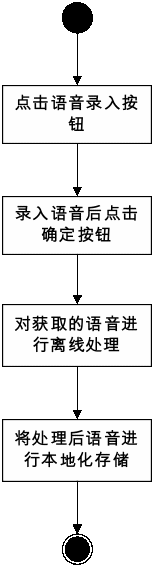
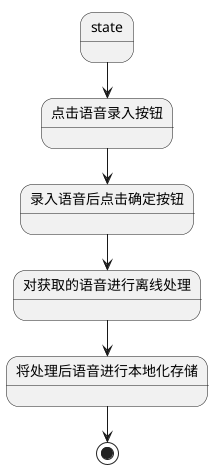
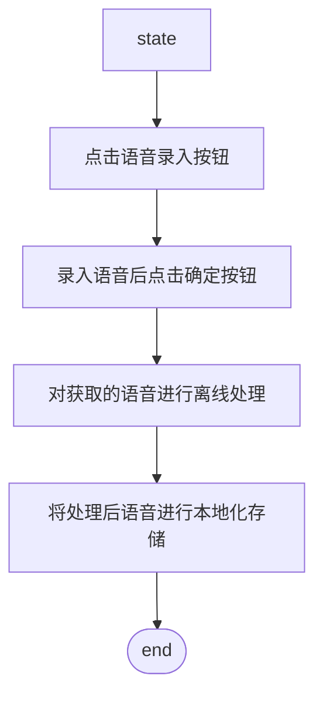
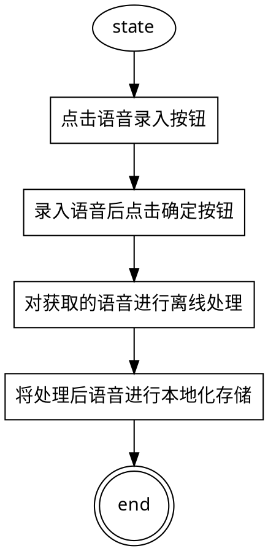

# 4_043 数据对档案

| 字段 | 值 |
|---|---|
| doc | 11语音综合处理软件需求规格说明-终稿 |
| section | 3.2 |
| image_caption | 图 10 语音识别流程图 |
| table_caption | 表 8语音识别能力标识 |

## 原始图片

*图 10 语音识别流程图*

## 结构图

*⚠ 结构经census重对齐: 旧锚点(oleObject2.bin:page1.xml)与图片不符, 已切换到与image.png内容一致的锚点(oleObject10.bin:page1.xml, align_score=1.0)*

*来源: born-digital导出(flowchart, 4节点/5边)*
*类型经几何启发式精化(Master类型识别失败的图, 投影层推断, canonical锚点不变)*

*状态图以PlantUML渲染(UML母语): [*]=起止 | 圆角框=状态 | 箭头标签=迁移事件*

Mermaid兼容投影(通用md渲染器可显示)

DOT源码(完整语义, graphviz可渲染)

### 锚点节点结构

| # | 文本 | 类型 |
|---|---|---|
| 1 | 点击语音录入按钮 | process |
| 2 | 录入语音后点击确定按钮 | process |
| 3 |   | state |
| 4 |   | end |
| 5 | 对获取的语音进行离线处理 | process |
| 6 | 将处理后语音进行本地化存储 | process |

## 表格内容

| 序号 | Use case名称 | 项目唯一标识符 | 需求描述 | 需求重用 | 方式名称 | 运行 状态 | 对应的任务书功能/性能 |
|---|---|---|---|---|---|---|---|
| 1 | 语音录入 | PZXQ-GN-YYZHCL-YYSB- | 提供语音录入的功能 | 新研 | 桌面、平板、手持 | 运行阶段 | 4.1.2a) |
| 2 | 文本规范化 | PZXQ-GN-YYZHCL-YYSB- | 对语音转换成的文本格式进行规范化定义，实 | 新研 | 桌面、平板、手持 | 运行阶段 | 4.1.2c) |
| 3 | 离线语音识别 | PZXQ-GN-YYZHCL-YYSB- | 支持离线条件下实时语音识别 | 新研 | 桌面、平板、手持 | 运行阶段 | 4.1.2b) |

## 正文

语音识别的主要功能包括：语音录入、文本规范化、离线语音识别，功能用例如图 9所示。
