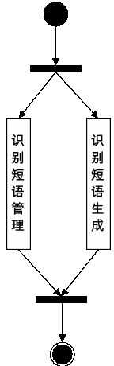
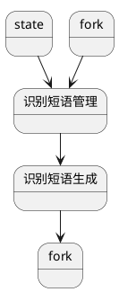
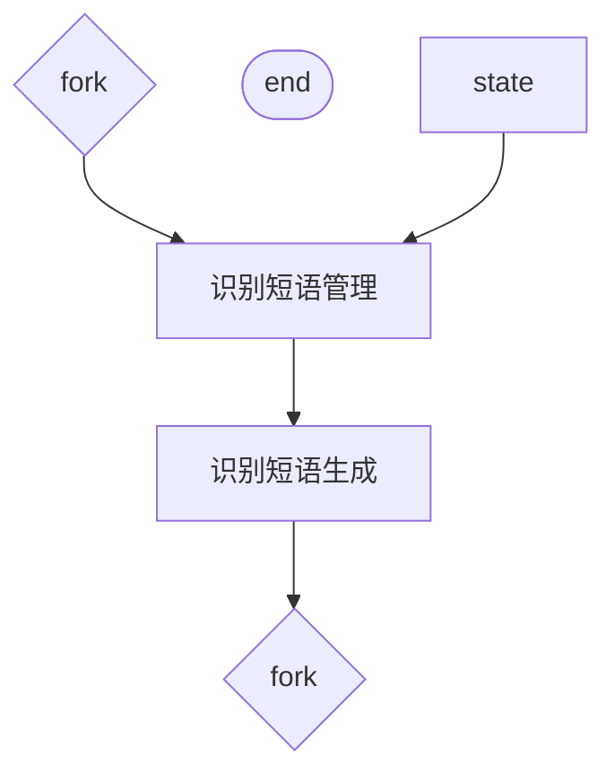
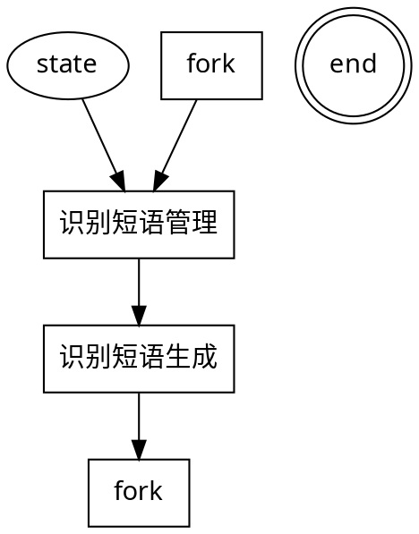

# 4_044 数据对档案

| 字段 | 值 |
|---|---|
| doc | 11语音综合处理软件需求规格说明-终稿 |
| section | 3.2 |
| image_caption | 图 15 语音短语识别流程图 |
| table_caption | 表2 语音综合处理软件所有能力标识 |

## 原始图片

*图 15 语音短语识别流程图*

## 结构图

*来源: born-digital导出(flowchart, 2节点/4边)*

*状态图以PlantUML渲染(UML母语): [*]=起止 | 圆角框=状态 | 箭头标签=迁移事件*

Mermaid兼容投影(通用md渲染器可显示)

DOT源码(完整语义, graphviz可渲染)

*⚠ 锚点Connect重建存在1个悬空连线端点(线端粘在无文本形状上被语义过滤跳过), 图示边数可能少于原图——渲染只呈现锚点事实, 不编造边; 独立证据可对照VLM通道提取(scene_vlm_extractions.json)*

### 锚点节点结构

| # | 文本 | 类型 |
|---|---|---|
| 1 |   | state |
| 2 |   | end |
| 3 | 识别短语管理 | process |
| 4 | 识别短语生成 | process |
| 5 |   | fork |
| 6 |   | fork |

## 表格内容

| 序号 | Use case名称 | 项目唯一标识符 | 需求描述 | 需求重用 | 方式名称 | 运行状态 | 对应的任务书功能/性能 |
|---|---|---|---|---|---|---|---|
| 1 | 语音合成 | PZXQ-GN-YYZHCL -YYHC | 提供格式化文本信息向语音信息转换的语音合 | 新研 | 手持、桌面、平板 | 运行阶段 | 4.1.1 |
| 2 | 语音识别 | PZXQ-GN-YYZHCL -YYSB | 提供语音录入功能，能够将语音信息转换为w | 无 | 手持、桌面、平板 | 运行阶段 | 4.1.2 4.2 a) |
| 3 | 识别短语定制 | PZXQ-GN-YYZHCL -SBDY | 提供识别短语的管理功能，支持用户按照需求 | 无 | 桌面 | 集成阶段、运行阶段 | 4.1.3 4.2 b） |

## 正文

语音综合处理软件按照其功能需求，包含语音合成、语音识别、识别短语的定制的功能，见图2所示。
