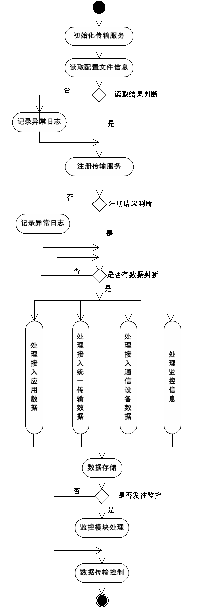
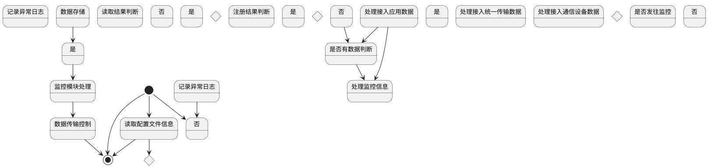
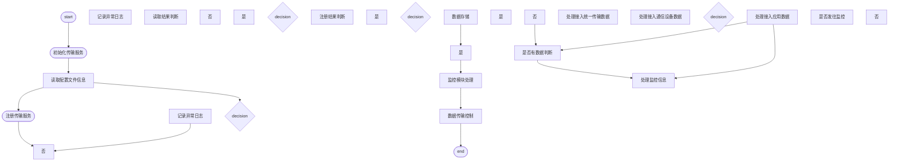
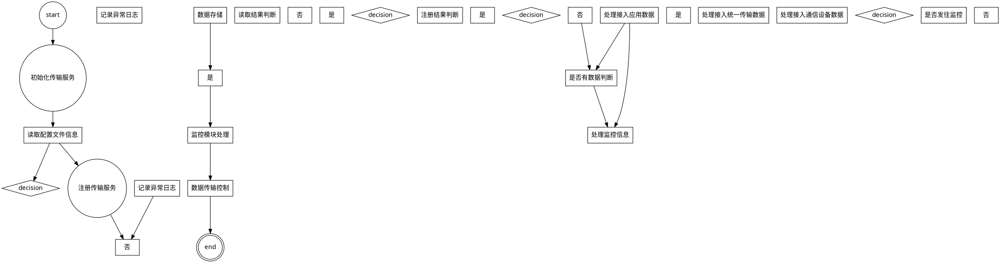

# 4_045 数据对档案

| 字段 | 值 |
|---|---|
| doc | 14传输服务软件需求规格说明-终稿 |
| section | 3.2 |
| image_caption | 图3 传输服务软件流程图 |
| table_caption | 表2 传输服务软件所有能力标识 |

## 原始图片

*图3 传输服务软件流程图*

## 结构图

*⚠ 结构经census重对齐: 旧锚点(oleObject8.bin:page1.xml)与图片不符, 已切换到与image.png内容一致的锚点(oleObject3.bin:page1.xml, align_score=0.667)*

*来源: born-digital导出(flowchart, 24节点/14边)*
*类型经几何启发式精化(Master类型识别失败的图, 投影层推断, canonical锚点不变)*

*状态图以PlantUML渲染(UML母语): [*]=起止 | 圆角框=状态 | 箭头标签=迁移事件*

Mermaid兼容投影(通用md渲染器可显示)

DOT源码(完整语义, graphviz可渲染)

### 锚点节点结构

| # | 文本 | 类型 |
|---|---|---|
| 1 |   | start |
| 2 | 记录异常日志 | process |
| 3 | 读取配置文件信息 | process |
| 4 |   | end |
| 5 |   | decision |
| 6 | 读取结果判断 | other |
| 7 | 否 | other |
| 8 | 是 | other |
| 9 |   | decision |
| 10 | 记录异常日志 | process |
| 11 | 注册结果判断 | other |
| 12 | 否 | other |
| 13 | 是 | other |
| 14 |   | decision |
| 15 | 是否有数据判断 | other |
| … | 共30个节点 | |

## 表格内容

| 序号 | Use case名称 | 项目唯一标识符 | 需求描述 | 需求重用 | 方式 | 对应的任务书功能/性能 |
|---|---|---|---|---|---|---|
| 1 | 数据传输 | PZXQ-GN-SJCS | 应用软件可进行格式化数据收发，具有数据优 | 沿用 | 桌面版、平板版、手持版 | 4.1.4/4.2 a)b) |
| 2 | 数据监控 | PZXQ-GN-SJJK | 具备监控收发端数据传输协议信息和正文信息 | 沿用 | 桌面版、平板版、手持版 | 4.1.5/4.2 a)b) |
| 3 | 参数配置 | PZXQ-GN-CSPZ | 应用软件可在传输服务运行条件下，对传输时 | 沿用 | 桌面版、平板版、手持版 | 4.1.6/4.2 a)b) |
| 4 | 数据存储 | PZXQ-GN-SJCC | 具备在带宽拥堵的状态下，对数据进行缓存， | 沿用 | 桌面版、平板版、手持版 | 4.1.2/4.2 a)b) |
| 5 | 通信设备状态监控 | PZXQ-GN-ZTJK | 具备监控通信设备状态情况的能力，动态响应 | 沿用 | 桌面版、平板版、手持版 | 4.1.3/4.2 a)b) |
| 6 | 数据接入 | PZXQ-GN-SJJR | 支持将业务软件数据报文根据通信设备协议， | 沿用 | 桌面版、平板版、手持版 | 4.1.1/4.2 a)b) |

## 正文

传输服务软件按照其功能需求，包含数据传输控制、数据监控、参数配置、数据存储、通信设备状态监控、数据接入功能。传输服务软件功能图，见图1所示。
