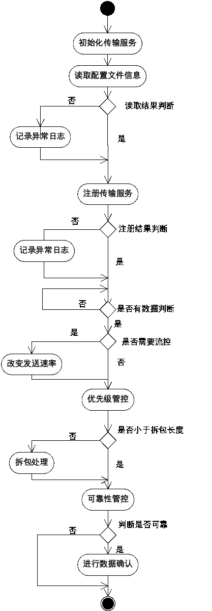

# 4_046 数据对档案

| 字段 | 值 |
|---|---|
| doc | 14传输服务软件需求规格说明-终稿 |
| section | 3.2.1 |
| image_caption | 图5 数据传输控制流程图 |
| table_caption | 表3 数据收发所有能力标识 |

## 原始图片

*图5 数据传输控制流程图*

## 结构图

*该对无Visio锚点(非Visio图, 无born-digital导出)*

## 表格内容

| 序号 | Use case名称 | 项目唯一标识符 | 需求描述 | 需求重用 | 方式 | 运行状态 | 对应的任务书功能/性能 |
|---|---|---|---|---|---|---|---|
| 1 | 优先级管控 | PZXQ-GN-SJCSKZ-YXJGK | 能够根据发送数据的优先级，保证高优先级数 | 沿用 | 桌面版、平板版、手持版 | 运行阶段 | 4.1.4 a) /4.2 a)b) |
| 2 | 可靠性管控 | PZXQ-GN-SJCSKZ-KKXGK | 能够通过部分确认和完全确认的机制，完成可 | 沿用 | 桌面版、平板版、手持版 | 运行阶段 | 4.1.4 b) /4.2 a)b) |
| 3 | 流量管控 | PZXQ-GN-SJCSKZ-LLGK | 能够根据通信设备流量管控能力，自动调节数 | 沿用 | 桌面版、平板版、手持版 | 运行阶段 | 4.1.4 c) /4.2 a)b) |
| 4 | 拆包重组 | PZXQ-GN-SJCSKZ-CBCZ | 能够根据报文长度进行数据拆包、按序重组； | 沿用 | 桌面版、平板版、手持版 | 运行阶段 | 4.1.4 d) /4.2 a)b) |

## 正文

数据收发功能包括格式化数据收发、优先级管控、可靠性管控、流量管控、拆包重组、与统一传输服务互通，其功能用例如图4所示。
