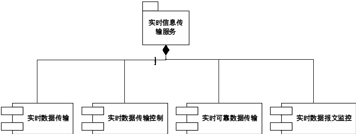
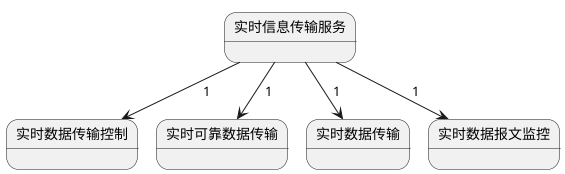
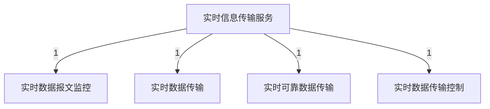

# 4_047 数据对档案

| 字段 | 值 |
|---|---|
| doc | 15实时信息传输服务软件需求规格说明-终稿 |
| section | 3.2 |
| image_caption | 图1实时信息传输服务软件活动图 |
| table_caption | 表2实时信息传输服务软件所有能力标识 |

## 原始图片


*图1实时信息传输服务软件活动图*

## 结构图

*来源: born-digital导出(flowchart, 5节点/4边)*
*类型经几何启发式精化(Master类型识别失败的图, 投影层推断, canonical锚点不变)*

*状态图以PlantUML渲染(UML母语): [*]=起止 | 圆角框=状态 | 箭头标签=迁移事件*



<details><summary>Mermaid兼容投影(通用md渲染器可显示)</summary>



</details>

<details><summary>DOT源码(完整语义, graphviz可渲染)</summary>

```dot
digraph G {
  rankdir=TB;
  node [fontname="Microsoft YaHei"];
  N5002 [shape=box, label="实时信息传输服务"];
  N5005 [shape=box, label="实时数据传输控制"];
  N5010 [shape=box, label="实时可靠数据传输"];
  N5025 [shape=box, label="实时数据传输"];
  N5045 [shape=box, label="实时数据报文监控"];
  N5002 -> N5045, label="1";
  N5002 -> N5025, label="1";
  N5002 -> N5010, label="1";
  N5002 -> N5005, label="1";
}
```

</details>

### 锚点节点结构

| # | 文本 | 类型 |
|---|---|---|
| 1 | 实时信息传输服务 | process |
| 2 | 实时数据传输控制 | process |
| 3 | 实时可靠数据传输 | process |
| 4 | 实时数据传输 | process |
| 5 | 实时数据报文监控 | process |

## 表格内容

| 序号 | Use case名称 | 项目唯一标识符 | 需求描述 | 需求重用 | 方式名称 | 运行状态 | 对应的任务书功能/性能 |
|---|---|---|---|---|---|---|---|
| 1 | 实时数据传输 | PZXQ-GN-SSSJCS | 具备实时数据传输的能力。 | 沿用 | 桌面版、平板版 | 运行阶段 | 4.1.1 |
| 2 | 实时数据传输控制 | PZXQ-GN-SSSJCSKZ | 具备实时数据传输控制的能力。 | 沿用 | 桌面版、平板版 | 运行阶段 | 4.1.2 |
| 3 | 实时可靠数据传输 | PZXQ-GN-SSKKSJCS | 具备实时可靠数据和文件的传输能力 | 沿用 | 桌面版、平板版 | 运行阶段 | 4.1.3 |
| 4 | 实时数据报文监控 | PZXQ-GN-SSSJBWJK | 具备监控收发端数据传输协议信息和正文信息 | 沿用 | 桌面版、平板版 | 运行阶段 | 4.1.4 |

## 正文

实时信息传输服务软件按照其功能需求，包含实时数据传输、实时数据传输控制、实时可靠数据传输、实时数据报文监控功能。
