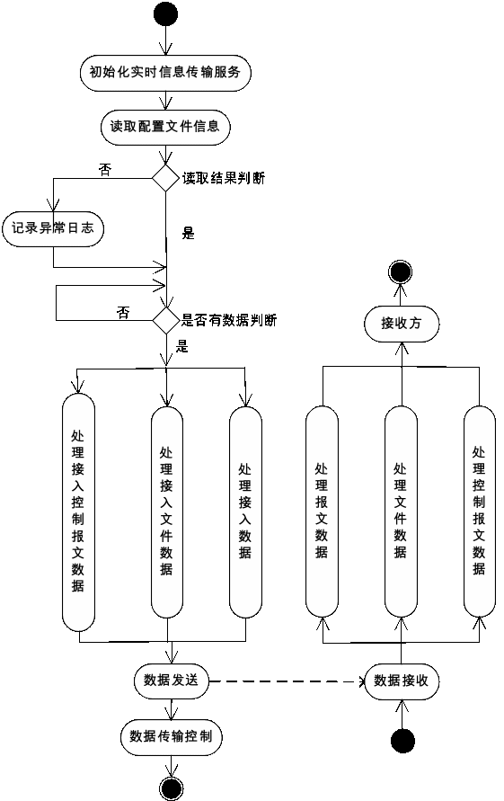
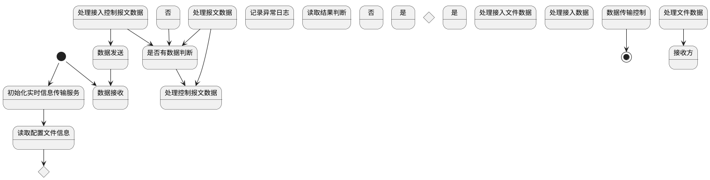
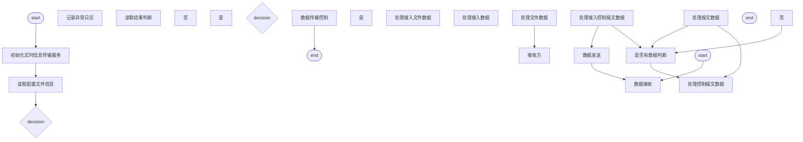
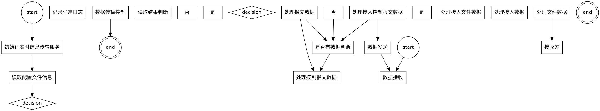

# 4_048 数据对档案

| 字段 | 值 |
|---|---|
| doc | 15实时信息传输服务软件需求规格说明-终稿 |
| section | 3.2 |
| image_caption | 图3实时信息传输服务软件流程图 |
| table_caption | 表2实时信息传输服务软件所有能力标识 |

## 原始图片

*图3实时信息传输服务软件流程图*

## 结构图

*⚠ 结构经census重对齐: 旧锚点(oleObject2.bin:page1.xml)与图片不符, 已切换到与image.png内容一致的锚点(oleObject3.bin:page1.xml, align_score=0.789)*

*来源: born-digital导出(flowchart, 19节点/13边)*
*类型经几何启发式精化(Master类型识别失败的图, 投影层推断, canonical锚点不变)*

*状态图以PlantUML渲染(UML母语): [*]=起止 | 圆角框=状态 | 箭头标签=迁移事件*

Mermaid兼容投影(通用md渲染器可显示)

DOT源码(完整语义, graphviz可渲染)

### 锚点节点结构

| # | 文本 | 类型 |
|---|---|---|
| 1 |   | start |
| 2 | 初始化实时信息传输服务 | process |
| 3 | 记录异常日志 | process |
| 4 | 读取配置文件信息 | process |
| 5 |   | end |
| 6 |   | decision |
| 7 | 读取结果判断 | other |
| 8 | 否 | other |
| 9 | 是 | other |
| 10 |   | decision |
| 11 | 是否有数据判断 | other |
| 12 | 否 | other |
| 13 | 是 | other |
| 14 | 处理接入文件数据 | other |
| 15 | 处理接入数据 | other |
| … | 共25个节点 | |

## 表格内容

| 序号 | Use case名称 | 项目唯一标识符 | 需求描述 | 需求重用 | 方式名称 | 运行状态 | 对应的任务书功能/性能 |
|---|---|---|---|---|---|---|---|
| 1 | 实时数据传输 | PZXQ-GN-SSSJCS | 具备实时数据传输的能力。 | 沿用 | 桌面版、平板版 | 运行阶段 | 4.1.1 |
| 2 | 实时数据传输控制 | PZXQ-GN-SSSJCSKZ | 具备实时数据传输控制的能力。 | 沿用 | 桌面版、平板版 | 运行阶段 | 4.1.2 |
| 3 | 实时可靠数据传输 | PZXQ-GN-SSKKSJCS | 具备实时可靠数据和文件的传输能力 | 沿用 | 桌面版、平板版 | 运行阶段 | 4.1.3 |
| 4 | 实时数据报文监控 | PZXQ-GN-SSSJBWJK | 具备监控收发端数据传输协议信息和正文信息 | 沿用 | 桌面版、平板版 | 运行阶段 | 4.1.4 |

## 正文

实时信息传输服务软件按照其功能需求，包含实时数据传输、实时数据传输控制、实时可靠数据传输、实时数据报文监控功能。
