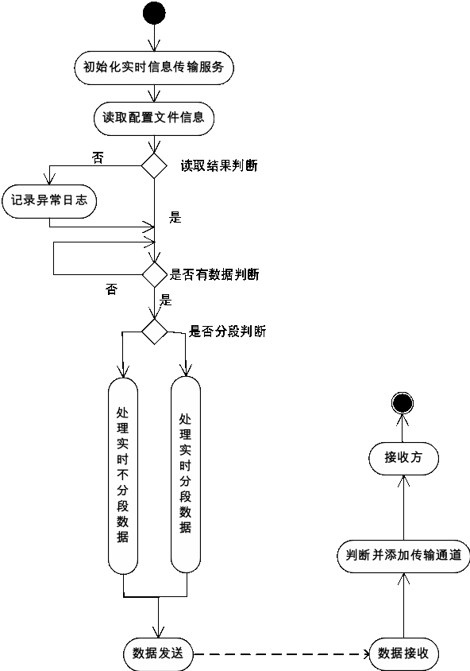
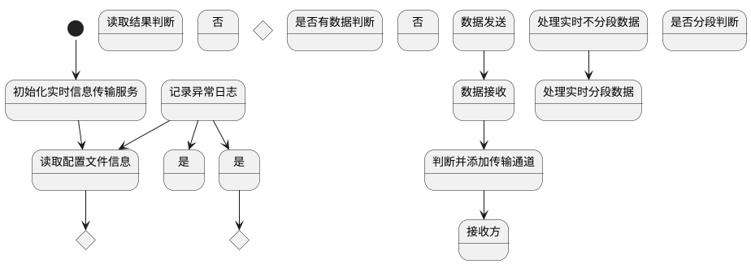
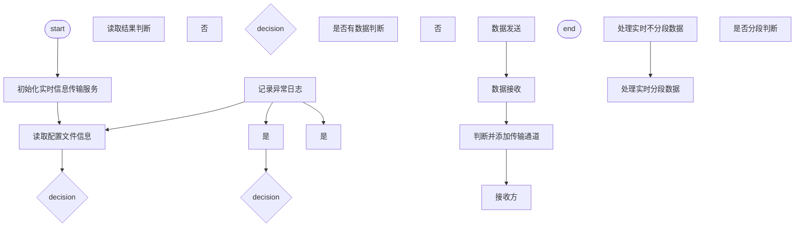
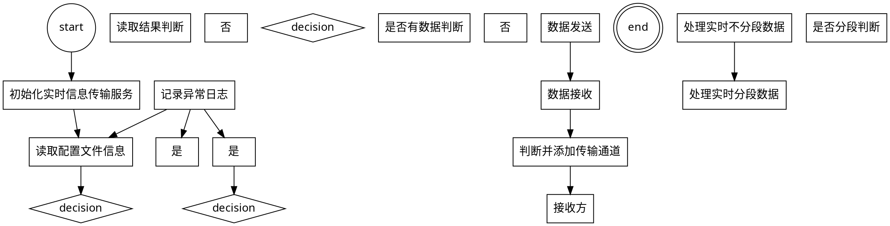

# 4_049 数据对档案

| 字段 | 值 |
|---|---|
| doc | 15实时信息传输服务软件需求规格说明-终稿 |
| section | 3.2.1 |
| image_caption | 图5实时数据传输流程图 |
| table_caption | 表3实时数据传输所有能力标识 |

## 原始图片

*图5实时数据传输流程图*

## 结构图

*⚠ 结构经census重对齐: 旧锚点(oleObject4.bin:page1.xml)与图片不符, 已切换到与image.png内容一致的锚点(oleObject5.bin:page1.xml, align_score=0.75)*

*来源: born-digital导出(flowchart, 16节点/11边)*
*类型经几何启发式精化(Master类型识别失败的图, 投影层推断, canonical锚点不变)*

*状态图以PlantUML渲染(UML母语): [*]=起止 | 圆角框=状态 | 箭头标签=迁移事件*

Mermaid兼容投影(通用md渲染器可显示)

DOT源码(完整语义, graphviz可渲染)

### 锚点节点结构

| # | 文本 | 类型 |
|---|---|---|
| 1 |   | start |
| 2 | 初始化实时信息传输服务 | process |
| 3 | 记录异常日志 | process |
| 4 | 读取配置文件信息 | process |
| 5 |   | decision |
| 6 | 读取结果判断 | other |
| 7 | 否 | other |
| 8 | 是 | other |
| 9 |   | decision |
| 10 | 是否有数据判断 | other |
| 11 | 否 | other |
| 12 | 是 | other |
| 13 | 数据发送 | process |
| 14 | 数据接收 | process |
| 15 | 判断并添加传输通道 | process |
| … | 共21个节点 | |

## 表格内容

| 序号 | Use case名称 | 项目唯一标识符 | 需求描述 | 需求重用 | 方式名称 | 运行状态 | 对应的任务书功能/性能 |
|---|---|---|---|---|---|---|---|
|   | 数据UDP不分段传输 | PZXQ-GN-SSSJCS-SJUDP | 能够支撑实时信息数据的不分段UDP传输 | 沿用 | 桌面版、平板版 | 运行阶段 | 4.1.1 a) |
|   | 数据UDP分段传输 | PZXQ-GN-SSSJCS-SJUDP | 能够支撑实时信息数据的分段UDP传输； | 沿用 | 桌面版、平板版 | 运行阶段 | 4.1.1 b) |

## 正文

实时数据传输包括数据UDP不分段传输、数据UDP分段传输，其功能用例如图4所示。
