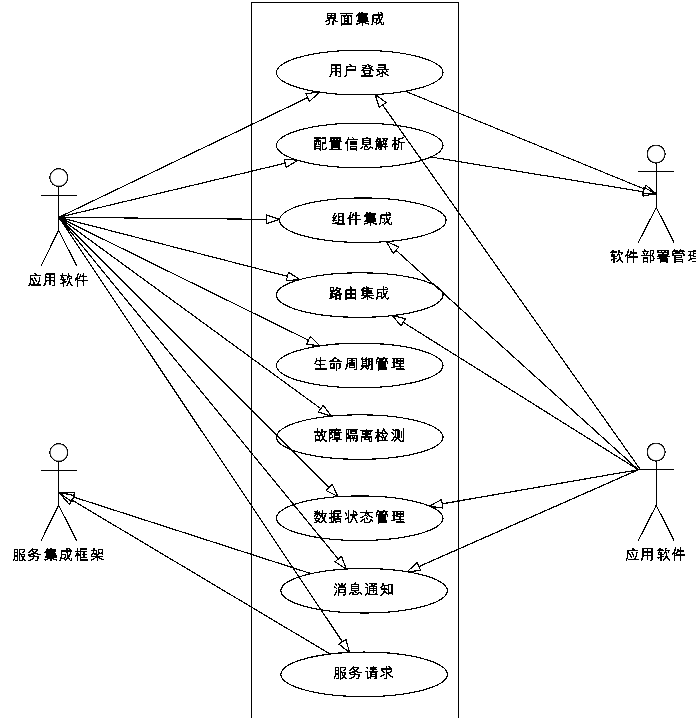
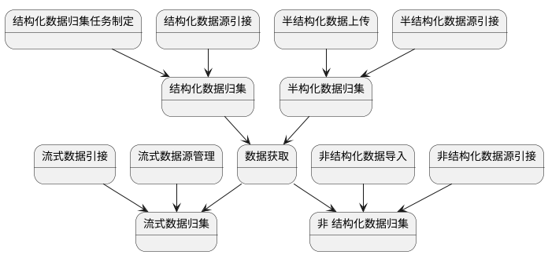
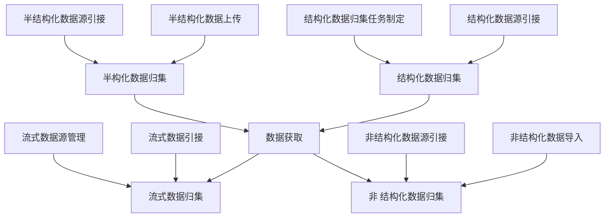
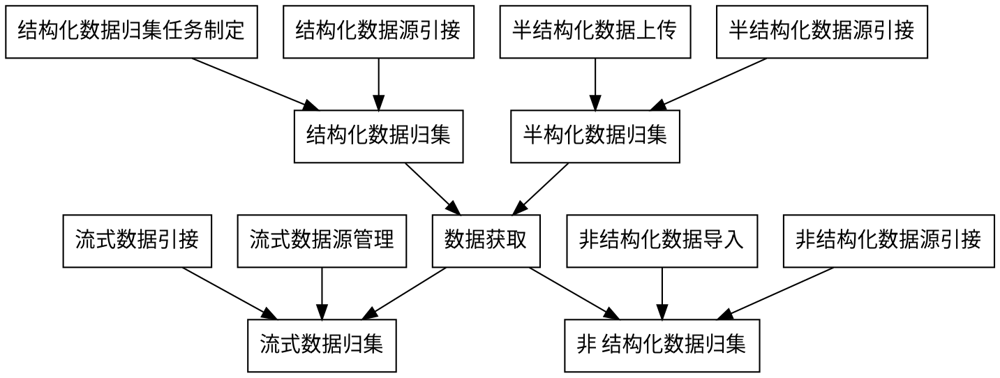

# 5_001 数据对档案

| 字段 | 值 |
|---|---|
| doc | 01数据获取转换分系统需求规格说明-终稿 |
| section | 3.2.1.3.1 |
| image_caption | 图 4 结构化数据归集能力组成图 |
| table_caption | 表4 结构化数据归集功能需求 |

## 原始图片

*图 4 结构化数据归集能力组成图*

## 结构图

*来源: born-digital导出(flowchart, 13节点/12边)*
*类型经几何启发式精化(Master类型识别失败的图, 投影层推断, canonical锚点不变)*

*状态图以PlantUML渲染(UML母语): [*]=起止 | 圆角框=状态 | 箭头标签=迁移事件*

Mermaid兼容投影(通用md渲染器可显示)

DOT源码(完整语义, graphviz可渲染)

### 锚点节点结构

| # | 文本 | 类型 |
|---|---|---|
| 1 | 数据获取 | process |
| 2 | 流式数据归集 | process |
| 3 | 结构化数据归集任务制定 | process |
| 4 | 结构化数据源引接 | process |
| 5 | 结构化数据归集 | process |
| 6 | 半构化数据归集 | process |
| 7 | 非
结构化数据归集 | process |
| 8 | 半结构化数据上传 | process |
| 9 | 半结构化数据源引接 | process |
| 10 | 非结构化数据导入 | process |
| 11 | 非结构化数据源引接 | process |
| 12 | 流式数据引接 | process |
| 13 | 流式数据源管理 | process |

## 表格内容

| 序号 | 子功能名称/标识 | 功能描述 | 优先级 |
|---|---|---|---|
| 1 | 结构化数据归集任务制定/ZZSJHQZH | 支持从某数据中台引接获取静态数据和动态报 | 高 |
| 2 | 结构化数据源引接/ZZSJHQZHFW- | 支持自定义结构化数据源，提供结构化数据源 | 中 |

## 正文

结构化数据归集能够面向各类结构化数据提供数据归集功能。结构化数据归集功能组成如图 4所示。
