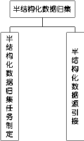
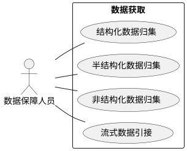
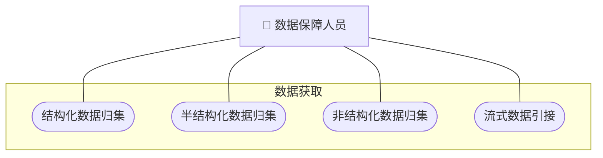
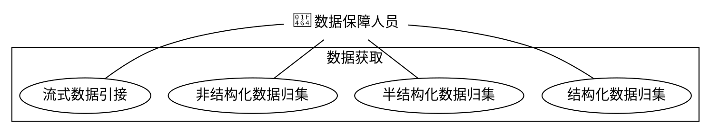

# 5_002 数据对档案

| 字段 | 值 |
|---|---|
| doc | 01数据获取转换分系统需求规格说明-终稿 |
| section | 3.2.1.4.1 |
| image_caption | 图 5 半结构化数据归集能力组成图 |
| table_caption | 表7 半结构化数据归集功能需求 |

## 原始图片

*图 5 半结构化数据归集能力组成图*

## 结构图

*来源: born-digital导出(usecase, 6节点/4边)*
*类型经几何启发式精化(Master类型识别失败的图, 投影层推断, canonical锚点不变)*

*用例图以PlantUML渲染(UML母语): 小人=参与者 | 椭圆=用例 | 矩形框=系统边界 | 实线=关联 | 虚线=include/extend*

Mermaid兼容投影(通用md渲染器可显示)

DOT源码(完整语义, graphviz可渲染)

### 锚点节点结构

| # | 文本 | 类型 |
|---|---|---|
| 1 | 数据获取 | boundary |
| 2 | 结构化数据归集 | usecase |
| 3 | 半结构化数据归集 | usecase |
| 4 | 数据保障人员 | actor |
| 5 | 非结构化数据归集 | usecase |
| 6 | 流式数据引接 | usecase |

## 表格内容

| 序号 | 子功能名称/标识 | 功能描述 | 优先级 |
|---|---|---|---|
| 1 | 半结构化数据归集任务制定/ZZSJHQZ | 提供半结构化数据上传功能，能够根据模型应 | 高 |
| 2 | 半结构化数据源引接/ZZSJHQZHFW | 支持自定义半结构化数据源，提供半结构化数 | 中 |

## 正文

半结构化数据归集能够面向各类半结构化数据提供数据归集功能。半结构化数据归集功能组成如图 5所示。
