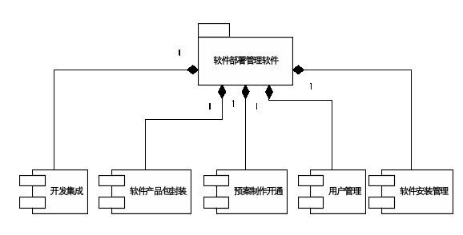
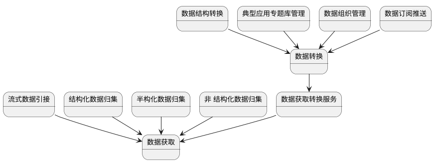
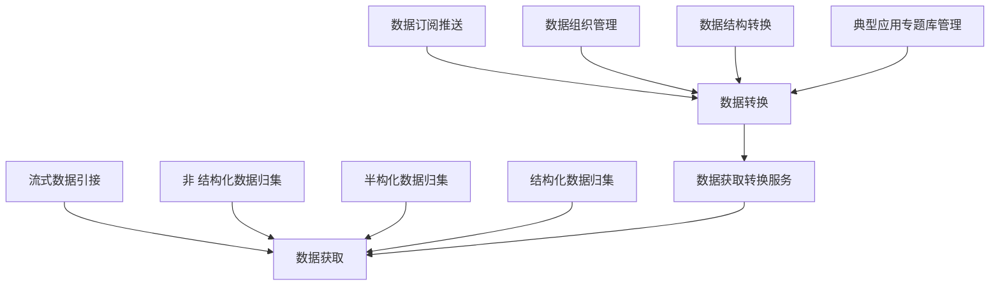
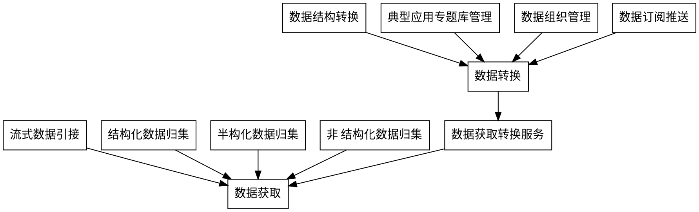

# 5_003 数据对档案

| 字段 | 值 |
|---|---|
| doc | 01数据获取转换分系统需求规格说明-终稿 |
| section | 3.2.1.5.1 |
| image_caption | 图 6 非结构化数据归集能力组成图 |
| table_caption | 表10 非结构化数据归集功能需求 |

## 原始图片

*图 6 非结构化数据归集能力组成图*

## 结构图

*来源: born-digital导出(flowchart, 11节点/10边)*
*类型经几何启发式精化(Master类型识别失败的图, 投影层推断, canonical锚点不变)*

*状态图以PlantUML渲染(UML母语): [*]=起止 | 圆角框=状态 | 箭头标签=迁移事件*

Mermaid兼容投影(通用md渲染器可显示)

DOT源码(完整语义, graphviz可渲染)

### 锚点节点结构

| # | 文本 | 类型 |
|---|---|---|
| 1 | 数据获取转换服务 | process |
| 2 | 数据获取 | process |
| 3 | 数据转换 | process |
| 4 | 数据结构转换 | process |
| 5 | 典型应用专题库管理 | process |
| 6 | 数据组织管理 | process |
| 7 | 数据订阅推送 | process |
| 8 | 流式数据引接 | process |
| 9 | 结构化数据归集 | process |
| 10 | 半构化数据归集 | process |
| 11 | 非
结构化数据归集 | process |

## 表格内容

| 序号 | 子功能名称/标识 | 功能描述 | 优先级 |
|---|---|---|---|
| 1 | 非结构化数据导入/ZZSJHQZHFW- | 支持从某数据中台引接获取地理信息数据；提 | 高 |
| 2 | 非结构化数据源引接/ZZSJHQZHFW | 支持自定义非结构化数据源，提供非结构化数 | 中 |

## 正文

非结构化数据归集能够面向各类非结构化数据提供数据归集功能。非结构化数据归集功能组成如图 6所示。
