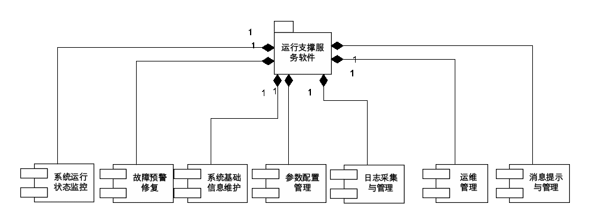
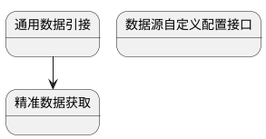
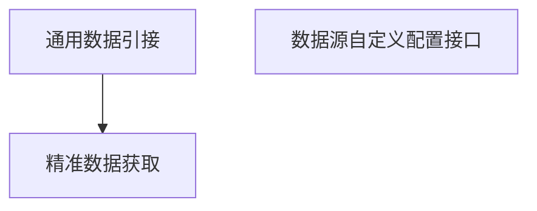
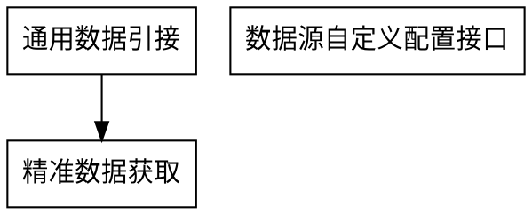

# 5_004 数据对档案

| 字段 | 值 |
|---|---|
| doc | 01数据获取转换分系统需求规格说明-终稿 |
| section | 3.2.1.6.1 |
| image_caption | 图 7 流式数据归集能力组成图 |
| table_caption | 表13 流式数据归集功能需求 |

## 原始图片

*图 7 流式数据归集能力组成图*

## 结构图

*来源: born-digital导出(flowchart, 3节点/1边)*
*类型经几何启发式精化(Master类型识别失败的图, 投影层推断, canonical锚点不变)*

*状态图以PlantUML渲染(UML母语): [*]=起止 | 圆角框=状态 | 箭头标签=迁移事件*

Mermaid兼容投影(通用md渲染器可显示)

DOT源码(完整语义, graphviz可渲染)

### 锚点节点结构

| # | 文本 | 类型 |
|---|---|---|
| 1 | 精准数据获取 | process |
| 2 | 通用数据引接 | process |
| 3 | 数据源自定义配置接口 | other |

## 表格内容

| 序号 | 子功能名称/标识 | 功能描述 | 优先级 |
|---|---|---|---|
| 1 | 流式数据引接/ZZSJHQZHFW-GN | 支持通过特定信源引接获取中台无法及时提供 | 高 |
| 2 | 流式数据源管理/ZZSJHQZHFW-G | 支持自定义消息队列数据源，提供消息队列数 | 高 |

## 正文

流式数据归集包括流式引接和流式数据源引接功能。其中，流式数据引接能够实现实时数据的接入，并提供实时数据的应用；流式数据源引接功能能够管理、添加、变更、删除各类流式数据的数据源。流式数据归集功能组成如图 7所示。
