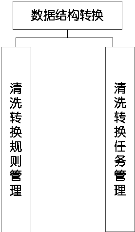
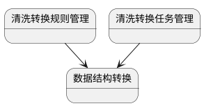
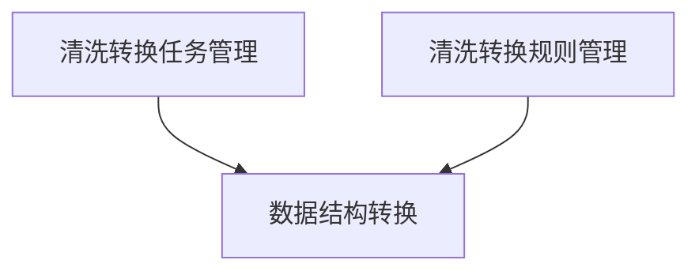
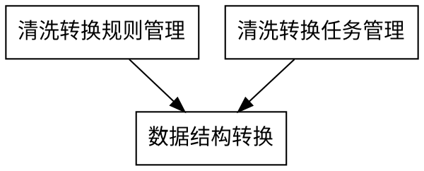

# 5_005 数据对档案

| 字段 | 值 |
|---|---|
| doc | 01数据获取转换分系统需求规格说明-终稿 |
| section | 3.2.2.3.1 |
| image_caption | 图 10 数据结构转换能力组成图 |
| table_caption | 表17 数据结构转换功能需求 |

## 原始图片

*图 10 数据结构转换能力组成图*

## 结构图

*来源: born-digital导出(flowchart, 3节点/2边)*
*类型经几何启发式精化(Master类型识别失败的图, 投影层推断, canonical锚点不变)*

*状态图以PlantUML渲染(UML母语): [*]=起止 | 圆角框=状态 | 箭头标签=迁移事件*

Mermaid兼容投影(通用md渲染器可显示)

DOT源码(完整语义, graphviz可渲染)

### 锚点节点结构

| # | 文本 | 类型 |
|---|---|---|
| 1 | 清洗转换规则管理 | process |
| 2 | 清洗转换任务管理 | process |
| 3 | 数据结构转换 | process |

## 表格内容

| 序号 | 子功能名称/标识 | 功能描述 | 优先级 |
|---|---|---|---|
| 1 | 清洗转换规则管理/ZZSJHQZHFW- | 支持查看清洗转换规则，主要包括脱敏、加密 | 中 |
| 2 | 清洗转换任务管理/ZZSJHQZHFW- | 支持构建并管理清洗转换任务，支持任务运行 | 高 |

## 正文

数据结构转换主要针对不同数据形式、错误残缺、非标准化数据等进行过滤，提高数据质量，完成数据标准化的过程，主要包括清洗转换规则管理和清洗转换任务管理。数据结构转换主要能力组成如图 10所示。
