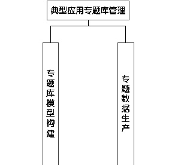

# 5_006 数据对档案

| 字段 | 值 |
|---|---|
| doc | 01数据获取转换分系统需求规格说明-终稿 |
| section | 3.2.2.4.1 |
| image_caption | 图 11 典型应用专题库管理能力组成图 |
| table_caption | 表20 典型应用专题库管理功能需求 |

## 原始图片

*图 11 典型应用专题库管理能力组成图*

## 结构图

*该对无Visio锚点(非Visio图, 无born-digital导出)*

## 表格内容

| 序号 | 子功能名称/标识 | 功能描述 | 优先级 |
|---|---|---|---|
| 1 | 专题库模型构建/ZZSJHQZHFW-G | 支持构建专题库模型，包括专题库概念模型、 | 高 |
| 2 | 专题数据生产/ZZSJHQZHFW-GN | 支持依据已构建的专题库模型生成专题数据。 | 高 |

## 正文

典型应用专题库管理主要包括专题库模型构建和专题数据生产，专题库模型构建支持构建专题库模型，包括专题库概念模型、逻辑模型和物理模型；专题数据生产支持依据已构建的专题库模型生成专题数据。典型应用专题库管理功能组成如图 11所示。
