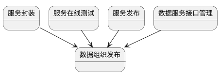

# 5_007 数据对档案

| 字段 | 值 |
|---|---|
| doc | 01数据获取转换分系统需求规格说明-终稿 |
| section | 3.2.2.5.1 |
| image_caption | 图 12 数据组织发布能力组成图 |
| table_caption | 表23 数据组织发布功能需求 |

## 原始图片

*图 12 数据组织发布能力组成图*

## 结构图

*来源: born-digital导出(flowchart, 5节点/4边)*
*类型经几何启发式精化(Master类型识别失败的图, 投影层推断, canonical锚点不变)*

*状态图以PlantUML渲染(UML母语): [*]=起止 | 圆角框=状态 | 箭头标签=迁移事件*

Mermaid兼容投影(通用md渲染器可显示)

DOT源码(完整语义, graphviz可渲染)

### 锚点节点结构

| # | 文本 | 类型 |
|---|---|---|
| 1 | 服务封装 | process |
| 2 | 服务在线测试 | process |
| 3 | 服务发布 | process |
| 4 | 数据服务接口管理 | process |
| 5 | 数据组织发布 | process |

## 表格内容

| 序号 | 子功能名称/标识 | 功能描述 | 优先级 |
|---|---|---|---|
| 1 | 服务封装/ZZSJHQZHFW-GN-S | 支持依据某领域数据应用需求，对领域、实体 | 高 |
| 2 | 服务在线测试/ZZSJHQZHFW-GN | 支持提供测试示例，对数据服务进行在线测试 | 高 |
| 3 | 服务发布/ZZSJHQZHFW-GN-S | 支持发布已封装的数据服务供用户进行申请使 | 高 |
| 4 | 服务接口管理/ZZSJHQZHFW-GN | 支持分类管理数据服务接口，并查看接口详情 | 高 |

## 正文

数据组织发布主要包括服务封装、服务在线测试、服务发布、数据服务接口管理数据服务接口访问权限控制功能。数据组织发布主要能力组成如图 12所示。
