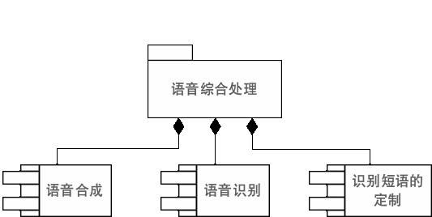
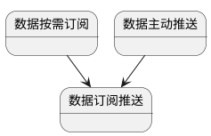
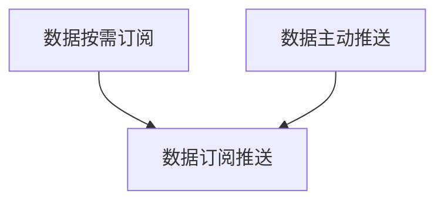
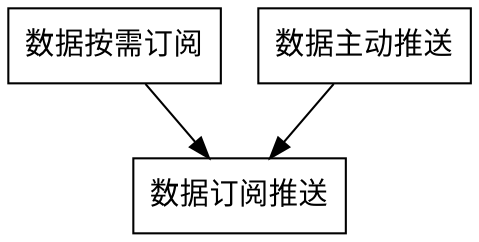

# 5_008 数据对档案

| 字段 | 值 |
|---|---|
| doc | 01数据获取转换分系统需求规格说明-终稿 |
| section | 3.2.2.6.1 |
| image_caption | 图 13 数据订阅推送能力组成图 |
| table_caption | 表28 数据订阅推送功能需求 |

## 原始图片

*图 13 数据订阅推送能力组成图*

## 结构图

*来源: born-digital导出(flowchart, 3节点/2边)*
*类型经几何启发式精化(Master类型识别失败的图, 投影层推断, canonical锚点不变)*

*状态图以PlantUML渲染(UML母语): [*]=起止 | 圆角框=状态 | 箭头标签=迁移事件*

Mermaid兼容投影(通用md渲染器可显示)

DOT源码(完整语义, graphviz可渲染)

### 锚点节点结构

| # | 文本 | 类型 |
|---|---|---|
| 1 | 数据按需订阅 | process |
| 2 | 数据主动推送 | process |
| 3 | 数据订阅推送 | process |

## 表格内容

| 序号 | 子功能名称/标识 | 功能描述 | 优先级 |
|---|---|---|---|
| 1 | 数据按需订阅/ ZZSJHQZHFW-G | 能够提供服务化访问接口，支持按需订阅等方 | 高 |
| 2 | 数据主动推送/ ZZSJHQZHFW-G | 能够提供服务化访问接口，支持主动推送等方 | 高 |

## 正文

数据订阅推送主要包括数据按需订阅和数据主动推送两项能力,主要能力组成如图 13所示。
